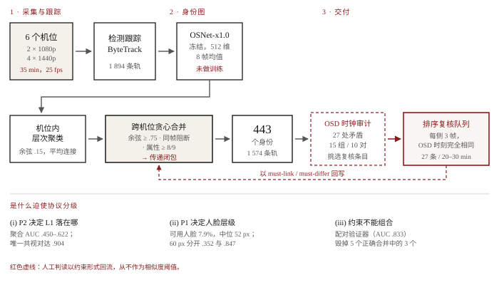
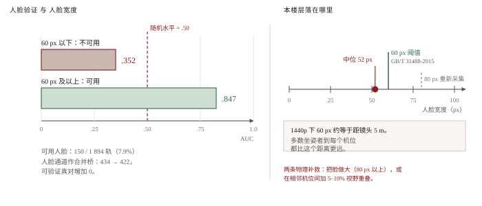
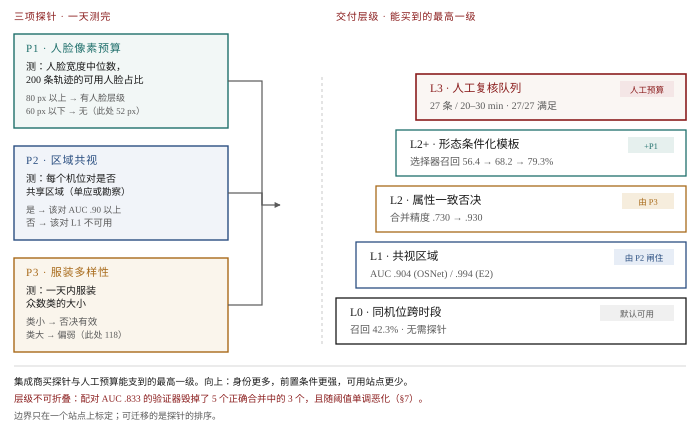

# 一个摄像机网络能交付多少身份？跨机位重识别的三探针诊断与分级交付协议

**作者.** [名] [姓] (a,\*), [名] [姓] (a), [名] [姓] (b)

(a) [院系], [单位], [城市], [邮编], [国家]

(b) [院系], [单位], [城市], [邮编], [国家]

\* 通讯作者。E-mail: [地址]。ORCID: [0000-0000-0000-0000]

*文章类型：研究长文。中文译稿，对应英文投稿版 `main.md`。*

---

## 摘要

跨机位重识别在公开基准上的 mAP 已报到 90% 以上，但这个数字无法告诉集成商：一套新的摄像机网络能支持哪些身份功能。本文用一套部署期测量程序回答这个问题。材料是某在用办公楼层 6 机位 35 分钟采集（1 574 条轨迹、443 个假设身份），以及一段含 26 个具名身份的八段语料。我们把「可用性」压缩成三项一天内能测完的探针：人脸像素预算、机位对之间的区域共视、服装多样性。每项探针闸住一级交付。五级交付各带验收条件与实测收益：同机位跨时段身份，召回 42.3%；共视区域内的跨机位身份，冻结 OSNet 的 AUC 为 0.904，独立编码器为 0.994；属性一致性闸门在召回不变的前提下把合并精度从 0.730 提到 0.930，63 折留一验证稳定；形态条件化模板把选择器召回从 56.4% 提到 79.3%，其中 11.8 个百分点不用人脸；以及一个 27 条的复核队列，20 到 30 分钟判完，27 条判读约束全部满足。在这一对机位之外，跨机位外观在六种编码器与对齐配置下都落在随机水平（AUC 0.450 至 0.622，置信区间全部覆盖 0.5），人脸通道在 60 px 以下不可用（AUC 0.352 对 0.847）。层级也不能折叠：三组实验表明，对全局划分施加局部约束会伤及它从未处理的正确合并，一个配对 AUC 0.833 的验证器会毁掉 5 个已知正确合并中的 3 个。真正的约束是采集几何，不是编码器。

**关键词：** 跨机位重识别；部署协议；选择性预测；人在环；区域共视；现场研究

---

## 1 引言

供应商演示跨机位 ReID 时会给你看两样东西：同一个人的两张裁图，和一个相似度分数。签合同的物业经理要的是另一件东西：「在这套网络下，你能回答**这一类**问题，精度**这么高**，需要**这么多**人工工时。」两者之间隔着整个部署问题。基准 mAP 回答不了它，因为基准的运行条件（紧凑直立的行走裁图、与训练共享视点的查询/底库划分、没有 50 px 的坐姿目标）并不是办公室的条件。

本文构造的是第二件东西。我们不提新的表征：编码器是现成的、冻结的，从不在现场调过。要回答的问题是：

> **给定一套固定的摄像机网络与一个冻结的编码器，集成商可以正当承诺哪些身份功能？又怎样才能在部署之前知道？**

答案分三部分，每一部分都能对着实测核对。

**第一，问题可以拆成三项现场测量。** 跨机位身份是否可用，取决于一批与模型选型无关的量：一张脸占多少像素（P1）、两个机位是否看得见同一块区域（P2）、人群穿衣的重复程度（P3）。每项探针花一天，不需要标签，各自对应一级交付。§5 定义它们，在我们的数据上标定判定边界，并说明三者合起来能按机位对预测外观关联是否成立：被判为共视的那一对达到 AUC 0.904，被判为不共视的一对只有 0.231，方向反得足够当警告用。

**第二，交付物是一道梯子。** 我们定义四级：L0 同机位跨时段、L1 共视区域、L2 属性一致合并、L3 人工复核；每级都写明验收条件并带实测收益：L0 召回 42.3%，L1 的 AUC 0.904 至 0.994，L2 把合并精度从 0.730 提到 0.930，L3 是 27 条、20 到 30 分钟可判完、且 27 条约束一次全部满足的队列。第五级 L2+ 用形态条件化模板，把选择器召回从 56.4% 提到 79.3%，其中一半以上的收益不需要人脸。层级按证据强度排序，集成商买它的探针与人工预算能支到的最高一级。§6 逐级说明。

**第三，这道梯子折不起来。** 最省事的想法是把 L3 换成一个自动验证器：给每对已合并的样本打分，低于阈值就切开。三组实验表明，对全局划分施加的任何局部约束都会伤及它从未处理的正确合并。把 15 条判为异人的边全部删掉，一个组都没拆开。约束最小着色遵守了全部 27 条标签，身份数只从 443 动到 450，因为一个 32 条轨的组只被一对约束时，最多能掉出一条轨。一个**配对** AUC 0.833 的验证器会切掉 5 个已知正确合并中的 3 个，且随阈值单调恶化。这三个失败正是协议要分级的原因，也是外观信号只能用于排序人工注意力、不能用于裁决的原因。§7 给出这三组实现。

跨机位身份这条线上的工作大多是诊断性的：外观关联在非受控采集中退化，时钟与拓扑不确定时时空先验不可靠，事后验证很脆。三条在本站点都成立，§5 到 §7 逐条测了。但诊断本身不能让集成商买到任何东西，所以下面的探针与层级是按「可以被采购的物件」来构造的，每一种失效模式都出现在它迫使某个设计决策的位置上。

### 1.1 贡献

1. **一套三探针部署诊断**（§5）。三项免标注的现场测量（人脸像素预算、区域共视、服装多样性），各带标定过的判定边界，合起来预测一个站点能支持哪些依赖外观的层级。边界锚点：60 px（AUC 0.352 对 0.847）、十五对机位里仅一对共视（AUC 0.904 对 0.231）、673 人只有 35 种服装组合且众数组合被 118 人穿着。
2. **一套带实测台阶的分级交付协议**（§6）。L0 至 L3 加 L2+，每级都有验收条件、实测收益和写明的失效模式。协议把「ReID 到底行不行」这个二值问题换成一个可以标价的菜单。
3. **一个说明分级必要性的不可组合性结果**（§7）。三组独立论证表明局部约束不能在全局划分上组合，其推论是配对 AUC 不能预测划分层面的效用。这是梯子无法用某个自动环节替代的形式化理由。
4. **一套配对级真值与报告纪律**（§4）。12 个机位对上的 153 条判读配对，分属两个刻意不合并的总体，并明写哪些数字之间不可比较。
5. **一件可运行的产物及其测得的成本**（§8）。离线单文件复核界面、以 must-link / must-differ 约束形式回写的 JSON，以及 27 条 20 到 30 分钟的实测耗时。

范围是一个站点、一天、一位判读人（§10）。我们公开协议与参数，不公开视频。

---

## 2 相关工作

### 2.1 表征与机位偏置

有监督 ReID 在 Market-1501 [1] 和 MSMT17 [2] 上随骨干网络与部件、Transformer 聚合的进展成熟起来 [3, 4, 5]。OSNet 的全尺度特征至今仍是部署场景里标准的冻结提取器。这条文献有两件事与本文相关。其一，报出的增益都是在与训练相同的采集条件下测的：紧凑框、行走的人、与训练共享视点的查询/底库划分。其二，机位身份是已知的混杂因素：模型会抓住分机位的颜色与背景统计量，这才有了机位感知与机位对抗训练 [6, 7, 8]。我们继承这个诊断，但换掉应对方式：测量一个冻结编码器的工作包络，再把它变成路由规则。探针说外观有信息的地方用外观，其余地方协议退回几何、语义或人。

### 2.2 基于聚类的身份图

无监督与伪标签流水线靠聚类轨迹特征来造身份，通常用 DBSCAN 或层次连接 [6, 9]，机位感知的变体则禁止同一机位内合并。我们部署的图沿用这个范式：机位内平均连接，然后跨机位在相似度阈值下贪心合并，配合同帧共现阻断与属性闸门。§7 需要的先验是：这些流水线都是在传递闭包上做**划分**的算法，所以一条边的决策会传播出去。既有工作把由此产生的敏感性当成阈值调参问题。我们说明它是结构性的，而且同样支配事后的修补，这正是分级协议必要的原因。

### 2.3 时空约束与拓扑

时空先验通常写成转移时间模型：一个人不能同时在两处，机位之间的通行至少需要 τ 秒 [10, 11]。这些先验假设时钟同步，并且知道哪些机位能共同看见一块区域。多机位跟踪基准 [12] 恰好做了这两个假设，而我们要说明第二个在普通办公室里如何失效。用 OSD 绝对时钟后，约束确实浮出 27 处相似度从未排出的矛盾，但用来判断这些矛盾的共视表本身在机位对粒度上就是错的，因为共视是区域的属性。所以我们把审计当成挑选用复核条目的触发器，并报告硬时空门只挡下一次合并：这就是它在协议里只做选题器、从不做判据的原因。

### 2.4 选择性预测与风险控制

拒答而非硬答这件事在选择性分类里有成熟研究 [13]，风险控制式标定（Learn-Then-Test）把启发式操作点换成有限样本保证 [14]。在自动建库的场景里，该拒的是**簇**而不是查询 [15]。我们的协议是同一想法在部署层面的实例：L3 就是一级显式弃权，§6.6 的两数报告（覆盖对上的精度，**加上**被审计组中混人组的比例）正是运维方需要的选择性风险陈述。与既有工作的差别在于，我们也量化了弃权的**代价**（27 条 20 到 30 分钟），并说明这级弃权为什么不能自动化掉（§7）。

### 2.5 现场研究与人在环身份

监控场景的部署研究反复报告：全自动的跨机位身份没有实现，系统的价值落在人工复核上 [16, 17, 18, 19]。据我们所知，还没有一项工作同时做到三件事：(i) 把可用性问题化约为少量部署前探针；(ii) 把外观天花板归因于可测的像素预算而不是表征质量；(iii) 把结果变成一套带分级验收条件的协议。本文是这三者的组合。

---

## 3 两个证据域

协议在一个域上开发、在第二个域上验证，因为不同层级需要不同性质的证据：D1 给部署规模的结构，D2 给具名身份的真值。§4 说明两者为何从不合并统计。

### 3.1 D1：六机位、35 分钟部署

某办公楼的一层：开放工位区、茶水间兼小会议室、玻璃墙走廊、一个大的多功能空间。6 个机位连续录 35 分钟（2 099 s），25 fps。其中 4 个是 2560×1440，2 个（318、323）是 1920×1080。无标定，无深度传感器，无人脸闸机。除一对之外，视野都不重叠。

**表 1. D1 采集与图的统计。**

| 项目 | 数值 |
|---|---|
| 机位 | 6（305, 316, 318, 320, 323, 343） |
| 分辨率 | 4 × 2560×1440，2 × 1920×1080 |
| 时长 / 帧率 | 2 099 s / 25 fps |
| 产出轨迹 | 1 894 |
| 进入身份图的轨迹 | 1 574 |
| 假设身份数（图 v0） | 443 |
| 跨机位组 | 56 |
| 最大组 | 67 条轨 |
| 可用人脸嵌入 | 150 / 1 894 轨（7.9%） |
| 人脸宽度中位数 | 52 px |

### 3.2 D2：八段具名身份语料

同一楼层的第二次采集，切成 8 段，445 条具名轨迹、26 个身份（每身份中位 14 条，最多 62 条）。D2 是唯一每条轨迹身份都已知的域，§6.4 的选择器与模板池实验需要这一点。D2 的检测/跟踪配置与 D1 不同，因此从不用于合并精度的结论。

### 3.3 时钟纪律

本文每一处时间陈述都用屏显（OSD）绝对时钟，从不用 `帧号 / fps`。D1 的六路流起始的墙钟时刻各不相同，相对 318 的帧 0 偏移分别是 0、+1、+2、+16、+25、+121 s。用分流的帧号会把一次真实的同框共现悄悄算成一次交接，我们犯过一次。改正之后，合并策略对比里的真对召回从 5/34 升到 7/34（表 10），身份数一点没动，这正是「测量修好了」而不是「模型改好了」的特征。建议任何报告时空约束的多机位论文都写明时钟口径：一句话的成本，换掉一个系统性错误。

### 3.4 流水线

检测与跟踪按机位独立跑（YOLO 系列检测器，ByteTrack [20]，调低激活阈值）。我们刻意让跟踪保持朴素，没有加 StrongSORT 一系的关联修正 [21]，这样每一级的行为可以归因于站点几何与冻结编码器，而不是跟踪启发式。每条轨迹由 OSNet-x1.0 [3] 编码（MSMT17 [2] 权重，冻结，8 帧时间均匀采样取 512 维均值）。身份图分两步建：机位内按余弦距离 0.15 做层次聚类，然后在余弦 ≥ 0.75 下跨机位贪心合并簇代表，同时受三道闸门约束：同帧共现阻断（一个合并实体不得同时在两个以上机位可见）、机位重叠阻断，以及上线版里的属性一致闸门（9 项服装属性中至少 8 项一致）。结果是覆盖 1 574 条轨迹的 443 个身份（图 1）。



**图 1. 部署流水线与三个探针位置。** 阶段 1 是现成组件。阶段 2 产出传递闭包，这正是 §7 的不可组合性得以发生、也是协议必须分级而不能全自动的原因。探针图标标出 §5 的诊断从哪里读站点：像素预算读编码器输入，共视读机位图，服装多样性读属性头。

### 3.5 我们刻意没有训练的部分

编码器没有训练或微调，这是设计选择。一次带留身份评测的域自适应微调把操作点召回从 24.2% 压到 11.0%；一个闭集线性判别在见过的身份上到 0.986，在留出身份上只有 0.595/0.554。这是域内指标常见的塌陷，我们复现了两次。冻结编码器使本文每一个数字都可归因于站点而不是某套拟合流程，这恰是诊断要求的：探针必须预测**给定**编码器的行为，而不是一个在被测站点上调过的模型。

---

## 4 评测协议

### 4.1 两套真值，两种抽样机制

**T1：按先验抽的配对（126 条）。** 这批配对用来检验既有配置下的合并规则：7 个机位对上 34 条同人、92 条异人。T1 偏向现有系统认为「看起来合理」的配对，是**规则**的测试集，不是总体的无偏样本。测一道闸门是否保住召回，用它是合适的。

**T2：由矛盾触发的配对（27 条）。** 由 §6.5 的时空审计浮出，即系统已经合并、而物理约束说不可能同人的那一批。12 条同人、15 条异人。T2 偏向**错误**，这正是它能用来测「修补是否尊重约束」的原因。

合起来是 12 个机位对上的 153 条配对。T1 与 T2 从不合并成一个精度数字。这么做是范畴错误，我们犯过一次，现在在自己的报告里明令禁止。

### 4.2 三个粒度

一张图可以在三个层面打分，而三者彼此不一致。把它们的名字写清楚，分级协议才可报告。需要说明的是，HOTA [22] 与基于 ID 的指标 [10] 评的是轨迹随时间的表现；我们的分析单元是合并决策，所以打分对象是配对与组，不是轨迹。

- **配对级。** 一条有标签的配对算对，当它的两条轨落入同一个身份组（同人标签），或落入不同的组（异人标签）。这是合并规则消费的层面。
- **组级。** 一个组里若含有至少一条被判为异人却被合进来的配对，就记为**混人**，否则为**纯**。这是运维人员消费的层面。
- **目视簇纯度。** 一个组被肉眼看过。这是审阅者消费的层面，它能发现配对标签永远碰不到的失效模式（一组影子、一顶被当成人的帽子）。

T2 在配对级给出 55.6% 的一致率（27 条矛盾中 15 条被确认），但运维上有意义的数字是**被触及的 15 个组里 7 个混人、8 个纯**。同一批数据支持两个分母和两个不同的判断，所以协议在任何地方都同时报这两个数。

### 4.3 报告规则

四条，每条都是在犯过错之后才采纳的。

1. **绝不跨检测版本比较。** D1 全程用同一套检测/跟踪配置。早先的八段研究用的是另一套，簇混人率相差 6 倍，跨版本比较已撤回。这就是 D1 与 D2 各自承载不同结论的原因。
2. **永远写清分母。** 真值覆盖对上的配对精度，与可疑对上的配对精度，是两个总体。
3. **绝不让相似度分数充作纯度证据。** 余弦相似度既不能证明一个簇是一个人，也不能否证一次人工判读。
4. **写明真值的抽样机制**，因为每个聚合数都继承了它。

---

## 5 三探针诊断

一个站点上基于外观的身份是否可用，可以由三项不需要身份标签、不需要模型训练的测量预测，每项测量闸住 §6 的某一级。

### 5.1 探针 P1：人脸像素预算

**测量。** 随机抽一批轨迹（我们用 200 条），在每个人体框内跑人脸检测，记录人脸框宽度的分布，以及能检出人脸的轨迹比例。成本：用现成工具一小时以内。

**标定。** 在 D1 上，1 894 条轨迹里有 150 条（7.9%）能产出人脸嵌入，人脸宽度中位数 52 px。以 60 px 切分会出现很陡的转变。这条线不是我们定的：GB/T 31488-2015 [23] 要求用于识别级采集的瞳距不小于 60 px。

- 60 px 以下：**AUC 0.352**（低于随机；嵌入量到的是压缩伪影）
- 60 px 及以上：**AUC 0.847**

**读法。** P1 只回答一个问题：**人脸通道到底有没有。** 这条边界是标准本就要求的物理分辨率阈值，不是我们拟合出来的。中位数低于 60 px 的站点不该买依赖人脸的层级。D1 的中位数是 52 px，在阈值以下；在 1440p 画面上，固定 60 px 对应的人距镜头大约 5 m，而这一层大多数坐姿的人到每个机位的距离都超过这个值。补救是物理性的：改机位位置或加机位，把中位数做到 80 px 以上。



**图 2. 像素预算。** 左：本站点的人脸验证在 60 px 处分成随机水平（0.352）与可用（0.847）两段。右：楼层的人脸宽度中位数（52 px）落在识别阈值**以下**，所以嵌入量到的是压缩伪影而不是身份。

P1 在部署**之前**就预测失效，并指出补救办法。它与用哪个人脸模型无关，因为这个转变是像素预算的属性，不是编码器的属性。

### 5.2 探针 P2：区域共视

**测量。** 对每个机位对，判定两个视野是否共享一块**区域**，若共享是哪一块。便宜的做法是带着共享标记物走一遍现场；可复现的做法是在共同平面上做单应检验，或用同时刻检测的统计量。成本：6 个机位半天。

重要的是答案的**单位**。一个机位对不是二值谓词。在 D1 上，现场勘察宣布 15 个机位对不重叠、1 对（318–320）重叠。这张表两半都错得很具体：318–320 确实共视（从两侧看同一茶水间，单应 AUC 1.000），但被勘察判为不重叠的那些对，其某些区域同样共视，后果直接出现在身份图里。

**聚合标定。** 先在 T1 的跨机位对上评六种特征配置：两种表征（OSNet-x1.0，以及我们记作 E2 的图像嵌入模型，覆盖 1 322/1 574 条轨迹）与三种对齐方案（原始余弦、分机位去均值 "cc"、分机位 PCA 白化到 33 维 "cw"，取分机位轨迹数的三分之一，沿用我们先前的维度结论）交叉。

**表 2. T1 上的跨机位判别力（34 同 / 80 异；E2 覆盖 28/61）。**

| 表征 | 对齐 | 同人（中位） | 异人（中位） | AUC | 95% CI |
|---|---|---|---|---|---|
| OSNet | 原始（部署版） | 0.499 | 0.532 | **0.490** | [0.350, 0.625] |
| OSNet | 分机位去均值 | 0.022 | 0.015 | 0.531 | [0.403, 0.666] |
| OSNet | 分机位白化 | 0.016 | -0.011 | 0.511 | [0.397, 0.626] |
| E2 | 原始 | 0.759 | 0.777 | **0.499** | [0.330, 0.658] |
| E2 | 分机位去均值 | 0.160 | 0.029 | **0.622** | [0.470, 0.765] |
| E2 | 分机位白化 | -0.052 | 0.012 | 0.450 | [0.321, 0.585] |

两点观察决定了这项探针的形状。其一，**没有一种配置能把跨机位同人与异人分开**：六个置信区间全部含 0.5。对部署版编码器，同人中位数（0.499）还**低于**异人中位数（0.532），排序是反的，不只是弱。其二，去均值是唯一动到点估计的方案（E2：0.499 到 0.622），靠的是把两个分布压到近零的窄带上，而那条带上的排序很脆：在 2% 误接受率下它捞回 28 条真对中的 7 条，10% 时捞回 13 条。这是**排序**变好，不是**阈值**可用。

聚合数落在随机水平，通常就此结束诊断，宣布外观不可用。P2 说明的是聚合是错的那个统计量。

**配对级标定。** 同一批数据按机位对分层，聚合就散了：

**表 3. T1 上的分对 AUC（OSNet 原始；两类都有的对）。**

| 机位对 | 同 / 异 | AUC | P2 读数 |
|---|---|---|---|
| **318–320** | 11 / 52 | **0.904** | 共视区域成立（单应 AUC 1.000）；E2 达 **0.994** |
| 316–323 | 2 / 5 | 0.600 | n 太小，无法解读 |
| 318–323 | 3 / 4 | 0.250 | 无共享区域；反向 |
| **316–343** | 13 / 18 | **0.231** | 无共享区域；强反向 |
| 323–343 | 1 / 1 | 0.000 | n = 2，不可解读 |
| 305–316、316–318 | 2 / 0、2 / 0 | n/a | 无负例；AUC 无定义 |

这里的规律不是「有些对更难」。而是**几乎全部信号集中在一对机位上，而这一对恰是探针判为共视的那一对**。反过来，样本最大的 316–343（31 条）是反相关的：模型把陌生人排在熟人前面。这就是选任何阈值之前必须按区域粒度测 P2 的原因：在 318–320 上调出来的阈值，用在 316–343 上是有害的；这也正是我们早先观察到「全局阈值下调使合并次数翻三倍、而真对召回仍是 7/34」的机制。

**P2 买到了什么。** 它把「跨机位 ReID 行不行」这个无法回答的问题，换成按机位对可回答的问题：「这一对是否共享够一个人站立的那么多像素」；并在站点重新布线时告诉集成商重叠该放在哪里。它还能不借助模型行为解释 §6.5 的 815 s 发现：开放楼层两侧的两个机位可以同时看见同一个工位，坐在那儿的人确实共视数分钟。

### 5.3 探针 P3：服装多样性

**测量。** 在一天的检测上，数不同的服装组合数，以及最大等价类的大小。成本：数小时，用流水线里已有的属性头。

**标定。** 在 D1 上，673 人只用到 **35 种服装组合**，平均每种 19.2 人；众数组合（蓝色长袖上衣配黑色下装）有 **118 人**穿着。

**读法。** P3 决定服装证据可用在哪个**方向**，而这个方向是不对称的。「衣服不同」是有效的否决：在众数装束有 118 人穿的人群里，两个实体的预测属性若有两项以上不符，同人的可能性极低。「衣服相同」不是投票：118 人穿同一套时，一致几乎不携带身份信息。全员制服的站点是反向失效：所有人属性都一致，于是这条通道从误导变成无信息，这也是 P3 报众数类大小、而不报单一多样性指数的原因。

这种不对称使 L2（§6.3）成为一次**选择性**修补：它只做否决，因此能删掉合并而不动召回。

### 5.4 路由规则

三项探针合成一条集成商在签合同前就能执行的路由规则：

```
P1  人脸宽度中位数
    80 px 以上   -> 人脸层级可用（L2+）
    60-80 px     -> 少数轨迹有人脸，只作加分
    60 px 以下   -> 没有可用人脸层级；预算投到人工

P2  每个机位对是否共享区域
    是           -> L1 可用（预期 AUC 0.90 以上）
    否           -> L1 不可用；改用 L0 + L3

P3  服装众数类占比
    ~5% 以下     -> 否决有效；启用 L2
    ~20% 以上    -> 否决偏弱；L2 可选
```

三点使它成为诊断而不是经验法则。每条判定边界分别是物理的（P1：分辨率）、几何的（P2：共享像素）、统计的（P3：类大小），所以不随模型选型漂移。每项探针都在站点本地测，无法从基准继承。每项探针只对应**一个**层级，所以输出是一份菜单，不是一个分数。



**图 3. 协议全景。** 左侧三项探针，右侧五级台阶。台阶形状编码了取舍：层级越高交付的身份功能越多，但可用的站点越少，前置条件越强。L0 不需要探针；L1 由区域共视闸住；L2 由服装多样性闸住；L2+ 从像素预算中受益但不要求它；L3 只需要人工预算。因为排序跟着证据强度走，这些层级既不能调换顺序，也不能合并。

### 5.5 规则在两个域上的验证

这条规则给出可被否证的预测，两个域都证实了。

在 D1 上，P2 预测只有 318–320 支持 L1：实测 AUC 0.904（OSNet）与 0.994（E2），而被预测为不重叠的 316–343 只有 0.231。P1 预测人脸通道不可用：实测可用率 7.9%、中位 52 px，60 px 以下那层落在随机水平。P3 预测服装只能当否决不能当投票：实测合并精度 0.730 到 0.930 而召回不变（表 5），是纯精度增益，正是否决的特征。

在 D2 上，身份已知，P1 又一次预测对了效应的方向和量级：可用人脸覆盖全部 1 178 条轨迹的 6.5%（在较长的具名轨迹中占 12.1%），而人脸锚点通道的增益几乎全部落在有跨姿态人脸覆盖的那少数身份上（§6.4）。

两条局限先说在前面。数值边界（80 px、5%、20%）是在一个站点、一个人群上标定的；我们预期可复现的是探针的**排序**，不是那几个切点。另外 P2 需要一个关于区域的判断，那是一项本身带误差率的勘察工作，其误差率在 §6.5 测了。

---

## 6 分级交付协议

现在把探针变成合同（图 3）。层级按证据强度排序：低层靠几何，因此几乎总成立；高层靠外观，因此需要探针支持。集成商买探针与人工预算能支到的最高一级。

**表 4. 协议全表。**

| 层级 | 交付的功能 | 验收条件 | 实测收益（域） | 超出条件后的失效模式 |
|---|---|---|---|---|
| **L0** | 同机位跨时段身份 | 单机位；任意分辨率 | 同机位跨时段配对召回 42.3%（D2） | 是碎片化不是混淆：每人在一段内 5.5 条轨（D2） |
| **L1** | 共视区域内的跨机位身份 | P2 判定存在共享区域 | AUC 0.904（OSNet）/ 0.994（E2）（D1，318–320 对） | 在此调出的阈值在别处有害（316–343 上 0.231） |
| **L2** | 属性一致合并 | P3 判定众数类够小 | 召回不变下合并精度 0.730 → 0.930（D1） | 制服使闸门失去信息 |
| **L2+** | 形态条件化模板 | 每身份至少 3 种可观测形态 | 选择器召回 56.4% → 68.2%（不用人脸）→ 79.3%（D2） | 身份数太少，训不出投影 |
| **L3** | 人工复核队列 | 有操作工时 | 27 条 / 20–30 min；15/15 负约束与 12/12 正约束同时满足（D1） | 队列随采集时长线性增长 |

### 6.1 L0：同机位跨时段身份

最便宜的一级，也是集成商几乎总能买下的一级。同一机位内，外观比的是同类对同类：同视点、同镜头、尺度接近。在 D2（唯一有逐轨姓名的域）上，部署操作点能正确解出 42.3% 的同机位跨时段配对。D1 提供部署规模的结构（1 574 条轨、443 个身份），D2 提供身份级召回，这个分工正是两域从不合并统计的原因。主要误差是碎片化而不是混淆（一段内每人 5.5 条轨，63% 的断口长于 10 s），这对协议有实际影响：碎片化可以靠**在时间上补证据**修回来，混淆不行。

有一项定量警告属于这一级：在同一机位内，外观失效的具体条件是同一个人改变**姿态类**，而不是改变位置。在 D2 上，同一个人的框高在一天内跨度中位数是 **3.76 倍**（最大 11.6 倍），因为站姿全身与坐姿头肩共享的部件构成很少。在配对层面，同人相似度从 0.887（框高接近）降到 0.557（框高差异极大），在有足够样本的 14 个身份里全部成立（中位相关系数 -0.48）。异人相似度在同样的分箱上基本平（0.519–0.553），这就是提高阈值没用、而 L2+ 存在的原因。

### 6.2 L1：共视区域内的跨机位身份

P2 判定存在共享区域的地方，跨机位外观就退化成普通的同视点匹配，这一级交出的表现接近基准水平：同一对上冻结 OSNet 为 AUC 0.904，独立的第二个编码器为 0.994。几何允许时，机器是能工作的。这一对是从两侧看同一个茶水间，两个视角主要差在方位角，这正是 ReID 基准假设、而多数办公室装修给不了的条件。

所以这一级的验收条件是几何的，不是统计的：能买到重叠的地方就买 L1。它的设计含义写在 §9：相邻视角之间 5% 到 10% 的重叠，比任何编码器升级都值钱，因为它把一对机位从 0.231 那一档挪到 0.904 那一档。

### 6.3 L2：属性一致性闸门

唯一站得住的**自动**组件是一致性检查，原因在 P3 的不对称。9 项服装属性（上衣颜色、下装颜色、袖长、背包、手持物、帽子、眼镜，另加两项）由同一个冻结编码器按轨预测。候选合并只有在两个实体至少 8 项一致时才被接受。

**表 5. 属性闸门的效果（D1，阈值 0.75，T1）。**

| 配置 | 身份数 | 合并次数 | T1 同人 | T1 异人 | 合并精度（判读） |
|---|---|---|---|---|---|
| 无闸门 | 434 | 76 | 5/34 | 0/80 | 0.730（46/63） |
| 属性闸门（8/9 以上） | **443** | 67 | 5/34 | **0/80** | **0.930（40/43）** |

闸门删掉 9 次合并，其中 6 次是错的，身份数因此加 9。这是一次**选择性**修补：真对召回与误合并条数都没动。三点使它成为适合协议层级的信号：

- 它问的是「穿的是不是同一身衣服」，不是「向量近不近」，因此不继承那种让余弦在跨视角上不可靠的机位偏置。
- 它只在测过可靠性的属性上评估。五项达到 0.88–0.99 的一致率；拎东西与背包封顶在 0.656 与 0.458，被排除在闸门的决定性字段之外。
- 它的操作点稳定。63 折留一里每一折都选中 ≥8，所以闸门不是单折产物。

作为量级参照：把相似度阈值从 0.75 提到 0.82，只能拿到这次精度增益的约五分之一，还要丢召回。闸门与阈值是两种证据。它的天花板写在这一级里：属性的**相同**不是证据，所以闸门只做否决、从不投票，在统一着装的人群上收益归零。

### 6.4 L2+：形态条件化模板

L0 的那条警告在这里变得可操作。既然姿态类一变同人相似度就塌，修法就是**按查询的形态去匹配模板**，因为没有任何阈值能修复部件构成的错配。两种机制，在 D2 上测（179 条查询，其身份在同一机位有早晨的底库条目）：

**表 6. 选择器召回，τ = 0.80（D2，179 条查询）。**

| 配置 | 召回 | Δ | 需要人脸 |
|---|---|---|---|
| 仅底库均值（S0） | 56.4% | n/a | 否 |
| 加框高核加权，σ = 0.6（S1） | **68.2%** | +11.8 | **否** |
| 加人脸触发的实时池（S5） | **79.3%** | 相对 S1 +11.1 | 是，覆盖 31.7% 的轨迹 |
| 上界：全天素材 + 核加权 | **92.7%** | 相对 S5 +13.4 | n/a |

由此得出三条，第一条在实践中最重要。

一半以上的增益不用人脸。按 `exp(-|log h_query - log h_template| / 0.6)` 给底库模板加权（`h` 是框高），召回提 11.8 点，零训练、零人脸检测。机制是拿同一体型构成的模板去比，不是把人认得更好。直接证据：在底库失手而池命中的那些样本里，被用到的池样本与查询的 `|δh|` 中位为 0.06，而底库均值是 1.05；94% 的情况下它离查询的形态更近。池捞到的是**同尺度**的样本，不是更好的外观匹配。

人脸提供的是覆盖。另外 11.1 点来自底库根本没有的那类样本，不是更强的身份线索。增益集中在底库结构性失明的地方：在极端形态差（`|δh| ≥ 0.8`）上召回从 7.0% 升到 88.4%（41 次总增益中的 35 次），而 53 条形态接近的查询只动了 +2 点。一个住户姿态很少变化的站点几乎拿不到这部分收益，所以这一级的验收条件是「每身份至少 3 种可观测形态」，而不是「有人脸」。

剩下 13.4 点靠素材，不靠方法。92.7% 的上界在底库含有查询可能出现的每种形态样本时达到，从 79.3% 到那里的缺口全部来自八段语料里没有这类样本。它指出的投入方向是：同一个人、更多姿态的更多采集。

这一级的失效模式值得写下来，因为它会复现：训练一个形态条件化投影需要跨姿态配对，而 D2 里 1 028 条可用配对中有 799 条（78%）属于同一个身份，只剩 26 个身份里的 13 个有任何跨姿态配对。留身份评测因此数据不够，这与排除编码器微调的是同一条限制（§3.5）。推理期的核加权完全绕开了这个问题，所以这一级是以推理形态交付的。

### 6.5 L3：人工复核队列

L3 是协议的产物，不是妥协。它的选题逻辑来自 §5.2：图与时钟之间的矛盾，本质是一个关于区域共视的问题，而人看两张裁图就能回答，所以它恰好是该交给人看的东西。

- **选题。** 时空审计出的矛盾（D1 上 27 条）。每条是一个组内的两条轨迹，**若**共视表无误则不可能同人；而这正是人要回答的问题。
- **呈现。** 每侧三帧，取**完全相同的 OSD 时刻**，从原生分辨率视频裁剪并画出目标框。均匀时间采样被放弃了：在坐姿办公场景里它会落在显示器上，可读产出率骤降。时刻改为取使两侧框高较小者最大的那几个。
- **交付。** 单个离线 HTML 文件（2.05 MB，图片内嵌），无网络也能在手机上打开，因为判读人未必在工位。
- **回写。** 判读结果导出为 JSON，以 must-link / must-differ 约束的形式入库，从不作为相似度阈值。
- **显式非标签。**「看不清」「走出了边界」「一侧混了两个人」会被记录，但不进真值，因为它们不约束身份。把一条从分母里拿掉，不等于给它贴了标签。

**实测产出。** 27 条由一个人 20 到 30 分钟判完：12 条同人、15 条异人，没有不可读条目，27/27 可用。组级：被触及的 15 个组里 7 个混人、8 个纯。作为约束应用（§7.2），身份数从 443 到 450，同时满足 15/15 负关系与 12/12 正关系。在 2% 以下的结构变动上换来约束满足度的严格提升，这就是 27 条标签在一个 1 574 条轨的图里能买到的东西。

### 6.6 复合交付物，以及必须一起走的两个数

拼起来，协议对 D1 给出下面这份陈述。表 7 就是集成商用来接受或拒绝一套系统的形式。

**表 7. D1 的交付陈述。**

| 陈述 | 层级 | 状态 | 依据 |
|---|---|---|---|
| 同机位跨时段身份 | L0 | 支持 42.3% 的同机位跨时段配对（D2） | §6.1 |
| 跨机位身份，318↔320 | L1 | 支持（AUC 0.904 / 0.994） | 表 3 |
| 跨机位身份，其余对 | L1 | 不可用；只给候选与证据 | 表 3，316–343 为 0.231 |
| 合并精度（T1 覆盖对） | L2 | 带属性闸门 0.930 | 表 5 |
| 合并精度（矛盾触发对） | n/a | 配对级 0.444；15 组中 7 组混人 | §6.5 |
| 选择器召回，具名身份 | L2+ | 56.4% → 79.3%（上界 92.7%） | 表 6 |
| 基于人脸的身份验证 | P1 | 本采集几何下不可用 | 可用率 7.9%，60 px 以下 AUC 0.352 |
| 已合并组的自动修补 | n/a | 不可用；必须 L3 | §7 |

两行精度数字在实践中最常被混为一谈，协议要求它们一起走。一套系统报「精度 0.930」而不报「15 个受审计组里 7 个混人」，等于对一个总体说了实话、对另一个总体隐瞒了实话。所以我们把这一对数写成 L2 与 L3 的报告要求，而不是可选项。

### 6.7 为什么 L3 不能被一个自动环节替换

对分级协议最自然的反对是：L3 太贵，而且可以自动化：拿判读过的配对训一个验证器，套到所有合并上，只留高置信的。§7 用三组实验回答这个反对，但短版必须写在这里，因为它决定协议的形状。任何作用于划分内部某一条关系的操作都会改变传递闭包，而传递闭包没有义务保住那些本来正确的合并。于是选项不是「同样精度的自动或人工」，而是「对选出的条目人工复核，或者对没选出的条目自动伤害」。这就是 L3 是一级、而不是一个步骤的原因。

---

## 7 为什么层级不可折叠

本节给出协议的必要性论证。它分析的情形是通用的：流水线已经产出了一个划分；有人掌握证据说其中某一条关系是错的；自然的修法是针对这条关系动手。我们用三组独立的实现说明，对这条关系动手，会伤及没有人约束过的那些关系。

### 7.1 删错边，一个组都拆不开

15 条确认的异人配对分布在 7 个身份组内部。把恰好这 15 条边从合并图里删掉，重算连通分量，**每一个组都原样保留**。理由很基础，但以我们的经验看经常被忘掉：两个端点还通过组里的其他成员连在一起。删边不是划分修补。这个效应我们跨项目复现过三次，所以把它当成设计规则：删一条边既不保证减少错误，也不保证减少正确合并。

### 7.2 约束最小着色给出的是下界，不是修补

把「这 15 对不是同一人、这 12 对是」正确定式化到一个组的成员上，是一个带约束的划分问题：先缩并 must-link 边，再对 must-differ 边诱导出的冲突图着色，色数就是最少块数。我们用 DSATUR 求解。

结果：**443 → 450 个身份**（净 +7）。15 条异人配对全部被分开，12 条同人配对全部保留，T1 自身的指标一点没动（P 1.000、R 0.147、5 真 / 0 假，与 v0 完全一致）。15/15 加 12/12 看着像成功，作为**约束满足**的陈述它确实是：这正是 L3 该保证的东西。

它不是对图的修补，而这个区别对协议很关键。一个 32 条轨的组只被**一条**确认的异人配对约束时，最多能掉出一条轨：它裂成 31 与 1 两块，其余 30 条从未被判定过。443 上净 +7 意味着这次操作触及了图结构不到 2% 的部分。所以约束满足给出的是**修正量的下界**，L3 的验收条件也就这样写：「所有已判读关系被遵守，且没有打断已知正确的合并」，从不写「图被修好了」。

### 7.3 一个强的配对验证器会毁掉划分

7.2 的自然推广是用稠密的自动验证器替代稀疏的人工标签：给每对已合并样本用外观信号打分，低于阈值就切。在那 27 条判读配对上，这些信号确实能分，而且这是 D1 里外观唯一表现好的地方：

**表 8. 27 条矛盾配对上的配对级判别力（12 同 / 15 异）。**

| 信号 | AUC | 95% CI | 方向 |
|---|---|---|---|
| OSNet 分机位去均值余弦 | **0.833** | [0.639, 0.978] | 同人更高 |
| E2 分机位去均值余弦 | 0.826 | n/a | 同人更高 |
| 三特征留一逻辑回归 | **0.856** | n/a | 同人更高 |
| 框高比 | **0.233** | [上界 0.433] | **反向** |

最后一行不是附带信息：同人配对的框高比反而**更小**，也就是说同一个人两个框的尺度差，比两个陌生人的框差还大。这与 §6.1 的姿态类分析一致，也解释了为什么基于尺度的推理只能用来**选模板**，不能用来**否配对**。

作为一个事后切分器，把低于阈值的合并对全部切开再重算连通分量，验证器的表现如下。

**表 9. 配对 AUC 0.833 的验证器在划分层面的效果。**

| 配置 | 身份数 | T1 真对 | T2 同人保留 |
|---|---|---|---|
| v1（只用人工约束） | 450 | 5 | 12/12 |
| 加验证器 @ 0.20 | 475 | **4** | 10/12 |
| 加验证器 @ 0.25 | 483 | 4 | 10/12 |
| 加验证器 @ 0.30 | 491 | **2** | 9/12 |
| 加验证器 @ 0.40 | 511 | 1 | 7/12 |

每一个操作点上，验证器都切掉了全部 15 条确认错误，同时也毁掉了它从未处理过的正确合并。在 0.30 上，它切掉了 T1 的 5 条真对中的 3 条。机制与 7.1、7.2 相同：切一条边就改变了传递闭包，所以一个**配对级**决策有**全划分**范围的后果，而被它切掉的配对并不是人约束过的那些配对。

一般化的陈述是：**配对 AUC 0.833 不蕴含划分层面的效用**。一个足以给复核候选排名的信号，并不因此足以裁决一个划分。所以协议把外观信号放在队列的排序里，那里它的判别力是资产；从不放在决策里。

### 7.4 为什么这是结构问题，不是调参失败

标定得更好的验证器也躲不掉这份伤害，理由有三。(i) 伤害随阈值单调（表 9），因此不存在某个操作点让验证器在 T1 上净为正。(ii) 被伤到的合并是**未被约束**的：把那 27 条标签标得再多也改不了，因为验证器作用于所有配对，而那些本来是对的配对从来不在标签集里。(iii) 任何做传递合并的流水线都有这个性质，所以这套论证适用于每一个基于层次聚类或图的身份构建器，不只是我们这套。

建设性的推论，也是 L3 被这样设计的原因：**把人工标注的预算花在划分上，不要花在配对上。** 一条配对标签约束一条关系；运维需要被约束的是一个组。这与主动学习的通常直觉相反，也解释了队列为什么问「组内的矛盾」，而不是从相似度分布里抽配对。

第四组实现应当放在这里，因为它涉及时钟而不是图。加上最严格的时空共视门，即在勘察判为不重叠的机位组上只要出现同时可见就阻断合并，身份数从 443 变成 444：恰好挡下一次合并，同时也引入一次误合并。

**表 10. 阈值 0.75 下的合并策略（D1，均带属性闸门）。**

| 策略 | 身份数 | 合并次数 | T1 同人 | T1 异人 | 合并精度 |
|---|---|---|---|---|---|
| 帧号时间跨度 | 443 | 67 | 5/34 | 0/80 | 0.930 |
| OSD 时钟 | 443 | 67 | **7/34** | 1/80 | 0.907 |
| OSD + 严格共视（>60 s） | 444 | 66 | 7/34 | 1/80 | 0.905 |
| OSD + 严格共视（>300 s） | 444 | 66 | 7/34 | 1/80 | 0.907 |

时钟改正值 +2 条真对，身份数不变，是任何部署都该采纳的测量修正。硬门一文不值，原因同上：贪心合并有冗余路径，挡掉一条边并不能阻止同样的两个簇通过第三个成员接上。几何在协议里的位置是**选题器**（L3）与**层级条件**（L1），不是边过滤器。

---

## 8 部署成本与运维

一个协议只有把成本写出来才有用，所以本节报我们实际花了多少，以及集成商要重复哪些。

**判读成本。** 27 条，20 到 30 分钟，一位判读人，手机上，离线。折算每条约 45 到 67 秒，这是集成商要的数字：它决定一个班次能吃多长的队列（约每操作员工时 30 到 40 条）。采样时刻取使两侧框高较小者最大的那几个，而不是均匀取，这才把每条耗时压到这个水平；均匀采样会落到显示器上，产出不可读条目，还得重发。

**工具成本。** 复核界面是一个自包含的 HTML 文件，图片内嵌（27 条共 2.05 MB），不需要网络也不需要服务端，因为判读人通常不在生成裁图的那台工位上。判读结果导出 JSON，以约束形式入库。从图与视频集生成这个文件首次约 10 分钟，之后走缓存。

**探针成本。** P1 与 P3 跑在已有检测结果上，各不到一小时。P2 是现场任务，6 个机位算上走场半天。整个诊断因此能在一天工时内做完，这才让「买之前先测」成为可执行的建议，而不是口号。

**不能白拿的部分。** 队列长度随采集时长与矛盾数量线性增长，35 分钟以外的判读成本曲线我们没有测。有两个杠杆能在不改协议的前提下压缩它：更好的选题（按矛盾持续时长与框大小排序，两者都与可读性相关），以及按组批量处理，因为一个组的判读能约束许多配对（§7.4）。

---

## 9 讨论

### 9.1 哪些可以迁移

四条结论超出本站点。

1. **像素预算。** 60 px 把 AUC 0.352 与 0.847 分开，这是监控距离上人脸的性质，不是这栋楼的性质。任何站点都能在一个下午测出自己的中位人脸宽度，提前知道人脸相关层级有没有，并从同一个数字读出补救办法（中位数做到 80 px 以上）。
2. **把区域共视作为层级条件。** 凡是有一面玻璃墙、一条两端可见的走廊、一块多角度可见的开放楼层的站点，都会发现配对级的共视表是错的。协议的应对是按区域测共视、只在共享区域的机位对上买 L1，这可以直接迁移，而且比任何模型改进都便宜。
3. **§7 的结构论证。** 传递闭包是普遍的，因此局部编辑造成的伤害也是普遍的。做传递合并的流水线应当预期配对验证器会伤到自己，而检验只要两行：按验证器切分、重算连通分量、数已知正确的合并还剩几条。
4. **§4.3 的报告纪律。** 版本对齐的比较、写清分母、拒绝让相似度证明纯度，这些都很便宜，且能挡住这条文献里最常见的错误。

### 9.2 哪些是站点特有的

- 443 个身份、56 个跨机位组、1 574 条轨，以及 §5 里每一个 AUC，都是这次采集、这个检测器、这个冻结编码器的属性。我们预期可复现的是每项探针读数的**符号**，不是**数值**。
- 属性闸门的 0.730 到 0.930 取决于站点的服装多样性。统一着装的站点表现的是反向失效：所有人属性都对得上，闸门变得没有信息，而不是出错。
- 27 条的队列来自 35 分钟与 6 个机位。采集更长，队列线性变长。

### 9.3 设计规则

四条，每条都是某个常见默认做法的反面。

- **不要加时空硬门去修补合并规则。** 它挡下一次合并，什么都没改变（表 10）。把力气花在共视**图**上，用矛盾去挑复核条目。
- **不要把验证器放在划分的下游。** 要么放在上游、在任何合并发生之前给候选排序，要么就别要。放在下游，配对级切分是用伤害替代修补（表 9）。
- **要把人工标签花在组上。** 一个组的判读约束许多配对关系；一条配对的判读只约束一条，而且（§7.2）往往根本改不动划分。
- **要先买重叠，再买编码器。** 0.904 的那一对与 0.231 的那一对，差别是几何的，而 5% 到 10% 的共享视野是一个布线决策，不是一个建模决策。

### 9.4 协议在采购环节改变了什么

实际后果是「要写进规格的东西」变了。一份写着「跨机位 ReID，准确率 90% 以上」的标书无法回答，在我们的数据里也无法实现。一份写着「全场 L0；经 P2 判定共视的机位对给 L1；L2 带属性否决；L3 按每操作员工时 30 条；合并精度须与混人组比例一并报告」的标书可以回答、可以标价、可以在验收时核对。这个转换，即从一个基准数字变成一组可测的义务，是我们认为最可能比本文所用编码器活得更久的贡献。

---

## 10 局限

1. **单站点、单日。** 一栋楼，一次 35 分钟采集，一段来自同一楼层的八段语料。共视反转与探针边界是一个站点的几何；我们预期成立的是探针的排序。
2. **单判读人、无标注者间一致性。** 153 条配对由一人判定。内部一致性核对过（同一组在不同条目上从未得到互相矛盾的判读），但没有计算 Cohen's κ。这是真值集最严重的局限，也是任何复现工作应当首先补上的一项。
3. **T1 不是无偏样本。** 它是为检验一条规则而抽的，不是为估计总体比率。每个聚合数都继承这个偏置，所以 T1 与 T2 从不合并。
4. **没有在同一协议下与公开基准对比。** 我们核对了同一套冻结栈在 MARS 类数据上表现正常（预注册的六项假设核对通过四项），这支持「行为由站点引起、不是由实现引起」的判断，但没有在公开语料上重跑划分层面的实验。
5. **审计覆盖是部分的。** 56 个跨机位组里有 15 个被矛盾触及；其余 41 个没有产生任何信号，尚未审计。「没有矛盾」不等于「纯」。
6. **L2+ 的证据来自 D2。** 形态条件化模板的结果在 26 个身份的 179 条查询上测得。方向在有足够样本的 14 个身份上全部稳定，但幅度取决于该身份的姿态跨度。
7. **数据不能公开。** 受隐私与站点授权限制。我们公开协议、参数、真值结构与判读规则；文中出现的裁图是示意性的，在发表尺度上不具可识别性。

---

## 11 结论

我们问的是「装上六个机位之后，集成商可以承诺什么」，回答是一套测量程序。三项探针（人脸像素预算、区域共视、服装多样性），每项不到一天可测完，各闸住一级交付，合起来预测一个站点能支持哪些身份功能。用在这里，它们给出一道梯子：同机位跨时段身份召回 42.3%（D2）；唯一真正共视的区域内 AUC 0.904 至 0.994（D1）；语义属性否决在召回不变下把合并精度从 0.730 提到 0.930；形态条件化模板把选择器召回从 56.4% 提到 79.3%，其中 11.8 点不用人脸；以及一个 27 条、20 到 30 分钟可判完、27 条判读约束全部遵守的队列。

这道梯子折不起来。局部约束不能在全局划分上组合：删掉错误的边一个组都拆不开，约束着色遵守了每一条标签却只把身份数挪了 7，配对 AUC 0.833 的验证器毁掉了 5 个正确合并中的 3 个。这个结果就是协议要分级的原因，也是外观信号只能给人工注意力排序、不能替代它的原因。

对实践的两点后果。真正的约束是采集几何，不是模型选型：中位人脸宽度做到 80 px 以上，或者相邻机位之间做到 5% 到 10% 的视野重叠，都会改变哪些层级存在，而这两件事都在布线时就定了。再者，能通过验收的交付物是一对必须一起报的数字：覆盖对上的精度，以及被审计组中混人组的比例。

---

## CRediT 作者贡献声明

**[作者 1]：** 概念构思、方法、软件、调查、数据整理、形式分析、可视化、原始稿件撰写。**[作者 2]：** 方法、验证、审阅与编辑、监督。**[作者 3]：** 资源、项目管理、经费获取、审阅与编辑。

*全体作者已批准稿件最终版本，并对本工作承担责任。*

## 利益冲突声明

作者声明不存在可能影响本文工作的已知经济利益冲突或个人关系。

## 资助

本研究未获得公共部门、商业部门或非营利机构的专项资助。

## 数据可用性

原始视频、轨迹表与裁图记录了客户现场可识别的个人，其授权禁止再分发，因此无法公开。随本文发布的内容包括：协议规范、探针阈值、两套真值的结构与抽样机制、判读规则、附录 A 引用的全部结果文件及其生成脚本。需要底层媒体做独立验证的研究者可向通讯作者申请，按数据使用协议获取。

## 生成式 AI 使用声明

在本工作的准备过程中，作者使用大语言模型起草和编辑文字，并核对所报数字的内部一致性。使用该工具后，作者审阅并修改了内容，并对发表内容承担全部责任。

## 致谢

作者感谢 [现场联系人] 协助在办公楼层完成采集，感谢 [审稿人/同事] 对早期稿件的意见。

---

## 参考文献

[1] L. Zheng, L. Shen, L. Tian, S. Wang, J. Wang, Q. Tian, Scalable person re-identification: a benchmark, in: Proceedings of the IEEE International Conference on Computer Vision (ICCV), 2015, pp. 1116–1124.

[2] L. Wei, S. Zhang, W. Gao, Q. Tian, Person transfer GAN to bridge domain gap for person re-identification, in: Proceedings of the IEEE Conference on Computer Vision and Pattern Recognition (CVPR), 2018, pp. 79–88.

[3] K. Zhou, Y. Yang, A. Cavallaro, T. Xiang, Omni-scale feature learning for person re-identification, in: Proceedings of the IEEE/CVF International Conference on Computer Vision (ICCV), 2019, pp. 3702–3712.

[4] S. He, H. Luo, P. Wang, F. Wang, H. Li, W. Jiang, TransReID: transformer-based object re-identification, in: Proceedings of the IEEE/CVF International Conference on Computer Vision (ICCV), 2021.

[5] M. Ye, J. Shen, G. Lin, T. Xiang, L. Shao, S.C.H. Hoi, Deep learning for person re-identification: a survey and outlook, IEEE Trans. Pattern Anal. Mach. Intell. 44 (2021) 2872–2893.

[6] N. Tang, Z. Fan, Y. Zhu, T. Zhang, Unsupervised person re-identification via camera-aware multi-level label refinement, Neural Netw. 195 (2025) 108292.

[7] J. Wang, H. Fu, L. Dou, CARR: camera-aware reciprocal refinement for unsupervised visible-infrared person re-identification, Appl. Soft Comput. 188 (2026) 114445.

[8] Y. Xiao, T. Zhu, F. Guan, H. Sun, J. Huang, A. Grau Saldes, Cross-camera reliability modeling with soft contrastive learning for unsupervised person re-identification, Knowl.-Based Syst. (2026), in press.

[9] Y. Ge, F. Zhu, D. Chen, R. Zhao, H. Li, Self-paced contrastive learning with hybrid memory for domain adaptive object re-ID, in: Advances in Neural Information Processing Systems (NeurIPS), Vol. 33, 2020.

[10] E. Ristani, F. Solera, R. Zou, R. Cucchiara, C. Tomasi, Performance measures and a data set for multi-target, multi-camera tracking, in: European Conference on Computer Vision Workshops (ECCVW), 2016, pp. 17–35.

[11] E. Ristani, C. Tomasi, Features for multi-target multi-camera tracking and re-identification, in: Proceedings of the IEEE Conference on Computer Vision and Pattern Recognition (CVPR), 2018, pp. 6036–6046.

[12] AI City Challenge, Track 1: multi-camera 3D perception (Sim2Real), 2026.

[13] Y. Geifman, R. El-Yaniv, Selective classification for deep neural networks, in: Advances in Neural Information Processing Systems (NeurIPS), Vol. 30, 2017.

[14] A.N. Angelopoulos, S. Bates, E.J. Candès, M.I. Jordan, L. Lei, Learn then test: calibrating predictive algorithms to achieve risk control, Ann. Appl. Stat. 19 (2025).

[15] J. Wang, J. Cao, C. Song, Gallery-distance profiles for open-set person re-identification with frozen encoders in camera networks, Sensors 26 (2026) 5479.

[16] Y. Ding, X. Chen, Y. Zhang, X. Huang, Smart building evacuation by tracking multi-camera network and explainable re-identification model, Eng. Appl. Artif. Intell. 148 (2025) 110394.

[17] K.L. Wagstaff, Machine learning that matters, in: Proceedings of the International Conference on Machine Learning (ICML), 2012.

[18] D. Sculley, G. Holt, D. Golovin, E. Davydov, T. Phillips, D. Ebner, V. Chaudhary, M. Young, J.-F. Crespo, D. Dennison, Hidden technical debt in machine learning systems, in: Advances in Neural Information Processing Systems (NeurIPS), Vol. 28, 2015.

[19] A. Paleyes, R.-G. Urma, N.D. Lawrence, Challenges in deploying machine learning: a survey of case studies, ACM Comput. Surv. 55 (2022).

[20] Y. Zhang, P. Sun, Y. Jiang, D. Yu, F. Weng, Z. Yuan, P. Luo, W. Liu, X. Wang, ByteTrack: multi-object tracking by associating every detection box, in: European Conference on Computer Vision (ECCV), 2022, pp. 1–21.

[21] Y. Du, Z. Zhao, Y. Song, Y. Zhao, F. Su, T. Gong, H. Meng, StrongSORT: make DeepSORT great again, IEEE Trans. Multimedia 25 (2023).

[22] J. Luiten, A. Ošep, P. Dendorfer, P. Torr, A. Geiger, L. Leal-Taixé, HOTA: a higher order metric for evaluating multi-object tracking, Int. J. Comput. Vis. 129 (2021) 548–578.

[23] GB/T 31488-2015, Technical Requirements for Video Surveillance Face Recognition Systems, Standardization Administration of China, Beijing, 2015.

---

## 附录 A. 可复现性

给定轨迹表与嵌入，全部实验都是确定性的，不涉及训练。入口如下（仓库路径）；`EVIDENCE.md` 把本文每个数字映射到源文件与命令。

**诊断探针**
- 跨机位 AUC 扫描（2 表征 × 3 对齐）：`tmp/full/emb_auc.py` → `emb_auc_out.txt`
- 分对分层：同一文件，`--by-pair`
- 反事实闸门（共视图、属性否决）：`tmp/full/attr_filter_ingraph.py`

**分级协议**
- 身份图构建与合并策略对比：`tmp/full/spacetime_ingraph.py`（`MODES=base,osd,covis60,covis300 THR=0.75`）
- 基于 OSD 时钟的时空审计：`tmp/full/spacetime_audit.py`
- 复核队列生成：`tools/build_spacetime_review.py`
- 判读回写：`tools/ingest_spacetime_review.py`
- 约束最小着色：`tools/apply_spacetime_truth.py`
- 形态条件化模板与池：`tmp/full/exp_pose_pool.py`、`tmp/full/pose_pr.py`
- 人脸锚点池：`tmp/full/exp_anchor_pool.py`
- 运行时选择器：`tmp/full/exp_selector_runtime.py`

**不可组合性实验**
- 配对验证器 AUC 与阈值扫描：`tmp/full/spacetime_verifier.py`
- 划分层面切分器：`tmp/full/verifier_split.py`

**机器可读结果**：`spacetime_audit.json`、`spacetime_ingraph.json`、`spacetime_signal.json`、`verifier_split.json`、`long35_crosscam_attr8.json`、`long35_crosscam_attr8_v1.json`、`emb_auc_out.txt`、`verifier_out.txt`。

原始视频、轨迹表与裁图不可公开（隐私与站点授权）。需要访问做验证的审稿人可按协议申请。

---

## 附录 B. 真值集构成

**表 B1. 按来源与判定统计的判读配对。**

| 来源 | 配对数 | 同人 | 异人 | 机位对 | 用途 |
|---|---|---|---|---|---|
| T1（先验抽样） | 126 | 34 | 92 | 7 | 检验合并规则；测召回保持 |
| T2（矛盾触发） | 27 | 12 | 15 | 10 | 检验约束修补；测失效面上的精度 |
| **合计** | **153** | **46** | **107** | **12**（并集） | n/a |

**表 B2. T2 的组级结果。**

| 指标 | 数值 |
|---|---|
| 审计的矛盾 | 27 |
| 被触及的身份组 | 15 |
| 判读后混人的组 | 7 |
| 判读后纯净的组 | 8 |
| T1 未覆盖的配对 | 20 |
| T1 部分覆盖的配对 | 6 |
| 「不重叠」机位对上的最长同人共现 | 815 s（305:173 对 320:45） |

判读产物：`deliverable/spacetime_review/{items.json, labels_20261112.json, gt_spacetime_items.json, ingest_report.md, apply_v1_report.md}`。
