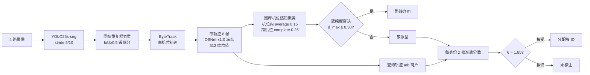

# 拒识图库簇而非查询：自动图库下免训练跨机位身份判定的现场研究

> **稿件状态**：v1 初稿（中文审阅版），2026-10-19
> **目标期刊**：Engineering Applications of Artificial Intelligence（首选）；Computer Vision and Image Understanding / Image and Vision Computing（备选）
> **说明**：正文中文，标题、摘要、关键词与参考文献英文；所有实验数字均可在仓库复跑（`configs/selector_deploy.json`）；引用仅列已核验的同行评审来源与官方基准说明。

---

**Reject the Gallery, Not the Query: A Field Study of Cluster-Level Purity Veto for Training-Free Cross-Camera Identity Association**

**Abstract.** Cross-camera person re-identification (ReID) in real buildings rarely starts from a clean, manually curated gallery. It starts from tracklets produced by a detector and a tracker, which contain duplicate boxes, fragmented tracks, and body parts misdetected as persons. We report a field study of a four-camera, non-overlapping, uncalibrated office deployment with a frozen OSNet encoder and a gallery built entirely from automatic tracklets (579 gallery and 229 query tracklets). Using a label-free protocol in which coverage, split-half consistency (same), and co-occurrence-based false merges (fm) are produced by a single threshold sweep, followed by a full census of all 39 defined gallery clusters, we find that end-to-end precision is limited by gallery-cluster purity rather than by score calibration. Thirteen of 39 clusters (33%) are impure and carry all 50 wrong labels. Six score-normalization and aggregation variants—T-norm, AS-norm, per-camera prototypes, competitive-cluster correction, 1-NN multi-prototype matching, and a cluster-size gate—fail to improve the precision–coverage trade-off under the same operating constraints: their newly accepted tracklets are correct in only 42.4%–57% of cases, and AS-norm exceeds the false-merge budget. This is consistent with a top-1 cosine AUC of only 0.571 between correct and incorrect matches. We then show that a single cluster-level statistic—the maximum pairwise cosine distance within a cluster (d_max)—separates impure from pure clusters (AUC 0.769). Vetoing clusters with d_max ≥ 0.30 raises audited label precision from 0.643 to 0.806 and reduces wrong labels by 58% (50 to 21), at the cost of 13.6 points of coverage (0.664 to 0.528). We argue that when the gallery is built automatically, the right object to reject is the cluster, not the query, and we document four field failure modes—head-box tracks, far-field recall loss, unusable faces, and mixed-detector galleries—that make aggregate metrics look better than the deployed system.

**Keywords:** cross-camera person re-identification; open-set recognition; gallery purity; clustering; label-free evaluation; field study

---

## 摘要

真实建筑中的跨机位行人重识别（ReID）很少从人工裁剪的干净图库开始，而是从检测器与跟踪器产生的轨迹开始，其中包含重复框、碎片轨迹与被误检为人的身体部位。本文基于一个四机位、视野不重叠、无标定的办公楼现场部署，使用冻结的 OSNet 编码器与完全由自动轨迹构建的图库（579 条库轨迹、229 条查询轨迹），研究端到端身份判定的误差来源。本文采用无标签评测协议：覆盖度（coverage）、同轨迹前后半段一致性（same）与同帧共现误合并率（fm）由同一次阈值扫描给出；随后对 39 个有定义的图库簇做全量人工普查，而非抽样。结果显示，端到端精度受图库簇纯度而非分数校准的限制：39 个簇中 13 个（33%）不纯，承载全部 50 条错标；包括 T-norm、AS-norm、每机位原型、竞争簇校正、1-NN 多原型与簇大小门在内的六种评分归一化/聚合变体，在同一约束下均未改善精度—覆盖权衡：其新增接受轨迹的正确率仅 42.4%–57%，且 AS-norm 突破误合并预算；这与「top-1 余弦区分对/错的 AUC 仅 0.571」一致。进一步，簇内最大成对余弦距离（`d_max`）可区分不纯簇与纯簇（AUC 0.769）；以 0.30 为阈值整簇弃用后，标注精度由 0.643 提升至 0.806，错标由 50 条降至 21 条（−58%），代价是覆盖度下降 13.6 个百分点（0.664→0.528）。本文认为：当图库由自动轨迹构建时，应被拒识的对象是簇，而不是查询。本文同时记录四类现场失效模式——头框轨迹、远场召回损失、人脸不可用与混检测器建库——并分析它们如何使聚合指标优于系统的真实能力。

**关键词：** 跨机位行人重识别；开集识别；图库纯度；聚类；无标签评测；现场研究

---

## 1 引言

在多摄像头建筑中，按机位独立计数再相加会系统性高估在场人数，因为同一个人会在不同机位被重复计入。若要在不依赖人工标定的前提下得到一致的在场人数，系统必须解决跨机位身份关联：判断不同机位、不同时段的轨迹是否属于同一人，同时保证同一时刻同框出现的两人不被合并。这一任务在工程上常被简化为行人重识别（ReID）的检索问题，但真实部署的输入与学术基准之间存在三处关键差异。

第一，图库不是人工裁剪的干净片段，而是检测器与跟踪器输出的轨迹集合，其中包含重复框、碎片轨迹，以及人只露出头肩时被误检为「人」的身体部位。第二，机位往往视野不重叠、无标定、无深度，外观是唯一可用的跨机位线索。第三，系统不能为每个现场重新训练编码器，也不能依赖人脸：在办公场景中，人员多数时间背对或侧对镜头，人脸可用率很低。上述约束使「先训练一个更强的表征，再做检索」的常规路线难以直接落地。

现有研究主要在三个方向推进：更强的 ReID 表征、更稳的无监督聚类、更精细的分数归一化。这些工作在 Market-1501、MSMT17 等基准上取得了显著进展，但其评价以 mAP 与 Rank-1 为主，隐含假设图库由人工整理、身份标注可用。部署侧真正关心的问题——**已被系统接受并打上 ID 的轨迹中，有多少是错的**——并没有被作为一等问题来研究。当图库由自动轨迹构建时，这个问题的答案可能远比检索指标悲观。

本文基于一个四机位、视野不重叠、无标定的办公楼现场部署，报告一组与此相关的实证结果。本文使用冻结的 OSNet 编码器与完全由自动轨迹构建的图库（579 条库轨迹、229 条查询轨迹），采用无标签评测协议，并对 39 个有定义的图库簇做全量人工普查。三个发现构成全文主线。

第一，**误差是簇级的，而不是轨迹级的**。39 个簇中 13 个（33%）不纯，它们承载了全部 50 条错标；同一簇内的成员在人工判定上高度一致（10 个多成员簇 0 冲突）。这意味着有效样本量是簇而不是轨迹，也意味着任何逐轨迹的评分改造都在处理一个已经被污染的对象。

第二，**评分层改造无法解决问题**。本文系统测试了六种变体——T-norm、AS-norm、竞争簇校正、每机位原型、1-NN 多原型、簇大小门——在同一条约束（same ≥ 0.90、fm ≤ 2%）下，没有一种能在提高覆盖的同时保证新增接受的质量：三种变体的新增正确率仅 42.4%–57%，AS-norm 则突破 fm 预算。机制是清晰的：正确匹配与错误匹配的 top-1 余弦 AUC 仅 0.571，且错误分为两类，其中「图库中存在极像的别人」这一类在分数上与真匹配重叠，任何对 body 余弦的单调变换都无法分开。

第三，**簇级否决是有效的干预点**。簇内最大成对余弦距离 `d_max` 可以区分不纯簇与纯簇（AUC 0.769）；以 0.30 为阈值整簇弃用后，标注精度由 0.643 提升至 0.806，错标由 50 条降至 21 条（−58%），代价是覆盖度由 0.664 降至 0.528（−13.6pp）。对按人计数的下游而言，错标会静默污染统计，而未标注可以由人工复核补足，因此这一交换在业务上是合理的。

本文的贡献如下。

1. 提出并验证一套**无标签评测协议与全簇普查方法**，把「覆盖度」与「正确率」分离，给出 229 条查询轨迹的完整去向分解（正确 39.3%、错标 21.8%、未标注 33.6%）。
2. 给出**六种评分层改造的系统性阴性结果**，并用 top-1 余弦的区分力（AUC 0.571）解释其共同失效机制。
3. 引入并验证以 `d_max` 为信号的**图库簇纯度否决**，报告其留一稳定性、真实流水线的代价—收益与误伤分析。
4. 记录**四类现场失效模式**（头框轨迹、远场召回、人脸不可用、混检测器建库），并分析它们如何使聚合指标优于系统的真实能力。

本文余下部分安排如下：第 2 节回顾相关工作并给出与最近邻工作的差异；第 3 节描述场景、系统与评测协议；第 4 节报告误差归因；第 5 节分析评分层为何失效；第 6 节给出簇纯度否决；第 7 节讨论现场失效模式；第 8 节讨论设计含义；第 9 节说明局限；第 10 节总结。

---

## 2 相关工作

### 2.1 单机位检测与跟踪

本文的轨迹来自实例分割检测器 YOLO26s-seg 与 ByteTrack；ByteTrack 通过关联低分检测框提升拥挤场景下的轨迹连续性 [2]，StrongSORT 进一步以 AFLink 与 GSI 做轨迹拼接与补洞 [3]。本文使用现成的单机位跟踪组件，贡献不在这一层。但需要强调的是：**跟踪质量决定图库质量**。当人只露出头肩时，检测器会把头部检成独立的「人」，跟踪器则把它维持成一条与宿主并行的轨迹；这类轨迹进入图库后，会成为后文所述「一致地答错」的来源（§7.1）。因此，本文把跟踪视为图库构建的一部分，而不是与身份判定无关的前处理。

### 2.2 ReID 表征与无监督聚类

OSNet 以多尺度感受野聚合提升跨分辨率鲁棒性 [4]，是监控场景中广泛使用的轻量编码器；TransReID 将 Transformer 引入 ReID，在长程依赖与局部特征上取得进展 [5]。无监督方向则以聚类生成伪标签再训练表征，SpCL 通过混合记忆与自步学习缓解伪标签噪声 [6]。这些方法的共同前提是：编码器可以针对目标域训练或微调。

本文的部署约束不允许训练：现场只有单日数据，且为每个新增机位重新训练并不现实。因此本文使用在 MSMT17 [7] 上预训练的 OSNet-x1.0，并全程冻结。这一选择带来一个必须正视的弱点：**OSNet 主要依赖衣着外观**。在办公楼场景中，同事的着装相似度高，冻结编码器无法利用人脸或步态，导致「图库中存在极像的别人」成为一类不可通过分数阈值消除的错误（§5.2）。

### 2.3 Camera bias 与机位感知聚类

同一机位的图像风格（角度、光照、背景、镜头）会使特征天然更近，全局聚类因此倾向于把同机位的不同人并到一起，这一现象在无监督 ReID 中被称为 camera bias 或 IDs Merge。CMLR 在簇级与实例级同时做机位感知的标签精修 [8]；CARR 以机位内/机位间差异化邻域搜索与双向质心优化处理跨模态的机位差异 [9]；Xiao 等将机位多样性、簇紧致度与邻域一致性统一为伪标签可靠性信号 [10]。其共同结构是「先机位内聚类、再跨机位合并」，并在训练中引入机位感知的表示或代理。

本文采用同样的结构，但**不在训练中使用**，而是作为冻结编码器下的图库构建步骤：机位内 average-linkage（余弦 0.15）→ 跨机位 complete-linkage（0.25），并强制同机位子簇不再合并。本文不将其视为方法贡献；它的作用是为后续的簇纯度分析提供一个可用的图库，并在 §6.2 说明其与 `d_max` 的因果关系。

### 2.4 跨机位关联与多目标跟踪

AI City Challenge 的 Track 1 以 3D HOTA 评价多机位 3D 感知与跟踪，2026 年进一步引入 Sim2Real 测试集，并要求推理阶段仅使用 RGB [11]。该类系统依赖相机标定、深度或 3D 检测，且通常允许训练。评价侧，HOTA 同时衡量检测、关联与定位 [12]，IDF1 则以身份级精度/召回衡量多目标跟踪 [13]。

本文的设定是这些工作的边缘情形：**非重叠视野、无标定、无深度、纯 2D 外观、冻结编码器**。在这一设定下，3D 或几何关联不可用，外观与时空先验是唯一线索；这也是本文把问题收窄为「图库构建 + 开集判定」的原因。

### 2.5 开集识别、拒识与风险控制

开集 ReID 的经典做法是拒识查询：当查询与图库的最近距离超过阈值时判为「不在库中」。Wang 等以 9 个图库距离统计量构建 query 级风险评分，在冻结 OSNet 与 camera network 设定下取得优于最近距离的未知检测性能 [14]。这与本文最为接近，但拒识对象不同：**它拒识查询，本文拒识簇**。

方法学上，本文的 coverage–precision 权衡可视为选择性分类中的 risk–coverage 曲线 [15]：系统被允许弃判，覆盖率与接受集风险此消彼长。近期 Learn then Test（LTT）框架进一步把风险控制转化为多重假设检验，对非单调风险给出有限样本保证 [16]。本文尚未引入 LTT，但在 §3.5 报告 Wilson 置信区间，并指出 fm 的 2% 预算在当前样本量下并未被统计认证；这是后续工作最直接的方法学扩展。

### 2.6 应用系统与本文定位

Ding 等在四机位建筑疏散场景中报告了完整的 ReID 系统，ReID 跟踪精度超过 75%、人数统计接近 100%，并自建数据集 [1]。这类系统论文证明了「多机位 + ReID + 人数」在应用类期刊有稳定的发表通道，但其评价以聚合精度为主，未回答「已接受的标签中有多少是错的」，也未分析图库纯度。本文补上的正是这一层诊断：不是再报告一个更高的聚合精度，而是解释为什么聚合精度会高估系统能力，并给出一个可在部署中监控与干预的簇级信号。

**表 1 与最近邻工作的设定对比**

| 工作 | 场景/数据 | 是否训练 | 编码器 | 图库来源 | 拒识对象 | 主要指标 | 与本文差异 |
|---|---|---|---|---|---|---|---|
| Ding 等 [1] | 4 机位建筑疏散，自建 | 是 | 注意力 ReID | 自建 | 无 | ReID >75%，计数≈100% | 系统完整，无簇纯度与错标分析 |
| Wang 等 [14] | Market/Duke/CUHK，camera network | 否（冻结） | OSNet-x1.0 | 人工图库 | **查询** | AUROC、Rank-1、mAP | query 级风险打分；本文为簇级否决 |
| CMLR [8] | Market/MSMT | 是 | 学习表征 | 伪标签簇 | 无 | mAP、Rank-1 | 训练框架内的标签精修 |
| CARR [9] | 可见光-红外 | 是 | 学习表征 | 伪标签簇 | 无 | mAP、Rank-1 | 跨模态；仍为训练框架 |
| AI City [11] | 合成 + 真实，多机位 | 是 | 多模态 | 3D 轨迹 | 无 | 3D HOTA | 依赖标定/深度；本文无标定 |
| **本文** | **4 机位办公楼，单日** | **否** | **冻结 OSNet** | **自动轨迹** | **簇** | **coverage/same/fm + 人工普查** | **诊断图库纯度，提出簇级否决** |

---

## 3 场景、系统与评测协议

### 3.1 场景与数据

现场为办公楼一层，部署四个机位：305 为大场景（2560×1440），318 为开放办公区，320 为茶水间/小会议室，323 为玻璃走廊（1920×1080）。四路视野互不重叠，未做标定，无深度信息，未接入人脸闸机。数据采集于同一工作日：上午四段各 60 min 用于构建图库，下午四段各 15 min 用于查询，帧率 25 fps。时间隔离是硬约束：图库与查询不共享任何时间窗，以防止身份泄漏。

**表 2 数据与图库统计**

| 项 | 值 |
|---|---|
| 机位 | 4（305 / 318 / 320 / 323） |
| 视野 | 互不重叠；无标定、无深度 |
| 图库（上午） | 4 段 × 60 min（08:03–09:35） |
| 查询（下午） | 4 段 × 15 min（14:22、15:03 起） |
| 图库轨迹 | 579 条 |
| 查询轨迹 | 229 条可评估（检测到 295 条） |
| 图库簇 | 111（否决前）/ 100（否决后） |
| 同帧共现对 | 918 对（其中 14 对被误合并） |
| 人脸可用率 | 6.4%（19/295；323 机位为 0%） |

图库的 579 条轨迹全部来自自动检测与跟踪，未做人工筛选。这一点是本文与多数 ReID 实验的关键区别：图库中同时存在完整人体、头肩框、碎片轨迹与短时误检，其统计特性与人工裁剪的查询-图库集合不同。

### 3.2 系统管线



**图 1 系统管线与三个判定点**（a/b 切分、图库聚类、簇纯度否决）。检测器为 YOLO26s-seg，实例分割输出用于同帧去重；跟踪器为 ByteTrack，按原始帧率运行并降低激活阈值以保留低分真实目标。每条轨迹在时间上均匀取 8 帧，经 OSNet-x1.0 编码后取 512 维均值。图库侧先做机位内 average-linkage（余弦距离 0.15），再对子簇质心做跨机位 complete-linkage（0.25）；同机位子簇之间的距离强制设为 2.0，保证永不合并。查询侧把每条轨迹按帧序列对半切分为 a、b 两片，各自独立编码与打分。簇分数为查询与簇内成员的最大余弦，再按簇做 z 校准（用训练段中共现轨迹的冒充者分数估计均值与方差），最后以单一全局阈值 θ=1.85 判定接受或拒识。

机位感知聚类相对全局聚类（余弦 0.20）的效果为：coverage 0.568→0.664、same 0.908 不变、fm 0.75%→1.53%、跨机位簇占比 19%→58%。该改动只在 YOLO 检测器上成立；在更碎的 DINO 轨迹上，coverage 反而从 0.423 降到 0.332，说明它依赖轨迹质量而非普遍适用。

全部计算在 CPU 上完成：YOLO 采样帧约 3.3 帧/秒，OSNet 单裁剪 112–229 ms。系统不需要 GPU、不需要训练、不需要标定。这一工程属性对应用类期刊是加分项，但也意味着编码器能力有限，后文的「极像的别人」问题与此直接相关。

### 3.3 无标签评测协议

形式化地，给定图库轨迹集合 G（|G|=579）与查询轨迹集合 Q（|Q|=229），系统输出映射 f: Q → {1,…,K} ∪ {⊥}，其中 ⊥ 表示拒识。理想目标是最大化正确映射的数量。由于没有逐帧身份真值，无法直接计算 IDF1 或 HOTA；本文用三个可从现有数据计算的代理指标构成评测协议，三者由**同一次 θ 扫描**给出，不分别调参：

- **coverage（覆盖度）**：`|{t : accept(a_t) ∧ accept(b_t)}| / |T|`，即一条轨迹的前后两片都被接受的比例。它衡量系统给出判定的比例，不衡量结论是否正确。
- **same（一致性）**：在两片都被接受的轨迹中，两片被分配到同一簇的比例。它是**内部一致性代理**，不是真值：一条轨迹可能两片一致地错。
- **false merge（fm，误合并率）**：同一机位内同帧共现 ≥5 帧的轨迹对（同时在场，铁定不同人），被分配到同一簇的比例。它是硬负例约束，只覆盖同机位共现；跨机位误合并无法用它测到（§7.5）。

工作点选择采用 self-cal：在 same ≥ 0.90 且可评估共现对 ≥100 的 θ 中取 coverage 最大者。必须强调，**这是启发式，不是统计保证**；本文在 §3.5 报告置信区间，并在 §9 说明其局限。

### 3.4 全簇人工普查

152 条被接受的轨迹只落在 42 个簇上。其中 39 个簇有唯一定义（另外 3 个只由 a/b 指向不同身份的轨迹组成，系统本身没有给出唯一分配），本文对 39 个簇**全部**做了人工目检，而不是抽样。判定分三态：正确（簇内成员确为同一人）、错误（簇内混入不同人）、看不清（画质/遮挡导致无法判定）。为避免「同簇内不同成员给出不同结论」的问题，本文先验证同簇同结论：10 个被判过 ≥2 条成员的多成员簇，**0 个冲突**。因此「1 簇判 1 条」可以代表整簇。

普查结果按簇与按轨迹两个层级报告。按簇：24 对、13 错、2 看不清；按轨迹：90 对、50 错、8 看不清；另有 4 条 a/b 分歧轨迹无唯一定义，剔除。判定为单人所做，未估计标注者间一致性，这是本文的明确局限（§9）。

### 3.5 统计不确定性

本文对主要比例报告 Wilson 95% 置信区间。以改前（机位感知聚类、无否决）工作点为例：coverage 0.664（152/229）的 95% CI 为 [0.600, 0.722]；same 0.908（138/152）为 [0.851, 0.944]；fm 1.53%（14/918）为 [0.91%, 2.54%]。**fm 的置信上界超过 2% 预算**，说明「fm ≤ 2%」在当前样本量下并未被统计认证——这与 LTT 一类风险控制方法的动机一致 [16]。

否决后的工作点：coverage 0.528（121/229）为 [0.464, 0.592]；same 0.901（109/121）为 [0.835, 0.942]；标注精度 0.806（87/108）为 [0.721, 0.869]。改前精度 0.643（90/140）为 [0.561, 0.717]。两个精度区间几乎不重叠（0.717 vs 0.721），但并非统计意义上的完全分离；本文因此把「精度提升」表述为在本批数据上的实测效应，而不是已认证的总体参数。

---

## 4 误差从哪里来：全簇普查

### 4.1 229 条查询轨迹的完整去向

**表 3 查询轨迹的 100% 去向分解（改前工作点，分母 229）**

| 状态 | 轨迹数 | 占比 |
|---|---|---|
| 正确打上 ID | 90 | 39.3% |
| 打上 ID 但错误 | 50 | 21.8% |
| 打上 ID 但看不清 | 8 | 3.5% |
| a/b 分歧、无唯一定义 | 4 | 1.7% |
| 未打 ID | 77 | 33.6% |

这张表是全文最重要的一张表。对外常被引用的 0.664 是「标注覆盖率」（152/229），不是准确率；把它当作「轨迹被正确识别的比例」会高估约 27 个百分点。更关键的是第二行：**21.8% 的轨迹被静默地打上了错误的 ID**。对按人计数的下游，未标注可以人工补，错标不会报错，只会使统计在无提示的情况下产生偏差。因此本文在后续所有比较中，都把「正确标签的绝对数量」而不是覆盖率作为主目标。

### 4.2 误差是簇级的

39 个有定义的簇中，24 个正确、13 个错误、2 个看不清；簇级精度 24/37 = 0.649（排除看不清）。13 个坏簇承载了全部 50 条错标（相当于接受轨迹的 33%）。坏簇的平均成员数为 9.1，好簇为 5.2；坏簇中跨机位簇占 69%，好簇为 46%。

三个典型坏簇说明了问题的规模：

- 簇 36：13 个成员（305×12 + 320×1），带来 **16 条错标**，占全部错标的 32%；
- 簇 29：33 个成员（305×4 + 323×29），带来 6 条错标；
- 簇 101：14 个成员（305×13 + 318×1），带来 3 条错标。

但**大簇不等于坏簇**：簇 13（323×16）全部正确，簇 47（305×14）全部正确，二者的 `d_max` 都在 0.2 以下。这解释了为什么「按簇大小砍」会失败（§6.6）：真正区分好坏的不是规模，而是簇内是否存在一条很长的成对距离。

### 4.3 分机位：323 是精度短板，不是覆盖短板

**表 4 分机位精度（改前工作点）**

| 机位 | 接受 | 正确 | 错误 | 看不清 | 精度 | 占总错误 |
|---|---|---|---|---|---|---|
| 305 | 79 | 54 | 22 | 0 | 0.711 | 44% |
| 318 | 32 | 21 | 5 | 5 | 0.808 | 10% |
| 323 | 35 | 14 | 18 | 3 | **0.438** | **36%** |
| 320 | 6 | 1 | 5 | 0 | **0.167** | 10% |

323 的覆盖率是 0.686，看起来正常，但精度只有 0.438，18 条错误占全部错误的 36%。这与「323 覆盖低」的直觉相反：它的问题不是拒识过多，而是接受过多且错误率高。320 只有 6 条接受，精度 0.167，但它只占接受量的 3.9%，整体影响有限。

### 4.4 提高门槛不能解决问题

**表 5 单一阈值前沿（改前工作点，分母 229）**

| 门槛 θ | 保留 | 覆盖 | 正确 | 错误 | 精度 | 正确数/229 |
|---|---|---|---|---|---|---|
| **1.85（现状）** | **152** | **0.664** | **90** | 50 | 0.643 | **0.393** |
| 2.2 | 134 | 0.585 | 85 | 40 | 0.680 | 0.371 |
| 2.6 | 117 | 0.511 | 76 | 35 | 0.685 | 0.332 |
| 3.2 | 87 | 0.380 | 62 | 22 | 0.738 | 0.271 |
| 4.0 | 46 | 0.201 | 37 | 8 | 0.822 | 0.162 |
| 4.5 | 25 | 0.109 | 23 | 1 | 0.958 | 0.100 |

提高门槛只减少接受量以降低错误，并不增加正确判定的数量：正确标签的绝对数量从 90 单调降到 25。分机位看，318 提高门槛有效（0.808→0.93 @3.2），305 要到 4.0 才明显（0.86），而 **323 完全无效**（0.438→0.39 @2.6，0.00 @4.0）——323 的错误是高分错误，分数对它没有区分力。因此，在「正确标签数量」这一目标下，当前工作点 1.85 已是最优；要继续提升，只能让更多轨迹变对，而不是筛除错误判定。

### 4.5 小结

三条证据指向同一个结论：误差不是均匀分布在轨迹上的随机噪声，而是集中在少数簇上的系统性污染。评分函数、阈值、单轨迹质量门都在处理污染的后果；真正的上游是图库簇的构成。

---

## 5 评分层为何失效

### 5.1 六种变体及其结果

本文在同一评测协议下测试了六种评分层改造。需要说明的是，受实验时序限制，T-norm、AS-norm、竞争簇校正与每机位原型是在**全局聚类基线**（coverage 0.568）上测试的，而 1-NN 与簇大小门是在**机位感知基线**（coverage 0.664）上测试的；两组实验的评测协议相同，但基线不同，不能直接横比。它们覆盖了 ReID 与说话人识别中常用的三类手段：分数归一化（T-norm、AS-norm）、竞争性校正（竞争簇校正、每机位原型）、以及近邻聚合（1-NN 多原型、簇大小门）。

**表 6a 全局聚类基线上的评分层变体（coverage 0.568 / same 0.908 / fm 0.75%）**

| 变体 | 覆盖 | same | fm | 新增接受的表现 | 判定 |
|---|---|---|---|---|---|
| T-norm | 0.659 | 0.901 | 1.75% | 新增 33 条，人工判定 14 对 / 19 错 = 42.4% | 新增正确率 42.4%，近六成为错 |
| T-norm + 绝对余弦 ≥0.50 | 0.620 | 0.908 | 1.20% | p=0.058，未达显著 | 未采纳 |
| AS-norm（64） | 0.760 | 0.902 | **2.69%** | — | 突破 fm 预算 |
| 竞争簇校正（λ≤0.5） | 0.555–0.581 | 0.91 | 1.0–1.2% | — | 无增益 |
| 每机位原型 | 0.568 | 0.908 | 0.76% | — | 与基线等价 |

**表 6b 机位感知基线上的评分层变体（coverage 0.664 / same 0.908 / fm 1.53%）**

| 变体 | 覆盖 | same | fm | 新增接受的表现 | 判定 |
|---|---|---|---|---|---|
| 1-NN 多原型（取 max） | 0.7205 | 0.9030 | 1.729% | 新增 18 条，8 对 / 9 错 / 1 看不清 = 44.4% | 未达 50% 线 |
| 簇大小门（size≥6） | 0.7249 | — | 1.96% | 新增正确率 57% | 仍低于基线精度 0.643 |

在两类基线上，没有一种变体在提高覆盖的同时证明新增接受是可靠的。T-norm 的 +9.1pp 覆盖增益来自 33 条新增接受，其中仅 14 条正确（42.4%），新增轨迹的绝对余弦中位仅 0.500（基线已接受组为 0.679）；它主要是把「分数分布靠后但确实相似」的轨迹放进来了，其中近六成是错的。AS-norm 把覆盖推到 0.760，但 fm 升至 2.69%，直接突破 2% 预算。1-NN 与簇大小门在机位感知基线上的新增正确率分别为 44.4% 与 57%，后者仍低于生产基线的 0.643。换言之，这些方法都在用精度换覆盖，而不是在同等精度下扩大覆盖。

### 5.2 机制：余弦在相关区间的区分力已经耗尽

为排除聚类与校准的干扰，本文直接在**全库轨迹级 top-1 余弦**上评估区分力（229 查询 × 579 库轨迹，不经聚类、不做校准）。结果是：

- 判对的轨迹，top-1 余弦中位数 0.624；
- 判错的轨迹，中位数 0.506，其中 79% 低于 0.55；
- 用 top-1 余弦区分「对/错」的 **AUC 仅 0.571**。

错误可以分为两类。**第一类：图库中根本没有这个人**。这类查询的 top-1 余弦偏低，可以被阈值挡掉，是「良性拒识」。**第二类：图库中存在一个极像的别人**（同款工装、相似体型、相近姿态）。这类查询的 top-1 余弦与真匹配分布重叠，任何单调阈值都无法在保留真匹配的同时排除它。第二类错误在 323 与 320 上尤为突出：提高门槛对这两个机位几乎无效（§4.4），说明它们的错误不是低分错误，而是高分错误。这也是所有评分层方法失效的共同原因。

这解释了 T-norm 的另一个现象：T-norm 是逐查询的仿射变换，argmax 不变，它只能改变「哪些查询被接受」，不能修复「12 条 a/b 异簇」这类分配错误。换言之，归一化改变的是接受边界，不是特征的可分性。

### 5.3 为什么文献中的有效性不能直接迁移

T-norm 与 AS-norm 在说话人识别中有效，前提是 cohort 足够大且多样，冒充者分布可以被可靠估计。本文的图库只有 579 条轨迹、约 100 个簇，且同一场景内着装高度相似；在训练段上，冒充者分布的尾部与真实匹配分布重叠（同人 a/b 的 p5 = 0.955，而同帧共现负对的 p99 = 0.976）。在这样的分布下，归一化没有可用的信号：它把正负样本一起平移，无法改变重叠区的排序。

这不是「实现不够好」，而是**信息条件不成立**。要突破这一点，只能扩图库（让真身进库）或增加模态（人脸已否证，见 §7.3；步态尚未尝试），而不是继续在 body 余弦上做变换。

### 5.4 小结

六种评分层方法的失败不是六个独立的工程问题，而是同一个统计事实的六种表现：在被污染的簇上做单调变换，不会把混在一起的人分开。评分层的方法假设「被打分的对象是纯的」；当这个假设不成立时，任何评分函数都无能为力。

---

## 6 图库簇纯度否决

### 6.1 信号：簇内最大成对余弦距离

本文在 39 个已人工判定的簇上比较了多个簇级特征。结果如下（AUC 为区分好簇/坏簇的能力）：

**表 7 簇级特征的判别力（39 簇：24 好 / 13 坏 / 2 看不清）**

| 特征 | 含义 | AUC |
|---|---|---|
| **`d_max`** | 簇内最大成对余弦距离（1 − 最小成对余弦） | **0.769** |
| `mst_max` | 最小生成树的最长边（与 `d_max` 同源） | 0.766 |
| `d_p95` | 成对距离的 95 分位 | 0.763 |
| `cent_mean` | 到质心的平均距离 | 0.747 |
| `d_mean` | 平均成对距离 | 0.718 |
| `n` | 簇成员数 | 0.652 |
| `n_cam` | 跨机位数 | 0.638 |
| `sub_share` | 按 0.12 再切一刀后最大子簇占比 | 0.625 |

`d_max` 的好簇中位数为 0.160，坏簇为 0.291。取阈值 0.30 等价于要求簇内最小成对余弦不低于 0.70——这是一个很宽松的要求，但仍能筛出大部分坏簇。

### 6.2 机制：average-linkage 的链式串联

为什么是 `d_max`，而不是簇大小或跨机位数？答案在聚类的几何性质。

机位内使用 average-linkage，它约束的是**平均**距离。假设 A、B 是两个人，A1、A2 与 B1、B2 之间各有一个「中间人」轨迹 M：A 与 M 相似、M 与 B 相似，但 A 与 B 并不相似。average-linkage 在合并时只看簇间平均距离，M 可以把 A 与 B 串成同一个簇，而簇内会出现一条很长的成对距离（A–B）。`d_max` 捕捉的正是这条长边。

跨机位使用 complete-linkage，它约束的是最大距离，等价于要求两簇之间所有跨簇对的相似度都超过阈值，因此跨机位合并本身不会产生这种链式串联。坏簇之所以在统计上更「跨机位」（69% vs 46%），是因为机位内的混合子簇后来又被跨机位合并到另一机位的同人子簇上，形成了「大簇 + 跨机位」的外观；因果起点仍在机位内的 average-linkage。

这也解释了为什么 `n`（簇大小）与 `n_cam`（跨机位数）的 AUC 只有 0.652 与 0.638：它们是相关的伴随特征，不是判别信号。两个大而纯的簇（簇 13、簇 47）就是反例。

### 6.3 阈值选择与留一验证

0.30 这个阈值是在 39 个簇上选出的，存在过拟合风险。本文做了留一簇交叉验证：每次留出 1 个簇，在其余 38 个簇上重新选切点。结果是切点稳定落在 0.29–0.30，留出精度 0.796，正确标签 86。这说明信号不是单点巧合，但**仍不是第二场数据的验证**；这是本文最需要补的实验（§9）。

算法 1 总结了否决的完整流程。单簇的成对距离计算为 O(n²)，本文最大簇为 33 个成员，开销可忽略；否决只作用于图库侧，不改变查询侧的评分函数与阈值。

```
算法 1  图库簇纯度否决
输入：图库轨迹嵌入 X；机位标签 c；机位内阈值 t_in=0.15；
      跨机位阈值 t_out=0.25；否决阈值 τ_d=0.30
1. 对每个机位分别做 average-linkage（余弦距离），阈值为 t_in
2. 对子簇质心做 complete-linkage，阈值为 t_out；
   同机位子簇之间的距离置为 2.0（永不合并）
3. 丢弃成员数 < 2 的簇
4. 对每个簇 C：
       d_max(C) ← 1 − min_{i,j∈C, i≠j} cos(x_i, x_j)
5. 若 d_max(C) ≥ τ_d，则从图库中移除 C
输出：净化后的图库簇集合
```

### 6.4 真实流水线的代价与收益

把否决接入真实流水线（`cluster.veto_dmax = 0.30`）后：

**表 8 否决前后的生产口径**

| 配置 | K | 覆盖 | same | fm | 正确 | 错标 | 看不清 | 精度 |
|---|---|---|---|---|---|---|---|---|
| 无否决 | 111 | 0.664 | 0.908 | 1.53% | 90 | 50 | 8 | 0.643 |
| **否决 0.30** | **100** | **0.528** | **0.901** | **1.48%** | **87** | **21** | **8** | **0.806** |

代价是覆盖度下降 13.6 个百分点（152→121 条），收益是精度提升 16.3 个百分点、错标减少 29 条（−58%）。正确标签从 90 降到 87，净损失 3 条。

如何理解这个交换？对「按人计数」的下游，错标与未标注的代价不对称：未标注可以进入人工复核队列，错标会静默地进入统计。以 229 条轨迹为分母，否决把「错标」从 21.8% 压到 9.2%，把「未标注」从 33.6% 推到 47.2%。如果下游有复核预算，这是一个明显更安全的操作点；如果下游完全无人复核，则需要按业务对漏计与错计的相对成本重新选择阈值（§6.7 给出 0.28、0.32 与降门槛的替代点）。

### 6.5 误伤分析

11 个被否决的簇中，8 个已人工判定：6 个坏簇（29、36、45、60、84、101），2 个好簇（55、69）。未审的 3 个中，簇 46、54 没有任何接受轨迹（影响为零），簇 98 只有 1 条 a/b 分歧轨迹（本身无唯一定义）。因此，否决对覆盖与精度的影响 **100% 来自已审的 8 个簇**，不需要再补目检。

误伤集中在两个好簇：簇 69 损失 3 条正确标签，簇 55 损失 1 条，合计 4 条；由于否决同时改变了接受集，净正确标签数为 87（−3）。收益高度集中：簇 36 一个就带来 16 条错标（占全部错标的 32%），簇 29 带来 6 条。这既是优势也是风险——如果换一场数据没有这种「大坏簇」，收益会缩水。

### 6.6 与「按簇大小砍」的区别

**表 9 不同剔除策略的代价—收益（正确数为绝对条数）**

| 策略 | 覆盖 | 精度 | 正确数 |
|---|---|---|---|
| 基线 | 0.646 | 0.643 | **90** |
| 剔除 size≥7 的簇 | 0.314 | 0.844 | 54 |
| 剔除 size≥10 的簇 | 0.371 | 0.792 | 61 |
| 门槛 2.6 + size<7 | 0.253 | 0.868 | 46 |
| 门槛 1.85 + size<7 + 去掉 320 | 0.306 | 0.855 | 53 |
| **`d_max` 否决 0.30** | **0.528** | **0.806** | **87** |

> 口径说明：本表基线的覆盖 0.646 = 148/229，剔除 4 条 a/b 分歧轨迹后的接受数；正文其他处的 0.664 = 152/229，包含这 4 条。两种口径的正确数相同（90）。

按大小砍能把精度推到 0.844，但正确标签只剩 54 条；`d_max` 否决在 0.806 的精度下保住了 87 条。差异来自「大而纯」的簇：簇 13（16 成员）与簇 47（14 成员）都被大小门误杀，而 `d_max` 放过了它们。

### 6.7 风险与替代工作点

0.30 不是唯一选择。若业务更看重覆盖，可以用 0.32（覆盖 0.555、精度 0.776、正确 90）；若更看重精度，可以用 0.28（覆盖 0.524、精度 0.829、正确 87），但 0.28 的 same 已跌到 0.892，突破 0.90 判据。降门槛（1.60、1.40）虽然能换回覆盖，但 same 分别跌到 0.873 与 0.848，同样破线。**只有 0.30 这一档同时满足 same ≥ 0.90 与精度显著提升**。

必须诚实说明三项风险：其一，0.30 是在同一批 39 个簇上选出的，留一验证只能排除单点巧合，不能替代第二场数据；其二，same 0.901 只比判据高 0.001，任何扰动（换检测器、加机位）都可能破线；其三，分机位留出验证偏弱（用 305+318 选点、在 323/320 上验证时，`d_max` 只拦住 2/5 个坏簇，误伤 1/3 个好簇），说明 n=39 选出的阈值在跨机位迁移时并不强健。

---

## 7 现场失效模式与指标反噬

本节记录四类在实验室基准中不常见、但在现场部署中反复出现的失效模式。它们的共同后果是：**聚合指标看起来比系统真实能力好**。

### 7.1 头框轨迹：一致地答错

当人只露出头部或后脑勺时，YOLO 会把头部检成一个独立的 person 实例，跟踪器把它维持成一条与宿主并行的轨迹。295 条测试轨迹中有 21 条属于这一类（305：17/102，318：2，320：2，323：0）。

这本身是检测问题，但它对身份判定的影响是特殊的：在 20 条可评估的头框轨迹中，15 条被 a/b 两片同时接受；这 15 条**全部**落进了与自己身体不同的簇（簇 81 与簇 47 是主要宿主）。按最保守估计，至少 11 条必然错误。机制是：训练段 29/579 = 5.0% 的头框形成了 5 个「头的堆」簇；同机位、同俯角的后脑勺在特征空间里彼此最相似，因此得分最高。

这类错误对指标是隐形的：coverage 奖励「接受」，same 奖励「两片一致」，fm 只检查同帧共现——一条头框轨迹被一致地贴到别人身上，三项指标都不会报警。本文尝试过三种修正：剔除头框（`--dedup-mask 0.9`）导致三项全跌；把图库中的头簇清场导致覆盖从 0.664 降到 0.590；让头框继承宿主身份在人数级上零增益，却把 fm 从 1.53% 推到 2.43%。原因是头簇本身不纯（混有 305 远场小框），清场会连带损失真实身份。**正确的修法在检测级**：用 IoA（交集 ÷ 头面积）而不是 IoU 做头身归属，或训练带 visible/full 双框的检测器。这是后续工作。

### 7.2 远场召回：覆盖率无法奖励召回

coverage 的分母是「检测到的轨迹」，不是「真实在场的人」。检测器漏掉的人根本不进分母，因此覆盖率从设计上无法奖励召回；换一个检出更多的模型，只会往测试集里新增更难的轨迹，覆盖率可能反而下降。

323 机位提供了一个干净的证据。在该段前 3.3 分钟的 4 帧中，人工点数为 8 人：s-seg 命中 2 人（25.0%，Wilson 95% CI 7.1%–59.1%），l-seg 命中 8 人（100%，CI 67.6%–100%）。全段统计显示，s-seg 的空帧率为 11.0%，且高度时间聚集：开场 0–2 分钟的 30 秒分桶空帧率为 26%–76%，5 分钟后基本为 0%。含义不是「s 随机丢检 11%」，而是「当画面里只有远场人物时，s 基本看不见」。覆盖率 0.588 已经是 s 能看见的那部分人的天花板。

这一现象对评测的启示是方法学的：**换检测器必须同时报告按帧点数的召回，否则会掉进「多检出 → 指标变差」的陷阱**。本文因此把「按帧点数」列为与三指标并列的第四把尺子。

### 7.3 人脸通道：可用率太低，不能作为判据

本文评估了人脸作为独立模态的可行性。以瞳孔距离 ≥20 px 且人脸宽度 ≥32 px 为可用标准，295 条测试轨迹中只有 19 条（6.4%）可用；分机位为 305 15.7%、318 2.6%、320 2.5%、**323 0%**。人脸特征的 AUC 为 0.880，低于 body 的 0.981；在阈值 0.2 下，异人通过率 31.7%；1:N 检索的 Rank-1 为 50%，低于 body 的 52%，Rank-5 为 71% vs 86%。

因此，人脸在本场景中不能作为 cannot-link，也不能作为主判据；它只能为「看不清」提供标签，或在 305 这类近场机位做辅助投票。工业界的 face/head/body 三模态 fallback 与回填关联设计在本场景缺少输入条件。若要使用人脸，正确做法是增加近场正视抓拍点，而不是在现有画面上调阈值。

### 7.4 混检测器建库：框的松紧会改变整个分数分布

323 的远场召回问题促使本文测试 l-seg。隔离测试中，323 的覆盖在全局口径下从 0.588 升到 0.913，在生产聚类口径下从 0.294 升到 0.739；fm 从 9.28% 降到 4.50%。但把 323 的 l-seg 轨迹与其余机位的 s-seg 轨迹放进**同一个图库**后，8 段覆盖反而降到 0.594（vs 0.664），θ 从 1.85 被迫抬到 2.25，四个机位的接受数全线下降。

机制是：不同检测器的框松紧不同（l-seg 框更贴边、s-seg 框更松），导致裁剪构图与特征分布不同；两类特征混在一个图库里，冒充者分布的尾部变宽，校准后的 θ 必须抬高，于是所有机位的接受都变保守。**结论：一个图库只能有一种检测器**。若某个机位必须换检测器，要么为它建独立图库（放弃跨机位统一），要么用同一检测器重编码全部机位。

### 7.5 指标反噬的汇总

**表 10 四类失效模式及其对指标的欺骗方式**

| 失效模式 | 证据 | 指标为何看不出来 | 可行缓解 |
|---|---|---|---|
| 头框轨迹 | 21/295；15/15 接受后落错簇 | coverage 奖励接受，same 奖励一致，fm 只查同帧共现 | 检测级头身归属（IoA）；不剔头簇 |
| 远场召回 | 323 远场召回 25%（l-seg 100%）；全段空帧 11% | coverage 分母不含漏检 | 按帧点数召回；近场补点或 l-seg |
| 人脸不可用 | 可用率 6.4%；323 为 0%；AUC 0.880 | 不进入三指标 | 仅作「看不清」标签；加近场抓拍 |
| 混检测器建库 | 共享图库 cov 0.594 < 0.664 | θ 抬高被误读为「更难」 | 一库一检测器；统一重编码 |

此外，fm 只覆盖同机位共现，**跨机位误合并是静默的**：同帧约束只存在于同一机位内，跨机位并错永远测不到。本文用跨机位簇的成员相似度下界做替代校验：64 个跨机位簇的成员相似度中位 0.76、p10 0.69、最小 0.64，没有低于 0.55 的簇。这只是「没有靠弱连接硬撑」的佐证，不是真值。

---

## 8 讨论

### 8.1 为什么拒识簇，而不是查询

开集 ReID 的默认动作是拒识查询：当查询与图库的最近距离超过阈值时弃判。这在图库干净时是合理的；但当图库由自动轨迹构建、且混入了不同人时，查询级拒识只能减少判定，不能纠正错误判定。一个混合簇同时包含多个人的成员，任何查询与它比较都可能匹配到错误的那个人；拒识查询只是避免了一部分错误，混合簇仍然留在图库中，继续污染后续查询。

簇级否决改变的是图库本身：把一个被判定为混合的簇整簇移出原型集合，后续所有查询都不再与它比较。这与选择性分类的精神一致 [15]，但拒识的对象从「样本」变成了「标签/簇」。本文将这一设定称为**标签级弃判**（label-level abstention）：系统不是对输入弃判，而是对已经形成的伪标签弃判。本文认为，在自动图库场景中，这是一个更有效的干预点：错误是簇级的（§4.2），干预也应当在簇级。

### 8.2 对部署的设计含义

基于上述结果，本文给出五条可操作建议。

1. **图库分层构建**：机位内紧聚类、跨机位保守合并，禁止同机位再合并。机位内的 average-linkage 阈值决定图库污染的上限；跨机位阈值决定身份统一率。本文的 0.15/0.25 在 0.14–0.17 与 0.24–0.26 的平台上，不是尖峰。
2. **把 `d_max` 作为部署健康指标**：每个簇记录 `d_max`，超过现场校准的阈值就否决或转人工复核。它比簇大小更可靠，且可在无标签条件下计算。
3. **三指标 + 两把额外的尺子**：报告 coverage、same、fm 的同时，报告**已接受标签的人工精度**与**按帧点数的召回**。缺了后两者，系统会系统性高估自己。
4. **一库一检测器**：不要把不同检测器的轨迹混进同一图库；框的松紧会改变整个分数分布。
5. **对计数下游，优先弃判而非错标**：错标静默污染统计，未标注可复核。若必须提高覆盖，应同时给出「错标率—覆盖率」曲线，让业务选择工作点，而不是只报一个覆盖率。

### 8.3 与文献的关系

本文不主张在 mAP/Rank-1 上超越任何方法，也不主张提出新的表征或聚类算法。它与三条文献线互补：在 camera-aware 聚类 [8–10] 中，本文提供的是冻结编码器、自动图库条件下的落地证据与检测器依赖性；在开集评分 [14] 中，本文把拒识对象从查询移到簇；在风险控制 [15, 16] 中，本文的 coverage–precision 前沿是一个尚未加保证的实例，LTT 是下一步。

### 8.4 可迁移性

`d_max` 的机制（average-linkage 的链式串联）不依赖具体场景，因此信号本身应可迁移到任何用层次聚类构建图库的系统。阈值 0.30 则依赖特征分布与检测器，不能直接搬运；部署时应在目标现场数据上重新校准，并监控漂移。本文尚未在公开数据集上验证这一点，这是最优先的后续工作。

---

## 9 局限

本文的结论受以下限制，阅读时应与数字一起理解。

1. **单场单日**：4 机位、1 天、约 5 机位小时。没有第二场或第二天数据，`veto_dmax = 0.30` 未经过独立复验。
2. **单标注人**：39 个簇的判定由一人完成，未估计标注者间一致性（Cohen's kappa）。虽然「同簇同结论」成立（10/10），但主观偏差未量化。
3. **阈值同批选择**：0.30 在 39 个簇上选出，留一交叉验证只能排除单点巧合，不能替代外部验证。分机位留出验证偏弱（`d_max` 拦 2/5 坏簇、误伤 1/3 好簇）。
4. **same 贴线**：0.901 只比判据 0.90 高 0.001。任何扰动（换检测器、加机位、换阈值）都可能破线；届时要么回滚，要么重定判据。
5. **无公开基准对比**：未在 Market-1501、MSMT17 等公开数据上做受控实验，也未与 camera-aware 聚类类方法在同一协议下比较。方法组件多为已有工作的工程实例化，新颖度有限。
6. **无人级计数指标**：本文只有身份级覆盖与精度，没有「每 15 分钟唯一人数」的 MAE。对计数应用而言，这是缺失的下游验证。
7. **跨机位误合并缺真值**：fm 只覆盖同机位共现；跨机位簇的纯度只有相似度下界佐证，没有人工真值。
8. **323 仍未解决**：l-seg 全量结果在本文写作时尚未完成；323 的精度 0.438 未被 veto 显著改善（veto 只去掉 2 个坏簇）。
9. **数据不可公开**：受隐私限制，原始视频与轨迹不能发布；本文提供协议、参数与复跑入口，但无法提供可复现的数据集。
10. **评分层变体未统一基线重跑**：T-norm、AS-norm 等在全局聚类基线上测试，1-NN 与簇大小门在机位感知基线上测试；两组结论方向一致，但严格的可比性需要在同一基线上重跑。

---

## 10 结论

本文报告了一个四机位、非重叠、无标定办公楼现场的跨机位身份判定研究。三个结果构成了一个完整的因果链：误差集中在少数图库簇上（13/39 簇承载全部 50 条错标）；评分层的六种改造无法改善精度—覆盖权衡，因为 body 余弦在相关区间的区分力已经耗尽（AUC 0.571）；簇级纯度否决可以在精度与覆盖率之间做出可解释的交换（精度 0.643→0.806，错标 −58%，覆盖 −13.6pp）。

本文的核心主张是一个设计原则：**当图库由自动轨迹构建时，应被拒识的对象是簇，而不是查询**。这一原则把开集 ReID 的拒识从「样本级」推进到「标签级」，并为部署提供了一个可在无标签条件下监控的信号（`d_max`）。

后续工作有四个方向：第二场/多场数据的外部验证；在公开数据集上验证 `d_max` 的可迁移性；把「否决」升级为「分裂」（在簇内定位长边并切开，而不是整簇丢弃）；以及用 LTT 一类风险控制方法，把 `fm ≤ 2%` 从点估计升级为有限样本保证。

---

## 数据可用性声明

受隐私与场所授权限制，原始视频、轨迹与裁剪图像不能公开。评测协议、聚类与评分参数、复跑入口已在稿件中给出；代码与配置可在与作者约定的条件下提供。本文不进行人脸身份识别，人脸仅用于可用性评估。

## 伦理声明

数据采集与使用遵循所在机构的隐私与伦理要求。所有分析基于匿名化的轨迹与裁剪，不关联任何人员身份；文中不包含可识别个人的图像或信息。

---

## 参考文献

[1] Ding, Y., Chen, X., Zhang, Y., & Huang, X. (2025). Smart building evacuation by tracking multi-camera network and explainable re-identification model. *Engineering Applications of Artificial Intelligence*, 148, 110394. https://doi.org/10.1016/j.engappai.2025.110394

[2] Zhang, Y., Sun, P., Jiang, Y., Yu, D., Weng, F., Yuan, Z., Luo, P., Liu, W., & Wang, X. (2022). ByteTrack: Multi-object tracking by associating every detection box. In *Computer Vision – ECCV 2022* (pp. 1–21). https://arxiv.org/abs/2110.06864

[3] Du, Y., Zhao, Z., Song, Y., Zhao, Y., Su, F., Gong, T., & Meng, H. (2023). StrongSORT: Make DeepSORT great again. *IEEE Transactions on Multimedia*, 25. https://arxiv.org/abs/2202.13514

[4] Zhou, K., Yang, Y., Cavallaro, A., & Xiang, T. (2019). Omni-scale feature learning for person re-identification. In *Proceedings of the IEEE/CVF International Conference on Computer Vision* (pp. 3702–3712). https://arxiv.org/abs/1905.00953

[5] He, S., Luo, H., Wang, P., Wang, F., Li, H., & Jiang, W. (2021). TransReID: Transformer-based object re-identification. In *Proceedings of the IEEE/CVF International Conference on Computer Vision*. https://arxiv.org/abs/2102.04378

[6] Ge, Y., Zhu, F., Chen, D., Zhao, R., & Li, H. (2020). Self-paced contrastive learning with hybrid memory for domain adaptive object re-ID. In *Advances in Neural Information Processing Systems* (Vol. 33). https://arxiv.org/abs/2006.10637

[7] Wei, L., Zhang, S., Gao, W., & Tian, Q. (2018). Person transfer GAN to bridge domain gap for person re-identification. In *Proceedings of the IEEE Conference on Computer Vision and Pattern Recognition* (pp. 79–88). https://arxiv.org/abs/1711.08565

[8] Tang, N., Fan, Z., Zhu, Y., & Zhang, T. (2025). Unsupervised person re-identification via camera-aware multi-level label refinement. *Neural Networks*, 195, 108292. https://doi.org/10.1016/j.neunet.2025.108292

[9] Wang, J., Fu, H., & Dou, L. (2026). CARR: Camera-aware reciprocal refinement for unsupervised visible-infrared person re-identification. *Applied Soft Computing*, 188, 114445. https://doi.org/10.1016/j.asoc.2025.114445

[10] Xiao, Y., Zhu, T., Guan, F., Sun, H., Huang, J., & Grau Saldes, A. (2026). Cross-camera reliability modeling with soft contrastive learning for unsupervised person re-identification. *Knowledge-Based Systems*. https://www.sciencedirect.com/science/article/abs/pii/S0950705126011299

[11] AI City Challenge. (2026). *Track 1: Multi-camera 3D perception (Sim2Real)*. https://www.aicitychallenge.org?p=1513/

[12] Luiten, J., Ošep, A., Dendorfer, P., Torr, P., Geiger, A., & Leal-Taixé, L. (2021). HOTA: A higher order metric for evaluating multi-object tracking. *International Journal of Computer Vision*, 129(2), 548–578. https://arxiv.org/abs/2009.07736

[13] Ristani, E., Solera, F., Zou, R., Cucchiara, R., & Tomasi, C. (2016). Performance measures and a data set for multi-target, multi-camera tracking. In *Computer Vision – ECCV 2016 Workshops* (pp. 17–35). https://arxiv.org/abs/1609.01775

[14] Wang, J., Cao, J., & Song, C. (2026). Gallery-distance profiles for open-set person re-identification with frozen encoders in camera networks. *Sensors*, 26(17), 5479. https://doi.org/10.3390/s26175479

[15] Geifman, Y., & El-Yaniv, R. (2017). Selective classification for deep neural networks. In *Advances in Neural Information Processing Systems* (Vol. 30). https://arxiv.org/abs/1705.08500

[16] Angelopoulos, A. N., Bates, S., Candès, E. J., Jordan, M. I., & Lei, L. (2025). Learn then test: Calibrating predictive algorithms to achieve risk control. *Annals of Applied Statistics*, 19(2). https://arxiv.org/abs/2110.01052
