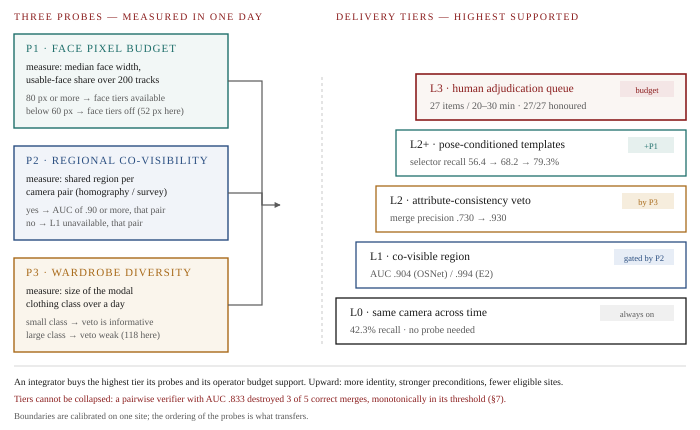

# 论文导读（中文）— v3 期刊版

> 面向：项目负责人评审。目标不是复述论文，而是让你 3 分钟内判断**这篇能不能投、投哪里、还缺什么**。
> 英文正文：`main.md` ｜ 可打印：`main.html` / `main.pdf` ｜ **中文全译：`main-zh.md` / `main-zh.pdf`（23 页，含中文图）** ｜ 投稿件：`main-review.pdf` + `submission/` ｜ 数字出处：`EVIDENCE.md` ｜ 投稿定位：`POSITIONING.md`

---

## 一句话

**v2 是「我们量出了天花板，而且证明三条路都不通」；v3 倒过来了：「先给三个能在半天内测完的探针，再给一张四级交付菜单，每一级都有实测收益」。**

标题：*How Much Identity Can a Camera Network Deliver? A Three-Probe Diagnostic and a Tiered Delivery Protocol for Cross-Camera Re-Identification*

| | v2（会议向，已废） | **v3（期刊向）** |
|---|---|---|
| 主结论 | 自动跨机位身份不可交付（边界） | 交付能力**可分级**，级别由探针决定 |
| 负面结果的地位 | 就是卖点 | 降级为「为什么必须分级」的论证 |
| 结构重心 | 逐条证明不行 | 先诊断 → 再分级 → 最后证明不能省掉分级 |
| 定位 | AVSS / WACV（会议） | Neurocomputing（Q1 期刊），详见 POSITIONING.md |

---

## 为什么要改成正向

三个理由，按重要性排：

1. **会议短文装不下正面资产。** 属性闸门（.730→.930）、形态加权模板（56.4→68.2）、人脸池（+11.1）、复核队列（27 项/30 分钟）——在 8 页里每项只能占一句，读者拿不走任何可用的东西。
2. **负结果短文的天花板是 poster。** 而 v3 的正面框架同样有硬证据支撑，且更贴合期刊读者（工程 + 系统 + 人在环）。
3. **正向不等于吹。** v3 没有删掉任何一个负结果，只是把它们放到「协议为什么长这样」的位置上：删边不拆组 → 所以要 L3；验证器拆对 → 所以不能自动化；共视硬门无用 → 所以几何只当选题器。

---

## 核心：三个探针 → 五级台阶

| 探针 | 测什么（半天内） | 门槛 | 卡住哪一级 |
|---|---|---|---|
| **P1** 人脸像素预算 | 中位脸宽、可用脸占比（抽 200 轨） | ≥80 px 可用；<60 px 关掉 | L2+ |
| **P2** 区域共视 | 每对机位是否共享视野（单应/勘察） | 有共享区 → AUC ≥ .90 | L1 |
| **P3** 服装多样性 | 最大同款类的人数 | 类小 → 否决有用；类大 → 否决失效 | L2 |

| 级 | 交付什么 | 验收条件 | 实测收益 | 域 |
|---|---|---|---|---|
| **L0** | 同机位跨时段身份 | 单机位即可 | 召回 **42.3%** | D2 |
| **L1** | 共视区内跨机位身份 | P2 判共享区 | AUC **.904 / .994** | D1 |
| **L2** | 属性一致否决 | P3 判类小 | 合并精度 **.730 → .930**（召回不变） | D1 |
| **L2+** | 形态条件化模板 | 每人 ≥3 种形态 | 选择器召回 **56.4 → 68.2 → 79.3%** | D2 |
| **L3** | 人工复核队列 | 有人工预算 | **27 项 / 20–30 min，27/27 约束满足** | D1 |

★ **L2+ 最关键的一点**：56.4 → 68.2 这 **11.8 个点完全不需要人脸**，只靠按框高加权的模板。人脸再补 11.1 点（它补的是「库里没有的形态」，不是「更强的认人能力」）。这条对产品化最值钱——不需要加人脸链路就能拿到大半收益。

---

## 三个数（记住就够）

1. **60 px**：人脸通道的物理分界。<60 px AUC **.352**（比随机差），≥60 px **.847**，本场地中位 **52 px** → 人脸通道不成立。**这是采集问题不是模型问题**。
2. **.904 vs .231**：唯一真共视对（318–320）**0.904**（E2 达 .994），最大样本的非共视对（316–343）**0.231 反相关**。→ 外观能不能用，取决于「这一对有没有共享像素」，不是「模型强不强」。
3. **.833 → 3/5**：配对 AUC .833 的验证器，在图层级把 5 个正确合并拆掉 3 个，且随阈值单调恶化。→ **外观信号只能排复核顺序，不能当判决器**。

---

## 五条贡献（v3 版）

| # | 贡献 | 支撑 |
|---|---|---|
| C1 | **三探针部署诊断**：三个免标注测量预测通道可用性，各带校准门槛 | §5, Table 2–3；60 px / .904 vs .231 / 118 人同款 |
| C2 | **分级交付协议 L0–L3+**：每级有验收条件与实测收益 | §6, Table 4–7 |
| C3 | **不可折叠性**（三种独立实现）：分级不可省 | §7, Table 8–10 |
| C4 | **153 条轨对真值 + 口径纪律**（两总体不合并） | §4, Appendix A |
| C5 | **可运行交付物 + 实测人工成本** | §8 |

与 v2 的差别只在**排序**：v2 把 C3 当第一贡献，v3 把 C1/C2 放前面，C3 变成 C2 的必要性证明。证据一条没换。

---

## 投稿建议

| 选项 | 适配度 | 取舍 |
|---|---|---|
| **Neurocomputing**（推荐） | ★★★★ | Q1；接受「系统+实测+协议」；篇幅够放 153 条真值与两域；一审 2–4 月 |
| Expert Systems with Applications | ★★★★ | 更匹配「人在环决策」，影响因子更高；但要 +1 节决策形式化，desk-reject 风险也高 |
| IEEE Trans. Instrumentation & Measurement | ★★★ | 若改成「测量程序 + 不确定度预算」极契合；需 +1 节计量学表述 |
| 方法刊（PR / TCSVT） | ★ | **不建议**：方法增量是诊断+协议，与口味正面冲突 |

细节与各刊改写清单见 `POSITIONING.md`。

---

## 还缺什么（诚实清单）

| 缺项 | 严重度 | 补的成本 |
|---|---|---|
| **单标注人、无 κ** | ★★★ 最严重 | 第二人独立判 40–50 条，约 20 min |
| 无公开集同协议对比 | ★★ | MARS 有现成资产（148 身份/484 查询），可补一节 |
| 第二场地/第二天 | ★★ | 需新采集，短期做不到 → Limitations 明写 |
| P2 的区域判读本身有误差 | ★★ | 已在 §5.5 主动声明；可用第二次勘察量化 |
| 审计只覆盖 15/56 跨机位组 | ★★ | 其余 41 组无信号 |
| 探针门槛只在一个站点校准 | ★★ | 已在 §9.2 声明「顺序可迁移，数值不可」 |

**投稿前建议只补第一项**（κ）。其余都已在 Limitations 里主动交代，属于可接受范围。

---

## 打包与复现

`deliverable/paper-package-v3/`（或同名 zip）内含：

| 目录 | 内容 |
|---|---|
| `00-paper/` | main.md / main.html / main.pdf / EVIDENCE.md / POSITIONING.md / README-zh.md / figs |
| `01-submission/` | 审稿版 PDF（双倍行距、34 页）、`highlights.txt`、`title-page.md`、`cover-letter.md`、`CHECKLIST.md`、`figures/Figure_1–3.pdf` |
| `02-zh/` | 中文全译（`main-zh.md` / `.html` / `.pdf`，23 页）＋三张中文标注矢量图；数字、表号与英文版一一对应 |
| `10-truth/` | T1 126 条、T2 27 条、判读原件、回写与着色报告 |
| `20-data/` | 身份图（443 / 450）、审计与验证器结果 JSON、AUC 输出 |
| `30-code/` | 9 个可复现脚本 + 说明 |
| `MANIFEST.csv` / `SHA256SUMS.txt` / `README.md` | 清单与校验 |

**不打包**：原始视频、裁图（隐私 + 站点授权）。审稿人需要时按协议申请。

---

## 按 Neurocomputing 收稿改了什么（2026-11-12）

不是换排版，是补硬指标 + 清 AI 腔。

| 项 | 改前 | 改后 |
|---|---|---|
| 摘要 | 502 词，四段加粗标签 | **249 词**（上限 250），连续散文 |
| 参考文献 | APA 式，编号与首引顺序不一致 | **Elsevier numbered**，23 条按 1→23 首引顺序重编（脚本核验） |
| 强制声明 | 只有一句数据不可发布 | CRediT / 竞争利益 / Funding / Data availability / 生成式 AI / 致谢 六段 |
| Highlights | 缺 | 5 条，72–80 字符 |
| 审稿版 | 单栏 1.5 倍行距，20 页 | Times 12 pt、**双倍行距**、A4 边距 25 mm，34 页 |
| 破折号 | 71 处 | **0 处**（正文与表头全部改写） |
| 自指元话语 | "this paper's sharpest claim"、"we invert the order of presentation" 等 | 删除，改陈述句 |
| X-not-Y 套式 | 4 处显式 + 33 处 `rather than` | `rather than` 降到 18 处，显式套式清零 |

顺带修掉三处内容错误：§3.3 的 `Table 5` 应为 `Table 10`；§3.2 的 `Sections 6.5–6.6` 应为 `Section 6.4`；§9.3 写「三条规则」实际列了四条。

