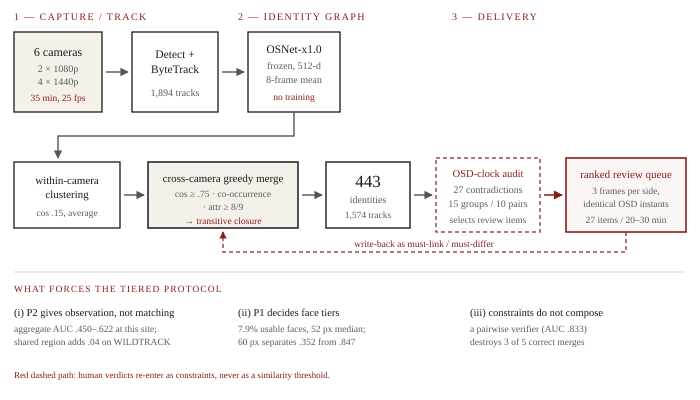
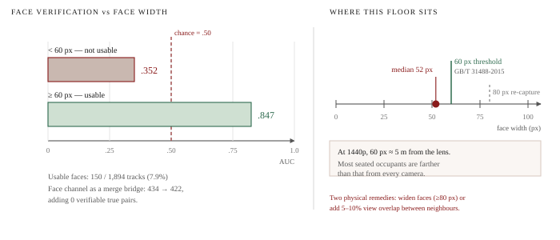
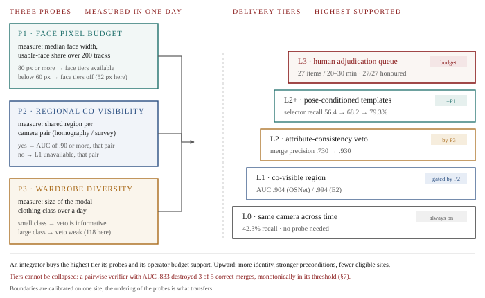

# How Much Identity Can a Camera Network Deliver? A Three-Probe Diagnostic and a Tiered Delivery Protocol for Cross-Camera Re-Identification

[Given name] [Family name] (a,\*), [Given name] [Family name] (a), [Given name] [Family name] (b)

(a) [Department], [Institution], [City], [Postcode], [Country]

(b) [Department], [Institution], [City], [Postcode], [Country]

\* Corresponding author. E-mail: [address]. ORCID: [0000-0000-0000-0000]

*Article type: Regular Paper. Submitted to IEEE Transactions on Biometrics, Behavior, and Identity Science.*

---

## Abstract

Cross-camera re-identification is reported above 90% mAP, yet that number does not tell an integrator which identity functions a network supports. We treat this as a measurement problem in identity science, answered by a deployment protocol. From a six-camera office floor (1,574 tracks, 443 hypothesised identities), an eight-segment corpus of 26 named identities, and three further capture days, we reduce availability to three probes measurable in one working day, each gating one tier: face pixel budget, regional co-visibility, wardrobe diversity. Its five tiers each carry a measured benefit: same-camera identity across time (42.3% recall); cross-camera identity inside a co-visible region (AUC 0.904 frozen OSNet, 0.994 independent encoder); an attribute-consistency gate that raises merge precision from 0.730 to 0.930 at unchanged recall; pose-conditioned templates that raise selector recall from 56.4% to 68.2% with no face at all, and to 69.8% with a measured face channel against an 83.2% identity-oracle ceiling; and a 27-item queue resolvable in 20-30 minutes. Outside that pair, cross-camera appearance sits at chance across six encoder and alignment configurations (AUC 0.450 to 0.622, every interval covering 0.5), and the face channel is unusable below 60 px (AUC 0.352 against 0.847). The tiers cannot be collapsed: a local constraint on a global partition damages correct merges it never addressed, and a verifier with pairwise AUC 0.833 destroys three of five known-correct merges. Across capture days, coverage moves by 0.001 while merge error doubles, and the best same-day gallery transfers worst. The binding constraint is capture geometry, not the encoder.

**Index Terms:** Person re-identification; Biometric evaluation protocol; Benchmarking; Confidence interval estimation; Surveillance identity analysis; Human-in-the-loop

---

## I. Introduction

A vendor demonstrating cross-camera ReID shows two crops of the same person and a similarity score. A facilities manager signing the contract needs a different object: a statement of the form "with this network, you will be able to answer *this* class of question, at *this* accuracy, with *this* much operator time". Between those two objects lies the entire deployment problem, and benchmark mAP does not address it, because the benchmark's operating conditions (tight upright walking crops, query/gallery splits that share viewpoints with training, no seated subjects at 50 px) are not the conditions of an office.

This paper constructs the second object. We propose no new representation: the encoder is off-the-shelf, frozen, and never tuned on the site. The contribution is a measurement instrument, and we treat it as one — what is measured is identity completeness, what is reported is a population together with an interval, and what is delivered is a set of obligations that can be written into a contract and checked after acceptance. The question we answer is:

> **Given a fixed camera network and a frozen encoder, what identity functions can an integrator legitimately promise, and how can the integrator know this before deployment?**

Our answer has four parts, each of which can be checked against measurements.

**First, a transitive partition cannot be repaired one relation at a time.** The obvious economy is to find the merges that are wrong, verify them automatically, and cut. Three experiments show that this fails, and not because the verifier is weak: cutting an edge changes a transitive closure, so a local decision has non-local consequences. Deleting the fifteen adjudicated-wrong edges splits zero groups. Constrained minimum colouring honours all 27 labels and moves the identity count from 443 to 450, because a 32-track group constrained by a single pair can shed exactly one track. A verifier whose *pairwise* AUC is 0.833 removes 3 of 5 known-correct merges, monotonically in its threshold. These results fix the shape of everything that follows: appearance may rank human attention but may not replace it. Section VII gives the three instantiations.

**Second, the question decomposes into three site measurements.** Whether cross-camera identity is available depends on quantities that have nothing to do with model choice: how many pixels a face occupies (P1), whether two cameras can see the same region at all (P2), and how repetitive the population's clothing is (P3). Each probe costs a day of measurement and needs no labels, and each maps to a specific delivery tier. Their novelty is uneven, and it is worth saying so: P1's boundary is a resolution threshold that a national standard already requires, and P3 is a class-size statistic. What is new is P2's *unit of answer*. Co-visibility is a property of regions, not of camera pairs, so the pair-level table an integrator would naturally write down is the wrong object — and one pair out of sixteen carries essentially all of the cross-camera signal. Section V defines the three probes, calibrates their boundaries on our data, and shows that together they predict, per camera pair, whether appearance association will work: the pair they certify as co-visible reaches AUC 0.904, and a pair they certify as disjoint sits at 0.231.

**Third, the deliverable is a ladder.** We define four tiers, L0 same-camera across time, L1 co-visible region, L2 attribute-consistent merging and L3 human adjudication, where each tier states an acceptance condition and carries a measured benefit: 42.3% recall at L0, AUC 0.904 to 0.994 at L1, merge precision 0.730 → 0.930 at L2, and a 27-item queue adjudicable in 20 to 30 minutes at L3 that satisfies all 27 adjudicated constraints at once. A fifth, L2+, uses pose-conditioned templates and raises selector recall from 56.4% to 68.2% with no face at all; a face channel adds 1.6 points when it is actually used to identify people, against the 15.0 an identity oracle would give. That gap is not a shortfall to be closed by a better model — it is what P1 predicts for a site whose median face is 52 px. The tiers are ordered by evidence strength, and an integrator buys the highest tier its probes and its operator budget can support. Section VI specifies them.

**Fourth, a ladder that works on one capture has to be re-accepted on the next, and the usual acceptance statistics will not detect the failure.** We re-ran the deployed pipeline across three capture days of the same site, with the gallery taken from one day and the queries from another. At a fixed threshold, cross-day coverage is 0.490 against a same-day 0.491 — a difference of 0.001 — while the merge error on evaluable co-occurrence pairs rises from 5.2% to 10.7%. The statistic that looks most objective, precisely because it needs no labels, is the blind one. Worse, the sensitivity runs the wrong way: the gallery with the highest same-day coverage (0.650) degrades furthest across days (0.396, largest cluster 12.1% → 37.0%). Section VIII reports the nine cells and proposes a label-free replacement that does detect the change.

Work on cross-camera identity is largely diagnostic: appearance association degrades in unconstrained capture, temporal priors are unreliable when clocks or topologies are uncertain, and post-hoc verification is fragile. All three hold at this site, and Sections V–VIII measure them. A diagnosis on its own still leaves an integrator with nothing to buy, so the probes and tiers below are built as the object that can be bought, with each failure mode appearing at the point where it forces a design decision.

### A. Contributions

1. **A non-composability result and its consequence for protocol design** (Section VII). Three independent demonstrations that local constraints do not compose over a global partition — edge deletion, constrained colouring, and a pairwise verifier — together with the corollary that *pairwise* AUC 0.833 does not predict *partition-level* utility. This is the formal reason the ladder cannot be replaced by an automatic stage, and the reason appearance signals are confined to the ordering of review rather than to the decision.
2. **A three-probe deployment diagnostic** (Section V). Three label-free site measurements (face pixel budget, regional co-visibility, wardrobe diversity), each with a calibrated decision boundary, jointly predicting which appearance-dependent tiers a site can support. The probes are not equally novel and the paper says which is which: P1 inherits its boundary from GB/T 31488-2015 (60 px, AUC 0.352 → 0.847) and P3 is a class-size statistic (35 clothing combinations over 673 people, modal class 118). The new content is P2's unit of answer — co-visibility per *region*, not per camera pair — which reverses the natural table an integrator would write: AUC 0.904 where the survey had one overlapping pair, and 0.231 where it had disjoint ones.
3. **A tiered delivery protocol with measured rungs** (Section VI). L0–L3 plus L2+, each with an acceptance condition, a measured benefit, and a stated failure mode. The protocol converts a binary "does ReID work" into a menu an integrator can price. L2+ is reported as two numbers rather than one, because the inference-time kernel weighting (+11.8 points, no face) and the face-dependent pool (+1.6 under measured identification) are different claims with different preconditions.
4. **A capture-change acceptance result** (Section VIII). Nine gallery-day × query-day cells of the same deployed pipeline: coverage is unchanged across days (0.490 vs 0.491) while merge error doubles (5.2% → 10.7%), and the degradation is monotone in same-day coverage rather than in elapsed time. The section also gives the label-free statistic that does detect the change (cluster concentration, flagged at a 25% largest-cluster share) and one case where the healthy-looking cell is the broken one.
5. **A pair-level truth set and reporting discipline** (Section IV). 153 adjudicated cross-camera pairs over 12 camera pairs, in two deliberately separate populations, with an explicit statement of which numbers may not be compared with which, and one worked rule that came out of auditing our own numbers: a per-pair AUC must report the share of its positives contributed by the dominant identity, because a single doubly-named identity can move a pair's AUC from 0.280 to 0.946.
6. **An operational artefact and its measured cost** (Section IX). An offline, single-file adjudication surface, JSON write-back as must-link/must-differ constraints, and a measured 20–30 minutes for 27 items.

The scope is one site, three capture days and one adjudicator (Section XI). We publish the protocol and the parameters, not the video.

---

## II. Related Work

### A. Representations and camera bias

Supervised ReID matured on Market-1501 [1] and MSMT17 [2] with strong backbones and part-based or transformer aggregation [3, 4, 5]. OSNet's omni-scale features remain the standard frozen extractor in deployment settings. Two properties of that literature matter here. First, reported gains are measured under the same capture conditions as training: tight boxes, walking subjects, and query/gallery splits that share camera viewpoints with training. Second, camera identity is a known confound: models latch onto per-camera colour and background statistics, which motivated camera-aware and camera-adversarial training [6, 7, 8]. Our study inherits the diagnosis and changes the response. We measure the operating envelope of a frozen encoder and turn it into a routing rule: appearance is used where the probe says it is informative, and elsewhere the protocol falls back to geometry, semantics, or a human.

### B. Clustering-based identity graphs

Unsupervised and pseudo-label pipelines build identities by clustering tracklet features, typically with DBSCAN or agglomerative linkage [6, 9], and camera-aware variants forbid merges within a camera. Our deployed graph follows this pattern: within-camera average linkage, then cross-camera greedy merging under a similarity threshold, a same-frame co-occurrence block, and an attribute gate. The relevant prior for Section VII is that these pipelines are all *partition* algorithms over a transitive closure, so a single edge decision propagates. Existing work treats the resulting sensitivity as a threshold-tuning problem. We show it is structural and that it governs post-hoc repair as well, which is what makes a tiered protocol necessary.

### C. Spatio-temporal constraints and topology

Spatio-temporal priors are usually introduced as transition-time models: a person cannot be in two places at once, and transit between cameras takes at least τ seconds [10, 11]. These priors assume a synchronised clock and a known notion of which cameras can co-observe a region. Multi-camera tracking benchmarks [12] make exactly these two assumptions, and we show how the second one fails in a plain office. With an OSD-based absolute clock the constraint does surface 27 contradictions that similarity never ranks, but the co-visibility table those contradictions are judged against is itself wrong at pair granularity, because co-visibility is a property of regions. We therefore use the audit as a trigger that selects review items, and report that a hard temporal gate blocks one merge, which is why it appears in the protocol as an item selector and never as a criterion.

### D. Selective prediction and risk control

Rejecting rather than answering is well studied as selective classification [13], and risk-controlling calibration (Learn-Then-Test) converts a heuristic operating point into a finite-sample guarantee [14]. In an auto-built gallery the object to reject is the *cluster*, not the query [15]. Our protocol is a deployment-level instance of the same idea: L3 is an explicit abstention tier, and the two-probe report of Section VI-F (precision on covered pairs *and* the fraction of audited groups that turn out mixed) is the selective-risk statement an operator needs. The difference from prior work is that we also quantify what abstention *costs* (20–30 minutes per 27 items) and show why the abstention cannot be automated away (Section VII).

### E. Field studies and human-in-the-loop identity

Deployment studies in surveillance consistently report that fully automatic cross-camera identity is not achieved, and that operator review is where the system earns its value [16, 17, 18, 19]. We are not aware of a study that (i) reduces the availability question to a small set of pre-deployment probes, (ii) attributes the appearance ceiling to a measurable pixel budget rather than to representation quality, and (iii) turns the result into a tiered protocol with per-tier acceptance conditions. That combination is this paper.

### F. Evaluation protocols and benchmarking in identity science

Identity science has a longer tradition of treating evaluation as a first-class contribution than the re-identification literature does. FERET fixed the pattern: define the partitions, the reported statistic and the protocol before comparing systems, so that a number means the same thing across systems [20]. Best-Rowden and Jain added the temporal dimension, showing that recognition performance is a function of the elapsed time between enrolment and probe, so a single operating point hides a decay curve [21]. Both lessons are thinned to a convention in the ReID benchmark setting, where one mAP on a fixed split stands in for deployability.

That convention has itself been questioned in this journal. Kang asks whether synthetic corpora are valid substitutes when benchmarking generalisable re-identification, which is the data-provenance form of the question we ask about capture conditions [22]. Our result is the field-capture analogue: the issue is not where the data came from but whether a number measured under benchmark conditions transfers. The same frozen encoder that behaves normally on MARS-style data reaches AUC 0.231 on one camera pair of a real floor. The remedy has the same shape in both cases — state the population a number was measured on, and state an interval — which is why Section IV devotes as much space to which numbers may be compared with which as to the numbers themselves.

---

## III. Two Evidence Domains

The protocol is developed on one domain and validated on a second, because the tiers need different kinds of evidence: deployment-scale structure from D1, and named-identity ground truth from D2. Section IV explains why the two are never pooled.

### A. D1: six-camera, 35-minute deployment

One floor of an office building: an open work area, a tea room / small meeting room, a glass-walled corridor, and a large multi-purpose space. Six cameras record continuously for 35 minutes (2,099 s) at 25 fps. Four are 2560×1440 and two (318, 323) are 1920×1080. No calibration, no depth sensor, no face turnstile. Fields of view do not overlap except for one pair.

**Table 1. D1 capture and graph statistics.**

| Item | Value |
|---|---|
| Cameras | 6 (305, 316, 318, 320, 323, 343) |
| Resolution | 4 × 2560×1440, 2 × 1920×1080 |
| Duration / frame rate | 2,099 s / 25 fps |
| Tracks produced | 1,894 |
| Tracks entering the identity graph | 1,574 |
| Hypothesised identities (graph v0) | 443 |
| Cross-camera groups | 56 |
| Largest group | 67 tracks |
| Usable face embeddings | 150 / 1,894 tracks (7.9%) |
| Median face width | 52 px |

### B. D2: eight-segment named-identity corpus

A second capture of the same floor, split into eight segments, with 445 named tracks over 26 identities (14 tracks per identity at the median, 62 at the maximum). D2 is the only domain where the identity of every track is known, which is what the selector and template-pool experiments in Section VI-D require. D2 has a different detector/tracker configuration from D1 and is therefore never used for merge-precision claims.

**D3: three capture days.** A third capture set, recorded on three days (10-22, 10-23, 10-26) from six cameras, is used only in Section VIII, to test whether acceptance statistics survive a change of capture. Each camera-day is split into a build (`tr`) and a query (`te`) portion. We do not claim that D3 shares cameras with D1: the six site labels differ (two open work areas, a work-area dome camera, a tea room, an administrative corridor and a lift lobby), and the detector configuration differs too. D3 contains no identity ground truth in any form, so it supports label-free statistics only, and any recall figure quoted from it would be meaningless. Its build portions are small — between 7 and 95 tracks per camera, and one track in the smallest cell — which is the reason its cells are reported with their denominators attached.

### C. Clock discipline

Every temporal statement in this paper uses the on-screen display (OSD) absolute clock, never `frame / fps`. The six D1 streams start at different wall-clock moments; their frame-0 offsets relative to camera 318 are 0, +1, +2, +16, +25 and +121 s. Using per-stream frame indices silently converts a genuine co-occurrence into a handover, a mistake we made once. Correcting it raised measured true-pair recall in the merge comparison from 5/34 to 7/34 (Table X) while leaving the identity count unchanged, which is the signature of a measurement fix and not of a modelling change. We recommend stating the clock convention in any multi-camera paper that reports temporal constraints; it costs one sentence and prevents a systematic error.

### D. Pipeline

Detection and tracking run per camera (YOLO-family detector, ByteTrack [23] with a lowered activation threshold). We deliberately keep the tracker plain and did not add the association refinements of the StrongSORT family [24], so that each tier's behaviour is attributable to the site's geometry and to the frozen encoder rather than to tracking heuristics. Each track is encoded by OSNet-x1.0 [3] (MSMT17 [2] weights, frozen, 512-d mean over 8 temporally uniform frames). The identity graph is built in two stages: within-camera agglomerative clustering at cosine distance 0.15, then cross-camera greedy merging of cluster representatives at cosine ≥ 0.75, subject to three gates: a same-frame co-occurrence block (a merged entity may not be simultaneously visible in more than two cameras), a camera-overlap block, and, in the shipped version, an attribute-agreement gate requiring ≥ 8 of 9 clothing attributes to agree. The result is 443 identities covering 1,574 tracks (Fig. 1).



**Figure 1. The deployed pipeline and the three probe points.** Stage 1 is off-the-shelf. Stage 2 produces a transitive closure, which is what makes the non-composability result of Section VII possible and what forces the protocol to be tiered rather than automatic. The probe icons mark where the diagnostic of Section V reads the site: pixel budget on the encoder input, co-visibility on the camera graph, wardrobe diversity on the attribute head.

### E. What we deliberately did not train

We did not train or fine-tune the encoder, by design. A domain-adaptive fine-tuning attempt with leave-identity-out evaluation reduced operating-point recall from 24.2% to 11.0%, and a closed-set linear discriminant reached 0.986 on seen identities but 0.595/0.554 on held-out identities, which is the usual collapse of in-domain metrics and which we reproduced twice. A frozen encoder makes every number in this paper attributable to the site rather than to a fitting procedure, which is precisely what a diagnostic requires: the probes must predict the behaviour of a *given* encoder, not of a model that was tuned on the very site being measured.

---

## IV. Evaluation Protocol

### A. Two truth sets, two sampling mechanisms

**T1: prior-sampled pairs (126).** Pairs drawn to test the merge rule as previously configured: 34 same-person and 92 different-person pairs over 7 camera pairs. T1 is biased toward pairs the existing system found plausible; it is a test set for the *rule*, not an unbiased sample of the population. It is the right set for measuring whether a gate preserves recall.

**T2: contradiction-triggered pairs (27).** Pairs surfaced by the temporal audit of Section VI-E, i.e. pairs the system had already merged and that a physical constraint says cannot be the same person. Twelve are same-person and fifteen different-person. T2 is biased toward *errors*, which is what makes it the right set for measuring whether a repair respects constraints.

Together, 153 pairs over 12 camera pairs. T1 and T2 are never pooled into a single precision figure. Doing so is a category error we made once and now forbid in our own reporting.

### B. Three levels of granularity

A graph can be scored at three levels, and they disagree. Naming them is what makes the tiered protocol reportable. We note that multi-camera tracking metrics such as HOTA [25] and ID-based measures [10] score trajectories over time; our unit of analysis is the merge decision, which is why we score pairs and groups rather than trajectories.

- **Pair level.** A labelled pair is correct if its two tracks land in the same identity group (same-person label) or different groups (different-person label). This is what a merge rule consumes.
- **Group level.** A group is *mixed* if it contains at least one adjudicated different-person pair that was merged into it, and *pure* otherwise. This is what an operator consumes.
- **Cluster purity by inspection.** A group is inspected visually; this is what a reviewer consumes, and it detects failure modes (a group of shadows, a hat mistaken for a person) that pair labels never touch.

T2 yields 55.6% pair-level agreement (15 of 27 contradictions confirmed), but the operationally meaningful number is that **7 of the 15 touched groups are mixed and 8 are pure**. The same data supports two denominators and two different decisions, so the protocol reports both everywhere.

### C. Reporting rules

Four rules, each adopted after getting it wrong.

1. **Never compare across detection versions.** D1 uses one detector/tracker configuration throughout. An earlier eight-segment study used a different one, and the cluster-mixing rate differed by a factor of six; cross-version comparisons were withdrawn. This is why D1 and D2 carry separate claims.
2. **Always state the denominator.** Pair-level precision over ground-truth-covered pairs and over suspicious pairs are different populations.
3. **Never let a similarity score stand as evidence of purity.** Cosine similarity cannot certify that a cluster is one person, and cannot refute a human adjudication either.
4. **State the truth set's sampling mechanism**, because every aggregate inherits it.

---

## V. The Three-Probe Diagnostic

Availability of appearance-based identity at a site is predictable from three measurements that require no identity labels and no model training, and each measurement gates a specific tier of Section VI.

### A. Probe P1: the face pixel budget

**Measurement.** Draw a random sample of tracks (we use 200), run a face detector inside each person box, and record the distribution of face-box widths together with the fraction of tracks that yield any face at all. Cost: under an hour with existing tooling.

**Calibration.** On D1, 150 of 1,894 tracks (7.9%) yield a face embedding, and median face width is 52 px. Splitting at 60 px gives a sharp transition. The cut is not ours: GB/T 31488-2015 [26] requires an inter-pupil distance of at least 60 px for recognition-grade capture.

- faces below 60 px: **AUC 0.352** (worse than chance; the embedding is measuring compression artefacts)
- faces at or above 60 px: **AUC 0.847**

**Reading.** P1 answers a single question: *is the face channel available at all?* The boundary is a physical resolution threshold that the standard already requires, and we did not fit it to our data. A site whose median is below 60 px should not buy a face-dependent tier. On D1 the median is 52 px, i.e. below the threshold, and a fixed 60 px on a 1440p frame corresponds to a person roughly 5 m from the lens while most of this floor's seated occupants are further than that from every camera. The remedy is physical: reposition or add cameras to reach a median above 80 px.



**Figure 2. The pixel budget.** Left: face-based verification on this site splits at 60 px into chance-level (0.352) and usable (0.847). Right: the floor's median face width (52 px) sits *below* the recognition threshold, which is why the embedding measures compression artefacts rather than identity.

P1 predicts failure *before* deployment and names the fix. It does not depend on which face model is used, because the transition is a property of the pixel budget and not of the encoder.

**What the pixel budget does not see.** Box height bounds how many pixels a face could occupy; it does not say whether a face is there. On D3 (Section III) the administrative corridor has the largest boxes of any camera — median 298–336 px, well past the 60 px gate — yet yields a usable face on only **8%** of its tracks, while the lift lobby at 244–308 px yields **40%**, and 83% in the segment where people wait facing the lens. Same detector, same quality gate, so this is not a threshold artefact: corridor traffic is recorded from behind, lobby traffic head-on. The yield estimate is therefore an **upper bound** wherever occupancy is dominated by people facing away from the camera, and a site should report measured yield — not median box — before buying a face-dependent tier.

### B. Probe P2: regional co-visibility

**Measurement.** For each camera pair, decide whether the two fields of view share a *region*, and if so which. The cheap version is a site walk-through with a shared marker; the reproducible version is a homography test on a common planar patch, or a statistic over simultaneous detections. Cost: half a day for six cameras.

What matters is the *unit of the answer*. A camera pair is not a binary predicate. On D1 the site survey declared fifteen camera pairs disjoint and one pair (318–320) overlapping. Both parts of that table are wrong in a specific way: 318–320 is genuinely co-visible (tea room seen from two sides, homography AUC 1.000), but so are regions of pairs the survey called disjoint, and the consequence shows up directly in the identity graph.

**Aggregate calibration.** We first evaluate six feature configurations on T1's cross-camera pairs: two representations (OSNet-x1.0, and an image-embedding model we denote E2, covering 1,322/1,574 tracks) crossed with three alignment schemes: raw cosine, per-camera mean subtraction ("cc"), and per-camera PCA whitening to 33 dimensions ("cw", one third of the per-camera track count, following our earlier dimensionality finding).

**Table 2. Cross-camera discrimination on T1 (34 same / 80 different pairs; E2 covers 28/61).**

| Representation | Alignment | Same (median) | Diff (median) | AUC | 95% CI |
|---|---|---|---|---|---|
| OSNet | raw (deployed) | 0.499 | 0.532 | **0.490** | [0.350, 0.625] |
| OSNet | per-camera mean-sub | 0.022 | 0.015 | 0.531 | [0.403, 0.666] |
| OSNet | per-camera whitening | 0.016 | −0.011 | 0.511 | [0.397, 0.626] |
| E2 | raw | 0.759 | 0.777 | **0.499** | [0.330, 0.658] |
| E2 | per-camera mean-sub | 0.160 | 0.029 | **0.622** | [0.470, 0.765] |
| E2 | per-camera whitening | −0.052 | 0.012 | 0.450 | [0.321, 0.585] |

Two observations shape the probe. First, **no configuration separates same-person from different-person cross-camera pairs**: all six confidence intervals contain 0.5. For the deployed encoder the same-person median (0.499) is *below* the different-person median (0.532), so the ordering is inverted rather than merely weak. Second, mean subtraction is the only scheme that moves the point estimate (E2: 0.499 → 0.622), and it does so by collapsing both distributions onto a near-zero band whose ordering is fragile: at a 2% false-accept rate it recovers 7 of 28 true pairs, at 10% it recovers 13 of 28. That is a better *ranking*, not a usable *threshold*.

An aggregate at chance would normally end the diagnostic, with appearance declared unusable. P2 shows that the aggregate is the wrong statistic.

**Pair-level calibration.** Stratifying the same data by camera pair dissolves the aggregate:

**Table 3. Per-pair AUC on T1 (OSNet raw; pairs with both classes).**

| Camera pair | same / diff | AUC | Probe P2 reading |
|---|---|---|---|
| **318–320** | 11 / 52 | **0.904** | co-visible region confirmed (homography AUC 1.000); E2 reaches **0.994** |
| 316–323 | 2 / 5 | 0.600 | n too small to interpret |
| 318–323 | 3 / 4 | 0.250 | no shared region; inverted |
| **316–343** | 13 / 18 | **0.231** | no shared region; strongly inverted |
| 323–343 | 1 / 1 | 0.000 | n = 2, not interpretable |
| 305–316, 316–318 | 2 / 0, 2 / 0 | n/a | no negatives; AUC undefined |

The pattern is not "some pairs are harder". It is that **one pair carries essentially all of the signal, and it is exactly the pair the probe certifies as co-visible**. Conversely 316–343, with the largest sample (31 pairs), is anti-correlated: the model ranks strangers above the same person. This is why P2 must be measured at region granularity before any threshold is chosen: a threshold tuned on 318–320 is actively harmful on 316–343, and that is the mechanism behind our earlier observation that lowering the global threshold triples the merge count while true-pair recall stays at 7/34.

**What P2 buys.** It converts an unanswerable question ("does cross-camera ReID work?") into an answerable one per pair ("does this pair share pixels' worth of person?"), and it tells the integrator where to put the overlap when the site is re-cabled. It also explains the 815 s finding of Section VI-E without appeal to model behaviour: two cameras on opposite sides of an open floor can both see one workstation, so a person seated there is genuinely co-visible for minutes.

### C. Probe P3: wardrobe diversity

**Measurement.** Over a day of detections, count distinct clothing combinations and the size of the largest equivalence class. Cost: hours, using the attribute head that is already part of the pipeline.

**Calibration.** On D1, 673 people occupy only **35 distinct clothing combinations**, averaging 19.2 people per combination; the modal one, a blue upper with long sleeves and a black lower, is worn by **118 people**.

**Reading.** P3 decides the *direction* in which clothing evidence may be used, and the direction is asymmetric. "Different clothes" is a valid veto: two entities whose predicted attributes disagree on two or more fields are very unlikely to be the same person in a population where the modal outfit has 118 wearers. "Same clothes" is not a vote: with 118 people in one outfit, agreement carries almost no identity information. A site with uniforms has the opposite failure: everyone agrees, so the attribute channel becomes uninformative instead of misleading, which is why P3 reports the size of the modal class and not a single diversity index.

This asymmetry is what makes L2 (Section VI-C) a *selective* repair: it removes merges without touching recall, because it only ever acts as a veto.

### D. The routing rule

The three probes compose into a routing rule that an integrator can execute before signing a contract:

```
P1  median face width
    80 px or more  -> face tiers available (L2+)
    60-80 px       -> face on a minority; bonus only
    below 60 px    -> no face tier; spend on operator time

P2  shared region per camera pair
    yes            -> L1 available (expect AUC 0.90+)
    no             -> L1 unavailable; use L0 + L3

P3  modal clothing class
    below ~5%      -> veto informative; use L2
    above ~20%     -> veto weak; L2 optional
```

Three properties make it a diagnostic. Each decision boundary is physical (P1: resolution), geometric (P2: shared pixels) or statistical (P3: class size), so it does not drift with model choice. Each probe is measured on the site itself, so it cannot be inherited from a benchmark. Each probe maps to a *specific* tier, so the output is a menu and not a score.



**Figure 3. The protocol at a glance.** Three probes on the left, five tiers on the right. The staircase encodes the trade-off: higher tiers deliver more identity but are available at fewer sites and depend on stronger preconditions. L0 needs no probe; L1 is gated by regional co-visibility; L2 by wardrobe diversity; L2+ benefits from the face budget without requiring it; L3 needs only an operator budget. Because the ordering follows evidence strength, the tiers cannot be reordered or merged.

### E. Validation of the rule on our two domains

The rule makes falsifiable predictions, and both domains confirm them. On D1, P2 predicts that only 318–320 should support L1: measured AUC 0.904 (OSNet) and 0.994 (E2), against 0.231 for the pair predicted disjoint. P1 predicts that the face channel should be unavailable: measured 7.9% usable and median 52 px, with the sub-60 px stratum at chance. P3 predicts that clothing should work as a veto but not as a vote: measured merge precision 0.730 → 0.930 with recall unchanged (Table V), i.e. a pure precision gain, which is the signature of a veto.

On D2, where identities are known, P1 again predicts the sign of the effect and its size: usable faces cover 6.5% of the full 1,178 tracks (12.1% of the longer named tracks), and the face-anchor channel's gain lands almost entirely on the minority of identities with cross-pose face coverage (Section VI-D).

Two limitations of the rule are stated in advance. The numerical boundaries (80 px, 5%, 20%) are calibrated on one site and one population; the *ordering* of the probes is what we expect to replicate, not the exact cut points. And P2 requires a judgement about regions, which is a survey task with its own error rate, the one measured in Section VI-E.

---

## VI. A Tiered Delivery Protocol

We now turn the probes into a contract (Fig. 3). The tiers are ordered by evidence strength: lower tiers rest on geometry and therefore nearly always hold; higher tiers rest on appearance and therefore require probe support. An integrator buys the highest tier the probes and the operator budget allow.

**Table 4. The protocol.**

| Tier | Function delivered | Acceptance condition | Measured benefit (domain) | Failure mode if pushed beyond condition |
|---|---|---|---|---|
| **L0** | Same-camera identity across time | One camera; any resolution | 42.3% recall on same-camera cross-period pairs (D2) | Fragmentation, not confusion: 5.5 tracks per person in a segment (D2) |
| **L1** | Cross-camera identity inside a co-visible region | P2 certifies a shared region | AUC 0.904 (OSNet) / 0.994 (E2) (D1, pair 318–320) | Threshold tuned here is harmful elsewhere (0.231 on 316–343) |
| **L2** | Attribute-consistent merging | P3 certifies a small modal class | Merge precision 0.730 → 0.930 at unchanged recall (D1) | Uniforms make the gate uninformative |
| **L2+** | Pose-conditioned templates (same camera) | ≥ 3 observable poses per identity | Selector recall 56.4% → 68.2% with no face; 69.8% with a measured face channel; 83.2% is the identity-oracle ceiling (D2) | Identity count too small to train a projection; cross-camera queries untested |
| **L3** | Human adjudication queue | Operator budget | 27 items / 20–30 min; 15/15 negative and 12/12 positive constraints honoured (D1) | Queue grows linearly with capture length |

### A. L0: same-camera identity across time

The cheapest tier and the one an integrator can almost always buy. Within one camera, appearance is comparing like with like: same viewpoint, same lens, similar scale. On D2, the only domain with per-track names, 42.3% of same-camera cross-period pairs are resolved correctly at the deployed operating point. D1 supplies the deployment-scale structure (1,574 tracks, 443 identities) while D2 supplies identity-level recall, and this division is why the two domains are never pooled. The dominant error is fragmentation and not confusion (5.5 tracks per person within a segment, 63% of breaks longer than 10 s), which matters for the protocol because fragmentation is *recoverable by adding evidence over time* and confusion is not.

A quantitative caution that belongs to this tier: within a camera, appearance fails specifically when the same person changes *pose class*, not when they change location. On D2 the same person's box height spans a median of **3.76×** (maximum 11.6×) over a day, because a standing full-body view and a seated head-and-shoulders view share little body-part composition. At pair level, same-person similarity falls from a median 0.887 (comparable box height) to 0.557 (very different box height), and this holds in 14 of 14 identities with enough samples (median correlation −0.48). Different-person similarity is flat across the same bins (0.519–0.553), which is why raising the threshold does not help and why L2+ exists.

### B. L1: cross-camera identity inside a co-visible region

Where P2 certifies a shared region, cross-camera appearance becomes ordinary same-viewpoint matching, and the tier delivers near-benchmark behaviour: AUC 0.904 for the frozen OSNet and 0.994 for a second, independent encoder on the same pair. The machinery works when the geometry permits it. The pair in question is a tea room seen from two sides, and the two views differ mainly in azimuth, which is the condition ReID benchmarks assume and which most office installations do not provide.

The tier's acceptance condition is therefore geometric, not statistical: buy L1 where you can buy overlap. Its design implication is stated in Section X: 5–10% overlap between adjacent views is worth more than any encoder upgrade, because it moves a pair from the 0.231 regime to the 0.904 regime.

### C. L2: the attribute-consistency gate

The only *automatic* component that earns its place is a *consistency* check, and P3's asymmetry is why. Nine clothing attributes (upper colour, lower colour, sleeve length, backpack, hand-carried object, hat, glasses, and two more) are predicted per track from the same frozen encoder. A candidate merge is accepted only if the two entities' predictions agree on at least 8 of 9 fields.

**Table 5. Effect of the attribute gate (D1, threshold 0.75, T1).**

| Configuration | Identities | Merges | T1 same | T1 diff | Merge precision (judged) |
|---|---|---|---|---|---|
| no gate | 434 | 76 | 5/34 | 0/80 | 0.730 (46/63) |
| attribute gate (≥8/9) | **443** | 67 | 5/34 | **0/80** | **0.930 (40/43)** |

The gate removes 9 merges, of which 6 were wrong, and adds 9 identities, a *selective* repair that leaves true-pair recall and false-merge count untouched. Three properties make it the right kind of signal for a protocol tier:

- It asks whether the same clothes are worn, not whether the vectors are close, so it does not inherit the camera bias that makes cosine unreliable across views.
- It is evaluated only on attributes with measured reliability. Five fields reach 0.88–0.99 agreement; carrying and backpack are capped at 0.656 and 0.458 and are excluded from the gate's decisive fields.
- Its operating point is stable. Leave-one-out over 63 folds selected ≥8 in every fold, so the gate is not a single-fold artefact.

For scale: raising the similarity threshold from 0.75 to 0.82 achieves roughly one fifth of this precision gain and loses recall. The gate is a different kind of evidence from a threshold. Its ceiling is stated as part of the tier: attribute *identity* is not evidence, so the gate is a veto, never a vote, and its benefit vanishes on a uniformed population.

### D. L2+: pose-conditioned templates

Two mechanisms are involved, and their preconditions differ enough that they are measured separately: weighting the gallery by the query's body scale, and adding samples from a same-day pool whose identity is established by face. The setting is D2, 179 queries whose identity has a morning gallery entry in the *same camera* — a same-camera across-time problem, which is what L0 and L2+ address. Neither mechanism has been tested on cross-camera queries, and Section VI-B is where cross-camera retrieval is discussed.

**Table 6. Selector recall at τ = 0.80 (D2, 179 queries). "Oracle" means pool entries are written with the true identity; "measured" means they are written only when a face channel accepts them.**

| Configuration | Recall | Δ vs S0 | Pool entries | Face channel |
|---|---:|---:|---:|---|
| Gallery mean only (S0) | 56.4% | — | 0 | none |
| + box-height kernel weighting, σ = 0.6 (S1) | **68.2%** | +11.8 | 0 | **none** |
| S0 + pool | 79.3% | +22.9 | 65 | oracle |
| S1 + pool | 83.2% | +26.8 | 65 | oracle |
| S1 + pool, measured identification | **69.8%** | +13.4 | 19 | measured |
| Upper bound: full-day material + kernel weighting | 92.7% | +36.3 | — | n/a |

Three findings follow, ordered by what an integrator can rely on.

**The half that needs no face is the half that ships.** Weighting gallery templates by `exp(−|log h_query − log h_template| / 0.6)`, where `h` is box height, raises recall by 11.8 points with no training, no face detection and no extra capture. The mechanism is comparing against a template of the same body composition, not recognising the person better. The direct evidence: among pool hits where the gallery had failed, the used pool sample differs from the query in `|δh|` by a median of 0.06 against 1.05 for the gallery mean, and is closer to the query's form in 94% of cases. The pool retrieves a sample at the same *scale*, which is what the kernel already does analytically.

**The face channel adds 1.6 points when it is actually used, and P1 predicts why.** With identity-oracle pool writes the same pipeline reaches 83.2%, so the pool mechanism is worth 15.0 points in principle. Under the oracle the gain is concentrated where the gallery is structurally blind: at extreme pose difference (`|δh| ≥ 0.8`) recall goes from 7.0% to 88.4%, supplying 35 of the 41 total gains, while the 53 near-form queries move by 2 points. That concentration is also why the tier's acceptance condition is "≥ 3 observable poses per identity" rather than "faces available" — a site whose residents keep one posture has nothing for the pool to supply. Under measured identification — a 0.80 similarity gate, a 0.02 margin, and a quality gate on the face crop — it writes 19 entries instead of 65 and delivers 69.8%, or 1.6 points over S1. The decomposition is almost entirely coverage: 54 of D2's 445 tracks (12.1%) yield a usable face, against 141 (31.7%) that yield any face vector at all, and the resulting prototypes cover 9 of the 48 camera-by-identity cells. Misidentification contributes nothing — 18 of the 19 accepted writes are correct — but that number should not be read as a success of face recognition: with 2 to 6 candidate identities per query (median 3) the task is easy and the constraint is not accuracy, it is how many people have a face to match against. Section V-A measured 52 px at this site; the same limit appears here as a recall ceiling.

**A further 9.5 points are material, not method.** The 92.7% upper bound is reached when the gallery contains samples of every form the query takes, and the gap from the 83.2% oracle row is the absence of such samples in an eight-segment corpus. That points at where to invest: more capture of the same person in more poses.

Two numbers in this table belong to different rows, and conflating them is the easiest error to make here. 79.3% is the unweighted gallery plus an identity-oracle pool; the kernel-weighted pipeline with the same pool reaches 83.2%, and with a measured face channel 69.8%. We report all three because the middle figure is an upper bound on a mechanism, not a result, and because the difference between 83.2% and 69.8% is the price of not having an oracle.

The tier's failure mode is worth stating because it recurs: training a pose-conditioned projection requires cross-pose pairs, and of 1,028 available pairs in D2, 799 (78%) belong to one identity, leaving only 13 of 26 identities with any cross-pose pair. Leave-identity-out evaluation therefore has insufficient data, which is the same limitation that ruled out encoder fine-tuning (Section III-E). The inference-time kernel weighting avoids this entirely, which is why the tier ships in inference form.

### E. L3: the human adjudication queue

L3 is a product of the protocol and not a concession. Its item selection follows from Section V-B: a contradiction between the graph and the clock is a region-level co-visibility question that a person can answer from two crops, so it is exactly the right thing to put in front of a human.

- **Item selection.** Contradictions from the temporal audit (27 items on D1). Each item is a pair of tracks from one group that cannot physically be the same person *if* the co-visibility table were right, which is precisely the question the human resolves.
- **Presentation.** Three frames per side at *identical OSD instants*, cropped from native-resolution video with the target box drawn. Uniform temporal sampling was abandoned: in a seated-office scene it lands on monitors, and readable yield drops sharply. Instants are instead chosen to maximise the minimum box height across the two sides.
- **Delivery.** A single offline HTML file (2.05 MB, images embedded) that works on a phone with no network, because the adjudicator is not necessarily at a workstation.
- **Write-back.** Verdicts export as JSON and are ingested as must-link / must-differ constraints, never as a similarity threshold.
- **Explicit non-labels.** "Cannot see clearly", "walked past the boundary", "mixed identities on one side" are recorded but excluded from the truth set, because they do not constrain identity. Removing an item from the denominator is not the same as labelling it.

**Measured yield.** All 27 items were adjudicated by one person in 20–30 minutes: 12 same-person, 15 different-person, no items unreadable, 27/27 usable. Group level: 7 of the 15 touched groups are mixed and 8 are pure. Applied as constraints (Section VII-B), they take the identity count from 443 to 450 while satisfying 15/15 negative and 12/12 positive relations simultaneously. That is a strict improvement in constraint satisfaction for under 2% structural change, which is what 27 labels can buy in a 1,574-track graph.

### F. The composite deliverable, and the two numbers that must travel together

Assembled, the protocol delivers the following statement for D1. Table VII is the form in which an integrator can accept or reject a system.

**Table 7. Deliverable statement for D1.**

| Claim | Tier | Status | Evidence |
|---|---|---|---|
| Same-camera identity across time | L0 | Supported for 42.3% of same-camera cross-period pairs (D2) | Section VI-A |
| Cross-camera identity, 318↔320 | L1 | Supported (AUC 0.904 / 0.994) | Table III |
| Cross-camera identity, other pairs | L1 | Not available; candidates with evidence only | Table III, 316–343 at 0.231 |
| Merge precision (T1-covered pairs) | L2 | 0.930 with attribute gate | Table V |
| Merge precision (contradiction-triggered pairs) | n/a | 0.444 pair-level; 7/15 groups mixed | Section VI-E |
| Selector recall, named identities | L2+ | 56.4% → 68.2% with no face; 69.8% with a measured face channel; 83.2% under an identity oracle | Table VI |
| Face-based verification | P1 | Not available at this capture geometry | 7.9% usable, <60 px AUC 0.352 |
| Automatic repair of a merged group | n/a | Not available; L3 required | Section VII |

The two precision rows are the ones most often conflated in practice, and the protocol requires that they travel together. A system that reports "0.930 precision" and omits "7 of 15 audited groups are mixed" has told the truth about one population and withheld it about the other. We therefore make the pair of numbers a reporting requirement of L2 and L3, not an optional disclosure.

### G. Why L3 cannot be replaced by an automatic stage

The natural objection to a tiered protocol is that L3 is expensive and could be automated: train a verifier on the adjudicated pairs, apply it to every merge, and keep the high-confidence ones. Section VII answers this objection with three experiments, but the short form belongs here because it determines the protocol's shape. Any operation that acts on one relation inside a partition changes a transitive closure, and a transitive closure has no obligation to preserve the merges that were correct. Consequently the choice is not "automatic or manual at the same accuracy"; it is "manual review of selected items, or automatic damage to unselected ones". That is why L3 is a tier and not a step.

---

## VII. Why the Tiers Cannot Be Collapsed

This section supplies the protocol's necessity argument. The situation it analyses is generic: a pipeline has produced a partition; someone has evidence that one relation inside it is wrong; the natural repair is to act on that relation. We show, in three independent instantiations, that acting on the relation damages relations nobody constrained.

### A. Deleting the wrong edges splits nothing

The 15 confirmed different-person pairs are edges inside 7 identity groups. Removing exactly those 15 edges from the merge graph and recomputing connected components leaves **every group intact**. The reason is elementary and, in our experience, routinely forgotten: the two endpoints remain connected through other members of the group. Edge deletion is not a partition repair. We have replicated the effect three times across projects, which is why we treat it as a design rule: deleting an edge guarantees neither fewer errors nor fewer correct merges.

### B. Constrained minimum colouring gives a lower bound, not a repair

The correct formulation of "these 15 pairs are not the same person, these 12 are" over a group's members is a constrained partition problem: contract must-link edges, then colour the conflict graph induced by must-differ edges, with the chromatic number as the minimum number of blocks. We solve it with DSATUR.

Result: **443 → 450 identities** (net +7). All 15 different-person pairs are separated, all 12 same-person pairs preserved, and T1's own metrics are untouched (P 1.000, R 0.147, 5 true / 0 false, identical to v0). A 15/15 and 12/12 result looks like success, and as a *constraint-satisfaction* statement it is: this is the correct thing for L3 to guarantee.

What it is not is a repair of the graph, and the distinction matters for the protocol. A 32-track group constrained by a *single* confirmed different-person pair can only shed one track: it splits into blocks of 31 and 1, and the other 30 tracks were never adjudicated. Net +7 identities on 443 means the operation addressed under 2% of the graph's structure. Constraint satisfaction therefore gives a **lower bound on the correction**, and L3's acceptance condition is written accordingly: "all adjudicated relations are honoured and no known-correct merge is broken", never "the graph is fixed".

### C. A strong pairwise verifier damages the partition

A natural generalisation of 7.2 replaces sparse human labels with a dense automatic verifier: score every merged pair with an appearance signal and cut below a threshold. On the 27 adjudicated pairs the signals do discriminate, and this is the one place where appearance works well in D1:

**Table 8. Pairwise discrimination on the 27 contradiction pairs (12 same / 15 different).**

| Signal | AUC | 95% CI | Direction |
|---|---|---|---|
| OSNet per-camera mean-sub cosine | **0.833** | [0.639, 0.978] | same higher |
| E2 per-camera mean-sub cosine | 0.826 | n/a | same higher |
| Three-feature leave-one-out logistic | **0.856** | n/a | same higher |
| Box-height ratio | **0.233** | [upper 0.433] | **inverted** |

The last row is not incidental: for same-person pairs the height ratio is *lower*, so the same person's two boxes differ in scale more than two strangers' boxes do. This is consistent with the pose-class analysis of Section VI-A and it explains why scale-based reasoning must be used to *select templates*, not to *reject pairs*.

Applied as a post-hoc splitter, cutting every merged pair below threshold and recomputing components, the verifier behaves as follows.

**Table 9. Partition-level effect of a pairwise verifier with AUC 0.833.**

| Configuration | Identities | T1 true pairs | T2 same-person preserved |
|---|---|---|---|
| v1 (human constraints only) | 450 | 5 | 12/12 |
| + verifier @ 0.20 | 475 | **4** | 10/12 |
| + verifier @ 0.25 | 483 | 4 | 10/12 |
| + verifier @ 0.30 | 491 | **2** | 9/12 |
| + verifier @ 0.40 | 511 | 1 | 7/12 |

At every operating point the verifier cuts all 15 confirmed errors and destroys correct merges it never addressed. At 0.30 it removes 3 of the 5 T1 true pairs. The mechanism is the same as 7.1 and 7.2: cutting an edge changes a transitive closure, so a *pairwise* decision has *partition-wide* consequences, and the pairs it cuts are not the pairs a human constrained.

The general statement is that *pairwise AUC 0.833 does not imply partition-level utility*. A signal good enough to rank review candidates is not thereby good enough to arbitrate a partition, so the protocol locates appearance signals in the ordering of the queue, where their discriminative power is an asset, and never in the decision.

### D. Why this is structural, not a tuning failure

A better-calibrated verifier would not avoid the damage, for three reasons. (i) The damage is monotone in threshold (Table IX), so there is no operating point where the verifier is net-positive on T1. (ii) The damaged merges are *unconstrained*: no amount of labelling of the 27 pairs changes them, because the verifier acts on all pairs and the pairs that were right were never in the label set. (iii) Any pipeline that merges transitively has this property, so the argument applies to every agglomerative or graph-based identity builder, not to ours specifically.

The constructive corollary, and the reason L3 is specified the way it is: **budget human labels on partitions, not on pairs.** A pair label constrains a relation; what an operator needs constrained is a group. This inverts the usual active-learning instinct, and it is why the queue asks about *contradictions inside groups* rather than about pairs sampled from a similarity distribution.

A fourth instantiation belongs here because it concerns the clock rather than the graph. Adding the strictest temporal co-visibility gate, under which any simultaneous appearance across a camera set the survey calls disjoint blocks the merge, changes the identity count from 443 to 444, blocks exactly one merge and introduces one false merge.

**Table 10. Merge strategies at threshold 0.75 (D1, all with the attribute gate).**

| Strategy | Identities | Merges | T1 same | T1 diff | Merge precision |
|---|---|---|---|---|---|
| frame-index spans | 443 | 67 | 5/34 | 0/80 | 0.930 |
| OSD clock | 443 | 67 | **7/34** | 1/80 | 0.907 |
| OSD + strict co-visibility (>60 s) | 444 | 66 | 7/34 | 1/80 | 0.905 |
| OSD + strict co-visibility (>300 s) | 444 | 66 | 7/34 | 1/80 | 0.907 |

The clock correction is worth +2 true pairs at constant identity count and is a genuine measurement fix that any deployment should adopt. The hard gate is worth nothing, for the same reason as above: greedy merging has redundant paths, so blocking one edge does not prevent the same two clusters from joining through a third member. Geometry earns its place in the protocol as an *item selector* (L3) and as a *tier condition* (L1), not as an edge filter.

---

## VIII. Why Acceptance Numbers Do Not Survive a Capture Change

Section VII shows that a partition cannot be repaired locally. This section asks a different question about the same object: once a tiered system has been built and accepted, does the acceptance number still mean what it meant when it was measured?

The natural assumption is yes, because the statistics used for acceptance are usually chosen for needing no labels. We test the assumption by changing one variable — which day the gallery comes from — and holding everything else fixed: the same detector, the same frozen encoder, the same threshold grid, the same evaluation code.

### A. Design

Nine cells: three gallery days by three query days, including the three same-day diagonals as controls. In each cell the gallery is the concatenation of the six build portions of the gallery day and the queries are the six query portions of the query day. The pipeline is the deployed one — within-camera clustering, cross-camera greedy merge at a shared threshold, same co-occurrence block.

Three statistics, none of which needs an identity label:

- **coverage** — the fraction of queries whose two independent views (two feature sets from the same track) both exceed the threshold. It measures whether the system is willing to answer.
- **same** — the fraction of covered queries where the two views place the query in the same cluster. It measures whether the system agrees with itself.
- **fm** — among *evaluable co-occurrence pairs* (both endpoints covered and both observed simultaneously in one camera at some point), the fraction placed in the same cluster. Simultaneous appearance is physical proof of two different people, so this is a negative-only error rate.

All three are reported at a fixed θ = 0.90 so the cells are comparable. The pipeline's own self-calibrated θ varies by a factor of 2.6 across days (0.90 to 2.35 in an earlier run), which would have silently changed every denominator.

Two corrections were needed before the numbers meant anything, and both are omissions we would otherwise have made.

**Co-occurrence pairs are polluted by duplicate boxes.** Among evaluable pairs, 6.6–11.1% have the two boxes overlapping at IoU ≥ 0.3, i.e. one person detected twice. Left in, those pairs are guaranteed to land in one cluster and inflate fm mechanically. We drop them before scoring.

**One camera-day is not a hard case, it is a broken sensor.** In the 10-23 work-area-2 query portion, one track holds a box at (896,249)–(973,344) across all 9,510 frames, and a second set of boxes repeats at a fixed position. These are static false positives. They are two "people" in every frame, so every pair between them is evaluable and every pair merges. The cell is excluded from Table XI and Table XII and discussed in Section VIII-C, because what it does to the metrics is the most useful single observation in this section.

### B. Coverage is flat; merge error is not

**Table 11. Nine gallery-day by query-day cells at θ = 0.90 (D3, geometric filter applied, broken camera-day excluded).**

| Gallery day | Query day | coverage | same | fm | evaluable pairs |
|---|---|---:|---:|---:|---:|
| 10-22 | 10-22 | 0.491 | 0.904 | 5.2% | 523 |
| 10-22 | 10-23 | **0.490** | 0.891 | **10.7%** | 363 |
| 10-22 | 10-26 | 0.367 | 0.882 | 9.8% | 112 |
| 10-23 | 10-23 | 0.580 | 0.809 | 8.8% | 375 |
| 10-23 | 10-22 | 0.446 | 0.775 | 20.0% | 70 |
| 10-23 | 10-26 | 0.367 | 0.745 | 36.4% | 22 |
| 10-26 | 10-26 | **0.650** | 0.836 | 7.2% | 264 |
| 10-26 | 10-22 | 0.396 | 0.756 | **30.0%** | 20 |
| 10-26 | 10-23 | 0.383 | 0.730 | **41.2%** | 17 |

Three readings.

**Rows one and two are the same system on the same site one day apart, and coverage differs by 0.001.** Merge error doubles. An acceptance test written on coverage passes. This is not a threshold artefact: the fm gap between 10-22→10-22 and 10-22→10-23 stays positive at every θ from 0.90 to 2.50.

**The sensitivity is monotone in the wrong direction.** Rank the three galleries by their same-day coverage: 10-22 at 0.491, 10-23 at 0.580, 10-26 at 0.650. Across days their coverage falls by 0.001 and 0.124, by 0.134 and 0.213, and by 0.254 and 0.267; their merge error rises from 5.2% to 10.7% and 9.8%, from 8.8% to 20.0% and 36.4%, and from 7.2% to 30.0% and 41.2%. The gallery that covers its own day best is the one that transfers worst.

**Elapsed time is not the variable.** 10-22 → 10-23 (one day) and 10-22 → 10-26 (four days) are close, at 10.7% and 9.8%, while 10-26 → 10-22 (four days backwards) reaches 30.0%. What separates those cells is not the interval but which gallery is in use, which is the same conclusion as the row above.

The mechanism generalises. Scores are normalised within the query domain, so a query from an unseen day does not score low in absolute terms; it scores normally against a gallery that contains nobody like it. The nearest neighbour is then an unrelated person, and the pipeline merges it into that person's cluster. Coverage asks "is the similarity above θ", the answer is yes, and it is yes for the wrong person. A statistic that only sees whether the system answered cannot see this.

### C. The cell that looks healthiest is the broken one

For the 10-23 work-area-2 query portion the three statistics read coverage 1.000, same 1.000, and merge error 100%.

Each reading follows from one cause. The static boxes sit in every frame, so every query track has a simultaneous partner, every such pair is evaluable, and the whole query set collapses onto the cluster that contains the static box. The two views agree because both are matching the same collapsed cluster. On a monitoring panel this is the best camera in the deployment; in the graph it is the worst.

The lesson is not "check your detector". It is that all three statistics are computed over the set of tracks the system produced, so a failure of the *detector* is invisible to them by construction. Any acceptance regime built only on coverage, self-consistency and co-occurrence error will certify a camera whose tracking has failed. The cheapest guard is a static-track check — box-centre variance below a threshold over a long track — which is independent of the identity logic.

### D. A label-free statistic that does move, and its limit

If coverage will not do, something else must. Cluster concentration is the natural candidate: it needs no labels and it measures the failure mode of Section VIII-B directly, since packing strangers into existing clusters is what raises concentration.

**Table 12. Concentration of the covered queries (same cells as Table XI; K = clusters, H / log K = normalised entropy, max = the largest cluster's share of covered queries).**

| Gallery day | Query day | K | covered | H / log K | max cluster |
|---|---:|---:|---:|---:|---:|
| 10-22 | 10-22 | 27 | 376 | 0.850 | 16.2% |
| 10-22 | 10-23 | 27 | 445 | 0.753 | 24.9% |
| 10-22 | 10-26 | 27 | 96 | 0.759 | 14.6% |
| 10-23 | 10-23 | 61 | 366 | 0.709 | 16.7% |
| 10-23 | 10-22 | 61 | 91 | 0.654 | 19.8% |
| 10-23 | 10-26 | 61 | 40 | 0.591 | 20.0% |
| 10-26 | 10-26 | 55 | 107 | 0.767 | 12.1% |
| 10-26 | 10-22 | 55 | 54 | 0.488 | 37.0% |
| 10-26 | 10-23 | 55 | 55 | 0.512 | 25.5% |

Concentration moves where coverage does not. Taking each gallery's own same-day diagonal as its baseline, normalised entropy falls in all six cross-day cells, and the largest-cluster share rises in five: 16.2% → 24.9%, 16.7% → 19.8%, 16.7% → 20.0%, 12.1% → 37.0%, 12.1% → 25.5%, for gains between 3.1 and 24.9 points. A 24% largest-cluster threshold flags two of the six, and would need to be set near 20% to flag three, which is why we describe it as a screening aid and not a detector.

It misses one cell, and the miss is instructive. 10-22 → 10-26 has a largest cluster of 14.6%, below its own same-day 16.2%, while its merge error still rises from 5.2% to 9.8%. Concentration measures how much query mass lands on one cluster; it does not see many people each mis-assigned to a different small cluster. No label-free statistic we tried covers both modes.

That is the operative conclusion, and it agrees with Section VII rather than adding a separate complaint: **a cheap surrogate can rank review work, but cannot substitute for labelled pairs at acceptance.** The measurement that would settle the question — a set of same-person pairs spanning two capture days — is the one thing D3 does not contain.

### E. What this changes

- **Acceptance has to be repeated after any change of capture.** Not because the encoder changed but because the population did. A gallery built in one season, or before an office move, is a different instrument.
- **Acceptance has to include labelled pairs across the boundary the system will operate over.** A number measured on same-day queries does not transfer, and Section VIII-B shows the failure is invisible in the cheap statistics.
- **L2+ is the tier most exposed.** Its gain comes from a pool of same-day observations, so it measures whether the right person happens to be in the pool — exactly the quantity a capture change removes. That is why its two components are reported separately in Section VI-D.

---

## IX. Deployment Cost and Operations

A protocol is only useful if its cost is stated, so this section reports what we actually spent and what an integrator repeats.

**Adjudication cost.** 27 items, 20–30 minutes, one adjudicator, on a phone, offline. Per item that is roughly 45–67 seconds, which is the number an integrator needs: it sets the queue length a shift can absorb (about 30–40 items per operator-hour). Sampling instants are chosen to maximise the minimum box height across the two sides rather than uniformly, which is what keeps the per-item time this low; uniform sampling lands on monitors and produces unreadable items that must be re-issued.

**Tooling cost.** The adjudication surface is a single self-contained HTML file with images embedded (2.05 MB for 27 items) that requires no network and no server, because the adjudicator is typically not at the workstation that generated the crops. Verdicts export as JSON and are ingested as constraints. Generating the file from a graph and a video set takes about 10 minutes on first run and is cached thereafter.

**Probe cost.** P1 and P3 run on existing detections and take under an hour each. P2 is a site task; for six cameras it is half a day including the walk-through. The whole diagnostic therefore fits in one working day, which is what makes "measure before you buy" a realistic recommendation.

**What does not scale for free.** Queue length grows linearly with capture duration and with the number of contradictions, and we have not measured the adjudication cost curve beyond 35 minutes. Two levers reduce it without changing the protocol: better item selection (rank by contradiction duration and by box size, both of which correlate with readability) and batching by group, since one group verdict constrains many pairs (Section VII-D).

---

## X. Discussion

### A. What is transferable

Five claims generalise beyond this site.

1. **The pixel budget.** A 60 px boundary separating AUC 0.352 from 0.847 is a property of human faces at surveillance distances, not of this building. Any site can measure its median face width in an afternoon, learn in advance whether face-dependent tiers are available, and read the remedy off the same number (median above 80 px).
2. **Regional co-visibility as the tier condition.** Every site with a glass wall, a corridor seen from both ends, or an open floor visible from multiple positions will find that pair-level co-visibility tables are wrong. The protocol's response, measuring co-visibility per region and buying L1 only where a region is shared, is directly transferable and cheaper than any model improvement.
3. **The structural argument of Section VII.** Transitive closure is universal, so the damage from local edits is universal. Pipelines that merge transitively should expect a pairwise verifier to harm them, and can test it in two lines: cut by verifier, recompute components, count known-correct merges.
4. **The reporting discipline of Section IV-C.** Version-matched comparison, stated denominators, and a refusal to let similarity certify purity are cheap and prevent the most common errors in this literature. One concrete instance came out of auditing our own tables: a per-pair AUC must carry the share of its positives contributed by the dominant identity, because a single identity named on two people moved one pair from 0.280 to 0.946.
5. **Acceptance expires when the capture changes.** A gallery is an instrument calibrated on a population, and Section VIII shows that calibration lapsing with no change to the code. The reusable part is not the number but the practice: re-run acceptance after any change of population or season, and insist on labelled pairs across the boundary the system will operate over.

### B. What is site-specific

- 443 identities, 56 cross-camera groups, 1,574 tracks and every AUC in Section V are properties of this capture, this detector, and this frozen encoder. The *sign* of each probe reading we expect to replicate; the *values* we do not.
- The attribute gate's 0.730 → 0.930 depends on the site's clothing diversity. A uniformed site shows the opposite failure: everyone agrees, and the gate becomes uninformative rather than wrong.
- The 27-item queue follows from 35 minutes and six cameras. Longer captures scale the queue linearly.

### C. Design rules

Five rules follow, each the inverse of a common default.

- **Do not add a temporal hard gate to repair a merge rule.** It blocks one merge and changes nothing (Table X). Spend the effort on a co-visibility *map* and use contradictions to select review items.
- **Do not put a verifier downstream of a partition.** Either put it upstream where it ranks candidates before any merge happens, or keep it out. Downstream, a pairwise cut substitutes damage for repair (Table IX).
- **Do put human labels on groups.** One group verdict constrains many pair relations; one pair verdict constrains one, and (Section VII-B) often fails to change the partition at all.
- **Do buy overlap before buying encoders.** The difference between the 0.904 pair and the 0.231 pair is geometric, and 5–10% shared view is a cabling decision, not a modelling one.
- **Do not accept on a label-free statistic.** Coverage and self-consistency are the natural acceptance criteria precisely because they need no labels, and Section VIII-B shows them moving by 0.001 while merge error doubles. Use them as screening aids; put labelled pairs where the contract is signed.

### D. What the protocol changes at procurement

The practical consequence is a change in what gets specified. A tender that says "cross-camera ReID with ≥ 90% accuracy" is unanswerable and, in our data, unachievable. A tender that says "L0 everywhere; L1 for pairs certified co-visible by P2; L2 with attribute veto; L3 for 30 items per operator-hour; report merge precision on covered pairs together with the mixed-group fraction" is answerable, priceable, and verifiable after acceptance. That conversion, from a benchmark number to a set of measurable obligations, is the contribution we consider most likely to outlive the particular encoder used here.

---

## XI. Limitations

1. **Single site, three capture days, one organisation.** One building: a 35-minute six-camera capture (D1), an eight-segment corpus from the same floor (D2), and three further capture days (D3) used only for acceptance testing (Section VIII). The co-visibility reversal and the probe boundaries are one site's geometry; the ordering of the probes is what we expect to hold. D3 carries no identity labels, so the cross-day result bounds *error growth* and cannot state *recall*: the 0.490 coverage figure contains an unknown fraction of correct associations and an unknown fraction of forced ones. A hundred adjudicated cross-day pairs would settle it and is the single most valuable addition to this work. The build portions of D3 are also small (7 to 95 tracks per camera), which is why three of its nine cells rest on fewer than 25 evaluable pairs and are read only for direction.
2. **No second adjudicator on the contradiction set.** The two layers of the truth set are not equally validated. The gallery-membership layer was re-annotated by a second person working blind to the first: 257 tracks, Cohen's κ = 0.925 (95% CI 0.891–0.958) after mapping the two annotators' name spaces, and κ = 0.945 (0.913–0.972) over the 236 tracks that contain a person; the residual disagreements concentrate on one camera (κ = 0.811 over 69 tracks at camera 323), which is the same camera that concentrates the pipeline's own errors. The 153 pair verdicts, by contrast, were judged by a single person. Internal consistency was verified (the same group never received contradictory verdicts across items) but κ was not computed for that layer. The pair layer is what Sections VII-B and VII-D consume, so this is the most serious limitation of the truth set and the first thing a replication should fix.
3. **T1 is not an unbiased sample.** It was drawn to test a rule, not to estimate a population rate. Every aggregate inherits that bias, which is why T1 and T2 are never pooled.
4. **No public-benchmark comparison under an identical protocol.** We verified that the same frozen stack behaves normally on MARS-style data (a pre-registered six-hypothesis check passed four), which supports the claim that the behaviour is site-induced rather than implementation-induced, but we did not re-run the partition-level experiments on a public corpus.
5. **Audit coverage is partial.** 15 of 56 cross-camera groups were touched by a contradiction; the other 41 produced no signal and remain unaudited. "No contradiction" is not "pure".
6. **L2+ evidence comes from D2, and only for same-camera queries.** The pose-conditioned template result is measured on 179 queries over 26 identities, all with a same-camera gallery entry. The direction is stable across all 14 identities with sufficient samples, but the magnitude is conditional on the identity's pose span. Of the three numbers in Table VI, only 68.2% is a deliverable: the additional 1.6 points rest on a face channel covering 12.1% of tracks, and 83.2% assumes oracle identity writes. Cross-camera queries have not been tested and Section V gives no reason to expect the gain to transfer.
7. **Data cannot be released.** Privacy and site-authorisation constraints. We release protocol, parameters, truth-set structure, and adjudication rules; the crops shown are illustrative and non-identifying at publication scale.
8. **Gait was measured, and it is too weak to stabilise the ladder.** Of 1,473 tracks, 204 (13.8%) contain a walking segment of at least two seconds whose median box height exceeds 100 px; of the 538 identity-labelled observations, 74 do. On the 63 tracks that also pass a silhouette quality gate (34 identities, 1,953 pairs, 44 evaluable rank-1 queries), a keypoint descriptor reaches AUC 0.613 (95% CI 0.496–0.720), a silhouette-dynamics descriptor 0.632 (0.534–0.725) and a gait energy image 0.656 (0.547–0.766), against 0.865 (0.796–0.926) for appearance on the same tracks and 45.5% rank-1 against 0% to 11.4%. Fusing gait into the appearance score monotonically degrades ranking (AUC 0.778 at weight 0.2, 0.684 at 0.5), so it cannot act as a stabiliser. The residual gait signal is also concentrated in cross-camera pairs (0.670) rather than same-camera pairs (0.575), which is the signature of body build rather than gait phase. We therefore claim three probes, not four. The reason is structural: gait needs a walking segment, 150 px of body height and a side view, and a floor of workstations supplies none of the three. A full account, including a retracted small-sample conclusion, is in `docs/mainline-gait-2026-11-12.md`.

---

## XII. Conclusion

We asked what an integrator can promise after installing six cameras, and answered with a measurement procedure. Three probes (face pixel budget, regional co-visibility, wardrobe diversity), each measurable in under a day and each gating a specific delivery tier, predict which identity functions a site can support. Applied here, they yield a ladder: 42.3% recall for same-camera cross-period identity (D2), AUC 0.904–0.994 inside the one genuinely co-visible region (D1), merge precision 0.730 → 0.930 from a semantic attribute veto at unchanged recall, selector recall 56.4% → 68.2% from pose-conditioned templates that use no face and a further 1.6 points from a face channel as it actually performs, and a 27-item queue adjudicable in twenty to thirty minutes that honours 27 of 27 adjudicated constraints.

The ladder cannot be collapsed. Local constraints do not compose over a global partition: deleting wrong edges splits nothing, constrained colouring honours every label and moves the count by seven, and a verifier with pairwise AUC 0.833 destroys three of five correct merges. That result is why the protocol is tiered, and it is why appearance signals rank human attention rather than replace it.

The ladder also has to be re-accepted. Across three capture days the same pipeline's coverage moved by 0.001 while its merge error doubled, and the gallery that covered its own day best transferred worst. The statistics an integrator would naturally accept on — coverage, self-consistency, co-occurrence error — do not see this, and one camera-day that scored perfectly on all three turned out to be the one whose tracking had failed. This is the non-composability lesson at a different level: a cheap surrogate can order work, but cannot certify it.

Two consequences for practice. The binding constraint is capture geometry, not model choice: a median face width above 80 px, or 5–10% view overlap between adjacent cameras, changes which tiers exist, and both are decided at cabling time. And the deliverable that survives acceptance is a pair of numbers reported together: precision on covered pairs, and the fraction of audited groups that turn out mixed.

---

## Reproducibility Statement

All experiments are deterministic given the track tables and embeddings; no training is involved. Every script, result file, and command behind the numbers reported in this article is listed in the supplementary material (Supplementary Appendix S1), and the repository file `EVIDENCE.md` maps each number to its source file and command. The raw video, track tables, and crops are not releasable (privacy and site authorisation); reviewers requiring access for verification may request it under an agreement.

## Appendix A. Truth-Set Composition

**Table A1. Adjudicated pairs by source and verdict.**

| Source | Pairs | Same | Different | Camera pairs | Purpose |
|---|---|---|---|---|---|
| T1 (prior-sampled) | 126 | 34 | 92 | 7 | test the merge rule; measures recall preservation |
| T2 (contradiction-triggered) | 27 | 12 | 15 | 10 | test constraint repair; measures precision at the failure surface |
| **Total** | **153** | **46** | **107** | **12** (union) | n/a |

**Table A2. T2 group-level outcome.**

| Measure | Value |
|---|---|
| Contradictions audited | 27 |
| Identity groups touched | 15 |
| Groups mixed after adjudication | 7 |
| Groups pure after adjudication | 8 |
| Pairs outside T1 coverage | 20 |
| Pairs partially covered by T1 | 6 |
| Longest same-person co-occurrence across a "disjoint" pair | 815 s (305:173 vs 320:45) |

Adjudication artefacts: `deliverable/spacetime_review/{items.json, labels_20261112.json, gt_spacetime_items.json, ingest_report.md, apply_v1_report.md}`.

**Table A3. Annotation reliability by layer.**

| Layer | Items | Second annotator | Cohen's κ (95% CI) |
|---|---|---|---|
| Gallery membership (track → identity) | 257 | Yes, blind | 0.925 (0.891–0.958) |
| Gallery membership, person-containing subset | 236 | Yes, blind | 0.945 (0.913–0.972) |
| Pair verdicts (same / different) | 153 | No | not computed |

The gallery κ is computed after aligning the two annotators' independently invented name spaces (28 mappings, 4 one-to-many); raw labels cannot be compared directly because each annotator numbered people themselves. Disagreements are not spread evenly: camera 323 carries 15 of the 18 gallery disagreements (κ = 0.811 over its 69 tracks) while 305 reaches 0.977 and 318 and 320 reach 1.000 on their subsets. The interpretation we adopt is that annotation ambiguity and pipeline error share a cause, namely small boxes and partial-body crops, rather than that one camera's annotator was careless.

## Acknowledgment

The authors thank [site contact] for facilitating capture on the office floor, and [reviewer/colleague] for comments on an earlier draft. This work was supported by [funding agency] under Grant [number]. The authors used a large language model solely to draft and edit prose and to check the internal consistency of reported figures; it produced no measurement, analysis, or figure. After using this tool, the authors reviewed and edited the content and take full responsibility for the content of the article.

## Ethics Statement

Capture was carried out on a client site under a written authorisation that permits research use of the video and prohibits redistribution. The study was reviewed by [institutional ethics committee], approval no. [number]. Six ceiling-mounted cameras recorded an ordinary working day; participants were not recruited, instructed, or compensated, and no biometric template database was retained beyond the embeddings analysed here. The crops reproduced in this article are shown at a scale at which individuals are not identifiable. Two annotators produced the gallery-membership reliability figures independently and blind to each other; no annotator had access to any identity record other than the video.

## Conflicts of Interest

The authors declare no conflicts of interest relevant to this article.

## Data Availability

The raw video, track tables and crops record identifiable individuals on a client site under an authorisation that prohibits redistribution, so they cannot be released. Released with this article: the protocol specification, the probe thresholds, the structure and sampling mechanism of both truth sets, the adjudication rules, every result file listed in the supplementary material, and the scripts that generate them. Researchers who need the underlying media for independent verification may request access under a data-use agreement from the corresponding author.

## Author Contributions

[Author 1] conceived and designed the study, implemented the pipeline, performed the experiments, analysed the data, produced the figures, and wrote the manuscript. [Author 2] designed the validation protocol, verified the reported figures, and revised the manuscript. [Author 3] secured site access and funding, supervised the study, and revised the manuscript. All authors approved the final version and agree to be accountable for all aspects of the work.

## References

[1] L. Zheng, L. Shen, L. Tian, S. Wang, J. Wang, and Q. Tian, "Scalable person re-identification: A benchmark," in *Proc. IEEE Int. Conf. Comput. Vis. (ICCV)*, 2015, pp. 1116–1124.

[2] L. Wei, S. Zhang, W. Gao, and Q. Tian, "Person transfer GAN to bridge domain gap for person re-identification," in *Proc. IEEE Conf. Comput. Vis. Pattern Recognit. (CVPR)*, 2018, pp. 79–88.

[3] K. Zhou, Y. Yang, A. Cavallaro, and T. Xiang, "Omni-scale feature learning for person re-identification," in *Proc. IEEE/CVF Int. Conf. Comput. Vis. (ICCV)*, 2019, pp. 3701–3711.

[4] S. He, H. Luo, P. Wang, F. Wang, H. Li, and W. Jiang, "TransReID: Transformer-based object re-identification," in *Proc. IEEE/CVF Int. Conf. Comput. Vis. (ICCV)*, 2021, pp. 14993–15002.

[5] M. Ye, J. Shen, G. Lin, T. Xiang, L. Shao, and S. C. H. Hoi, "Deep learning for person re-identification: A survey and outlook," *IEEE Trans. Pattern Anal. Mach. Intell.*, vol. 44, pp. 2872–2893, 2022, doi: 10.1109/TPAMI.2021.3054775.

[6] N. Tang, Z. Fan, Y. Zhu, and T. Zhang, "Unsupervised person re-identification via camera-aware multi-level label refinement," *Neural Netw.*, vol. 195, p. 108292, 2026, doi: 10.1016/j.neunet.2025.108292.

[7] J. Wang, H. Fu, and L. Dou, "CARR: Camera-aware reciprocal refinement for unsupervised visible-infrared person re-identification," *Appl. Soft Comput.*, vol. 188, p. 114445, 2026, doi: 10.1016/j.asoc.2025.114445.

[8] Y. Xiao, T. Zhu, F. Guan, H. Sun, J. Huang, and A. Grau Saldes, "Cross-camera reliability modeling with soft contrastive learning for unsupervised person re-identification," *Knowl.-Based Syst.*, vol. 349, p. 116403, 2026, doi: 10.1016/j.knosys.2026.116403.

[9] Y. Ge, F. Zhu, D. Chen, R. Zhao, and H. Li, "Self-paced contrastive learning with hybrid memory for domain adaptive object re-ID," in *Proc. Adv. Neural Inf. Process. Syst. (NeurIPS)*, vol. 33, 2020.

[10] E. Ristani, F. Solera, R. Zou, R. Cucchiara, and C. Tomasi, "Performance measures and a data set for multi-target, multi-camera tracking," in *Proc. Eur. Conf. Comput. Vis. Workshops (ECCVW)*, 2016, pp. 17–35.

[11] E. Ristani and C. Tomasi, "Features for multi-target multi-camera tracking and re-identification," in *Proc. IEEE Conf. Comput. Vis. Pattern Recognit. (CVPR)*, 2018, pp. 6036–6046.

[12] Z. Tang, S. Wang, D. C. Anastasiu, M.-C. Chang, A. Sharma, and Q. Kong, "The 10th AI City Challenge," in *Proc. Eur. Conf. Comput. Vis. Workshops (ECCVW)*, 2026, arXiv:2608.17044.

[13] Y. Geifman and R. El-Yaniv, "Selective classification for deep neural networks," in *Proc. Adv. Neural Inf. Process. Syst. (NeurIPS)*, vol. 30, 2017.

[14] A. N. Angelopoulos, S. Bates, E. J. Candès, M. I. Jordan, and L. Lei, "Learn then test: Calibrating predictive algorithms to achieve risk control," *Ann. Appl. Stat.*, vol. 19, pp. 1641–1662, 2025, doi: 10.1214/24-AOAS1998.

[15] J. Wang, J. Cao, and C. Song, "Gallery-distance profiles for open-set person re-identification with frozen encoders in camera networks," *Sensors*, vol. 26, p. 5479, 2026, doi: 10.3390/s26175479.

[16] Y. Ding, X. Chen, Y. Zhang, and X. Huang, "Smart building evacuation by tracking multi-camera network and explainable re-identification model," *Eng. Appl. Artif. Intell.*, vol. 148, p. 110394, 2025, doi: 10.1016/j.engappai.2025.110394.

[17] K. L. Wagstaff, "Machine learning that matters," in *Proc. Int. Conf. Mach. Learn. (ICML)*, 2012.

[18] D. Sculley, G. Holt, D. Golovin, E. Davydov, T. Phillips, and D. Ebner, "Hidden technical debt in machine learning systems," in *Proc. Adv. Neural Inf. Process. Syst. (NeurIPS)*, vol. 28, 2015.

[19] A. Paleyes, R.-G. Urma, and N. D. Lawrence, "Challenges in deploying machine learning: A survey of case studies," *ACM Comput. Surv.*, vol. 55, pp. 1–29, 2022, doi: 10.1145/3533378.

[20] P. J. Phillips, H. Moon, S. A. Rizvi, and P. J. Rauss, "The FERET evaluation methodology for face-recognition algorithms," *IEEE Trans. Pattern Anal. Mach. Intell.*, vol. 22, pp. 1090–1104, 2000, doi: 10.1109/34.879790.

[21] L. Best-Rowden and A. K. Jain, "Longitudinal study of automatic face recognition," *IEEE Trans. Pattern Anal. Mach. Intell.*, vol. 40, pp. 148–162, 2018, doi: 10.1109/TPAMI.2017.2652466.

[22] C. Kang, "Are synthetic datasets reliable for benchmarking generalizable person re-identification?" *IEEE Trans. Biom. Behav. Identity Sci.*, vol. 7, pp. 146–155, 2025, doi: 10.1109/TBIOM.2024.3459828.

[23] Y. Zhang, P. Sun, Y. Jiang, D. Yu, F. Weng, and Z. Yuan, "ByteTrack: Multi-object tracking by associating every detection box," in *Proc. Eur. Conf. Comput. Vis. (ECCV)*, 2022, pp. 1–21.

[24] Y. Du, Z. Zhao, Y. Song, Y. Zhao, F. Su, T. Gong, and H. Meng, "StrongSORT: Make DeepSORT great again," *IEEE Trans. Multimedia*, vol. 25, pp. 8725–8737, 2023, doi: 10.1109/TMM.2023.3240881.

[25] J. Luiten, A. Ošep, P. Dendorfer, P. Torr, A. Geiger, and L. Leal-Taixé, "HOTA: A higher order metric for evaluating multi-object tracking," *Int. J. Comput. Vis.*, vol. 129, pp. 548–578, 2021, doi: 10.1007/s11263-020-01375-2.

[26] *Technical Requirements for Video Surveillance Face Recognition Systems*, GB/T 31488-2015, Standardization Administration of China, Beijing, China, 2015.
